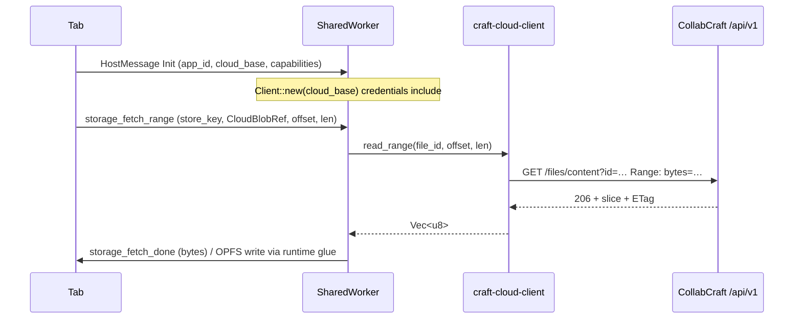

# CollabCraft range / chunk API for tier-store cloud streaming

Design for [wdunn001/collab-craft#14](https://github.com/wdunn001/collab-craft/issues/14). Tracks [storytold/craft-libs#132](https://github.com/storytold/craft-libs/issues/132).

**Status:** v1 implemented (ranged `GET /files/content`, `GET /files/meta`, `craft-cloud::Files::read_range`, `craft-cloud-client::read_range` / `stat`). Multipart upload remains design-only. **Repin order:** craft-libs → collab-craft → `-web` apps ([web-runtime.md](./web-runtime.md)).

---

## 1. Problem

Browser Craft runtimes ([craft-tier-store](../crates/tier-store/), [craft-runtime](../crates/runtime/)) need to **hydrate and flush large blobs** without holding whole files in WASM heap or tab memory. Cloud-backed keys should:

- **Read** byte ranges (warm OPFS / slice cache via `StoreKey::slice_cache`).
- **Write** large payloads without a single giant `PUT` body when optional multipart is available.
- Reuse a **`craft-cloud` HTTP gateway** (in our lab: **collab-craft**). No provider credentials or WebDAV in craft-libs or in the tab.

Document Open/Save in [DesignCraft#878](https://github.com/storytold/designcraft/issues/878) already uses full-file `GET`/`PUT` with **etag preconditions**. Tier-store streaming extends the same routes and conflict semantics; it does not introduce a second save story.

---

## 2. Layer boundaries

| Layer | Repo / crate | Responsibility |
| --- | --- | --- |
| Portable identity | `craft-libs` → `craft-tier-store` | `CloudBlobRef`, `StoreKey`, mirror policy. **No IO, no HTTP, no `craft-nextcloud`.** |
| Contracts | `craft-libs` → `craft-cloud` (pinned by collab-craft) | Vendor-neutral `Entry`, `Files::read` / `write` / `stat`, `Error::Conflict`. |
| HTTP + provider | **Gateway service** (lab: **collab-craft**) | Axum (or equivalent), session, `craft_cloud::Provider` adapter (Range on content GET, PUT, etags). **Not in craft-libs.** |
| Browser transport | `collab-craft` → `craft-cloud-client` | `req.rs` route builders, `web.rs` `fetch` (`credentials: include`). |
| Orchestration | `craft-libs` → `craft-worker-host` / `craft-runtime` | SharedWorker RPC; wasm glue maps cloud bytes ↔ OPFS. |

**Hard rule:** `craft-libs` must not depend on `craft-nextcloud` or Nextcloud-shaped types. Provider details stay in collab-craft; craft-libs only stores refs that match **`craft-cloud` JSON** (same field names as today’s list/read responses).

---

## 3. Reference model: `CloudBlobRef` ↔ `craft_cloud::Entry`

Portable ref ([`cloud_ref.rs`](../crates/tier-store/src/cloud_ref.rs)):

```rust
pub struct CloudBlobRef {
    pub file_id: String,
    pub etag: Option<String>,
    pub content_type: Option<String>,
    pub byte_length: Option<u64>,
}
```

Mapping from [`craft_cloud::Entry`](https://github.com/storytold/craft-libs/blob/289d562cc6e8b567819aee51f759a78f41a65454/crates/cloud/src/types.rs) (after list, stat, or successful write):

| `CloudBlobRef` | `Entry` | Notes |
| --- | --- | --- |
| `file_id` | `id` | Opaque read/write handle for the provider adapter. **Not** `room` (collab-stable id). |
| `etag` | `etag` | Unquoted on the wire in JSON; client sends back via `if_match` query (existing API). |
| `content_type` | `mime` | Optional. |
| `byte_length` | `size` | `None` for folders; tier-store uses this for progress and range planning. |

Persist `CloudBlobRef` beside the logical `StoreKey` (e.g. in session metadata or a sidecar key `config/cloud-ref/<store-key>`). Refresh `etag` / `byte_length` after every successful write or stat.

---

## 4. Authentication

Same as today’s [`craft-cloud-client` web `Client`](https://github.com/wdunn001/collab-craft/blob/main/crates/cloud-client/src/web.rs):

- **Same-origin CollabCraft-hosted apps:** `Client::same_origin()` (empty base), `fetch` with `RequestCredentials::Include` so the **session cookie** is sent from the **SharedWorker** (fetch uses `js_sys::global()`, not `window` only).
- **Cross-origin static host:** `<meta name="craft-cloud-url" content="…">` on the **page**; the tab passes the resolved base URL into the worker at `Init` (worker cannot read page meta).
- **Bearer token:** optional `with_token` for device-flow desktop parity; tier-store pilots on the web path use cookies only.

No API keys in wasm. Unauthenticated calls get `401` + `{ "code": "unauthenticated" }`. No linked provider: `428` + `provider_not_linked` (unchanged).

---

## 5. Etag preconditions (DesignCraft #878 alignment)

Match existing document save behavior:

1. **Conditional write:** query parameter `if_match=<etag>` on PUT (already used by `req::write` / `invite_write`). Server maps provider etag failure to **`409 Conflict`** + `{ "code": "conflict", "detail": "…" }` via `craft_cloud::Error::Conflict` ([`api::fail`](https://github.com/wdunn001/collab-craft/blob/main/src/api.rs)).
2. **Unconditional write:** omit `if_match` (Save As / first create). Tier-store flush of a **new** cloud object uses `POST /files/new` or PUT without `if_match` per product rules.
3. **UI contract:** on `conflict`, **do not retry or force** the write. Surface reload / save-copy / keep-local-editor (DesignCraft #878). Worker reports conflict to the tab; tab owns UX.
4. **Response:** successful PUT returns JSON `Entry`; client updates stored `CloudBlobRef.etag` from `entry.etag`.

Multipart **finish** step uses the same `if_match` query as monolithic PUT.

---

## 6. Recommended HTTP shape

Extend the existing content route where possible so `craft_ui` cloud tests and tier-store share one URL space under `/api/v1`.

### 6.1 Endpoint A — ranged read (extend `GET /api/v1/files/content`)

**Purpose:** Stream slices into `StoreKey::slice_cache(content_hash, offset, length)` without full-file buffering.

| | |
| --- | --- |
| **Method / path** | `GET /api/v1/files/content?id={file_id}` |
| **Query** | `id` — same opaque id as today’s read (required). |
| **Request headers** | `Range: bytes={first}-{last}` (optional). No `Authorization` when cookie session is used. |
| **Success without Range** | `200 OK`, body = full object, `Content-Type: application/octet-stream`, **`ETag`**, **`Accept-Ranges: bytes`**, `Content-Length`. (Backward compatible with current `read` handler.) |
| **Success with Range** | `206 Partial Content`, body = slice, **`Content-Range: bytes {first}-{last}/{total}`**, same `ETag` for the **whole** object (not the slice). |
| **Errors** | `401` unauthenticated; `428` provider_not_linked; `403` forbidden; `404` not_found; **`416`** range_not_satisfiable (malformed or beyond EOF); `502` unreachable / malformed provider response. |

**Server (collab-craft only):** resolve session → `craft_cloud::Provider` → ranged content GET with forwarded `Range`. Map statuses into `craft_cloud::Error` and the existing JSON error envelope.

**Client (`craft-cloud-client`):** add `read_range(id, offset, length) -> Call<Vec<u8>>` building `Range: bytes=…` and decoding via existing raw byte decoder (206 and 200 both success).

---

### 6.2 Endpoint B — metadata (`GET /api/v1/files/meta`)

**Purpose:** Populate or refresh `CloudBlobRef` without downloading bytes (tier warm-tier planning, slice count, If-Match before multipart).

| | |
| --- | --- |
| **Method / path** | `GET /api/v1/files/meta?id={file_id}` |
| **Query** | `id` (required). |
| **Request headers** | Cookie session (or bearer). |
| **Success** | `200 OK`, `Content-Type: application/json`, body = **`craft_cloud::Entry`** (same shape as list items / write response). |
| **Errors** | Same as other file routes; `404` if id unknown to provider. |

**Server:** `spawn_blocking(|| provider.stat(&id))` — already used internally for `/token`; expose as HTTP.

**Client:** `stat(id) -> Call<Entry>`; runtime maps to `CloudBlobRef`.

---

### 6.3 Endpoint C — optional multipart upload

**Purpose:** Flush large `PendingWrite` blobs from the SharedWorker without one enormous PUT body. **Optional:** small writes keep using `PUT /files/content` (≤ configurable threshold, e.g. 8–32 MiB).

**Session flow**

| Step | Method / path | Body / headers | Success |
| --- | --- | --- | --- |
| 1. Start | `POST /api/v1/files/uploads` | JSON `{ "id": "<file_id>", "total_size": N, "content_type": "…" }` optional `"if_match": "…"` for replace | `201` + `{ "upload_id": "…", "part_size": 8388608 }` |
| 2. Part | `PUT /api/v1/files/uploads/{upload_id}` | Raw bytes; **`Content-Range: bytes {start}-{end}/{total}`** | `204 No Content` or `200` + `{ "received_until": end }` |
| 3. Finish | `POST /api/v1/files/uploads/{upload_id}/finish` | empty; query **`if_match`** same as monolithic PUT | `200` + JSON **`Entry`** |

| **Errors (all steps)** | `401`, `428`, `403`, `404`, **`409` conflict** (if_match stale at start or finish), `400` invalid (overlapping parts, wrong total), `410` upload expired / unknown id. |

**Server:** staging in CollabCraft (temp storage or provider-specific chunk API); **finish** composes parts into one provider `Files::write(id, bytes, if_match)` or streaming PUT inside `craft-nextcloud` only. craft-libs never sees upload ids.

**Client:** `upload_start`, `upload_part`, `upload_finish` in `req.rs`; `web.rs` mirrors with `async` methods. Abort via `DELETE /api/v1/files/uploads/{upload_id}` (optional, returns `204`).

**Tradeoff:** More server state vs simpler client memory. **Alternative rejected for v1:** exposing raw WebDAV URLs to the browser would break the “apps talk only to CollabCraft” rule.

---

## 7. SharedWorker + `craft-cloud-client` call flow

Pattern: **hexagonal adapter** — tier-store logic in wasm asks the worker host for cloud bytes; worker is the only place that calls `fetch`.



**Concrete client usage (worker JS + wasm-bindgen shell):**

1. Construct once per session: `craft_cloud_client::web::Client::new(base)` where `base` is `""` when the app is served from CollabCraft, else the tab-supplied service root.
2. **Stat:** `client.stat(&blob.file_id).await` → map to `CloudBlobRef`.
3. **Slice read:** `client.read_range(&blob.file_id, offset, length).await` → write to OPFS at `StoreKey::slice_cache(digest, offset, length)`.
4. **Small flush:** `client.write(&blob.file_id, &bytes, blob.etag.as_deref()).await` → update ref from returned `Entry`.
5. **Large flush:** `upload_start` → loop `upload_part` → `upload_finish(..., if_match)`; on `Error::Refused { code: "conflict" }` propagate to tab (no auto-retry).

**Worker protocol extension (craft-worker-host, follow-up issue):** add tagged messages, e.g. `CloudReadRange`, `CloudWrite`, `CloudWriteMultipart`, with correlated done/error replies. Keep JSON + serde alongside existing `GpuJobs` / `StorageFlush`.

**CSRF:** CollabCraft session cookies for mutating routes remain same-site; multipart POST/PUT use same cookie model as existing `PUT /files/content`. No new CSRF token unless CollabCraft already requires one for API mutations (match existing auth middleware).

---

## 8. Files to touch (implementation checklist)

| Area | Files |
| --- | --- |
| Design (this doc) | `craft-libs/docs/collabcraft-range-api.md` |
| Portable types | `craft-libs/crates/tier-store/src/cloud_ref.rs` (docs only unless fields need extension) |
| Worker RPC | `craft-libs/crates/worker-host/src/protocol.rs`, `craft-libs/assets/craft-worker-host.js`, runtime wasm glue |
| HTTP handlers | `collab-craft/src/api.rs`, `collab-craft/src/main.rs` (route table) |
| Provider Range | `collab-craft/crates/nextcloud/src/dav.rs` (`GET` + `Range` header) |
| Optional upload store | new `collab-craft/src/uploads.rs` (or module under `api`) |
| Client wire | `collab-craft/crates/cloud-client/src/req.rs`, `web.rs`, `native.rs`, tests |
| craft-cloud trait (if needed) | `storytold/craft-libs` `crates/cloud/src/lib.rs` — e.g. `read_range` default via full read **only** if collab-craft implements Range in nextcloud; avoid default in production provider |

**Not in scope for craft-libs:** any `crates/nextcloud` copy (collab-craft already vendors it).

---

## 9. Error code summary (stable `code` field)

| HTTP | `code` | Tier-store / UI action |
| --- | --- | --- |
| 401 | `unauthenticated` | Prompt sign-in |
| 428 | `provider_not_linked` | Link cloud account |
| 403 | `forbidden` | Stop; show permission error |
| 404 | `not_found` | Drop stale ref; re-list |
| **409** | **`conflict`** | **DesignCraft #878 flow** — user chooses reload / copy / keep editor |
| 416 | `range_not_satisfiable` | Re-stat; adjust slice |
| 400 | `invalid` | Bug or bad upload session |
| 502 | `unreachable` / `malformed` | Retry with backoff (reads only; not for conflict writes) |

JSON errors remain `{ "code": "…", "detail": "…" }` ([`ApiError`](https://github.com/wdunn001/collab-craft/blob/main/src/api.rs)).

---

## 10. Testing strategy

- **collab-craft:** integration tests against mock `Provider` with Range + conflict injection; extend cloud-client unit tests with canned `206` / `409` responses (mirror [`cloud_files.rs`](https://github.com/storytold/designcraft/issues/878) spirit).
- **craft-libs:** tier-store tests stay pure; worker-host protocol round-trip tests with fake transport.
- **Manual:** same-origin app on CollabCraft, SharedWorker network tab shows `Range` on content GET and cookie on worker-origin requests.

---

## 11. Non-goals (v1)

- Direct Nextcloud/WebDAV from the browser.
- Cross-origin cloud streaming without CollabCraft CORS + cookie policy (still unsupported).
- Changing `Entry.room` semantics or relay token routes.
- Replacing full-file `GET`/`PUT` for `craft_ui` cloud Open/Save.

---

## 12. Decision record

| Choice | Rationale |
| --- | --- |
| Extend `GET /files/content` for Range | One URL, existing `id=` contract, compatible with current `read()`. |
| Add `GET /files/meta` | Cheap `CloudBlobRef` refresh; avoids HEAD ambiguity with JSON `Entry`. |
| Multipart upload session | Keeps provider complexity server-side; optional for large tier-store flushes. |
| Cookie auth from SharedWorker | Already supported by `web.rs`; matches CollabCraft-hosted wasm deployments. |
| `if_match` query on PUT/finish | Matches DesignCraft #878 and existing `req::write`; maps to WebDAV If-Match in collab-craft only. |
