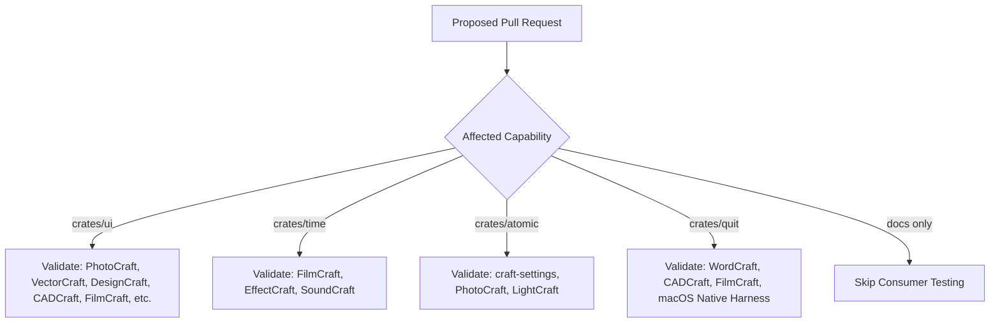

# Consumer Dependency Map & Selective Release Gating

This document accompanies [`consumer-dependency-map.json`](consumer-dependency-map.json) and defines how the Craft application suite coordinates shared library adoption and validation.

---

## 1. Ecosystem Overview

The Craft suite consists of 10 specialized desktop applications. 9 applications have adopted `craft-ui` pinned to revision `5c874d51eeb3de70e735c8ce87a59a7dedd47675`:

| Application | Target Role | Primary Shared Crates | Pinned Status | Test Command |
| :--- | :--- | :--- | :--- | :--- |
| **PhotoCraft** | Image editing & raster | `craft-ui`, `craft-atomic`*, `craft-settings`* | Adopted (`PR #3097`) | `cargo test -p photocraft-ui-egui` |
| **VectorCraft** | Vector illustration | `craft-ui`, `craft-settings`* | Adopted (`PR #1090`) | `cargo test -p vectorcraft-ui-egui` |
| **DesignCraft** | Page publication & layout | `craft-ui`, `craft-quit`* | Adopted | `cargo test -p designcraft-ui-egui` |
| **PdfCraft** | PDF document inspection | `craft-ui` | Adopted | `cargo test -p pdfcraft-ui-egui` |
| **LightCraft** | Non-destructive RAW | `craft-ui`, `craft-settings`* | Adopted | `cargo test -p lightcraft-ui-egui` |
| **FilmCraft** | NLE video editing | `craft-ui`, `craft-time`*, `craft-quit`* | Adopted | `cargo test -p filmcraft-ui-egui` |
| **EffectCraft** | Motion graphics compositing | `craft-ui`, `craft-time`*, `craft-quit`* | Adopted | `cargo test -p effectcraft-ui-egui` |
| **CADCraft** | CAD precision drafting | `craft-ui`, `craft-quit`* | Adopted | `cargo test -p cadcraft-ui-egui` |
| **SoundCraft** | Digital audio workstation | `craft-ui`, `craft-time`*, `craft-quit`* | Adopted | `cargo test -p soundcraft-ui-egui` |
| **WordCraft** | Rich text & word processing | `craft-quit`*, `craft-settings`*, `craft-text`* | Candidate | `cargo test -p wordcraft-ui-egui` |

*\*Asterisk indicates candidate adoption under active review/PR.*

---

## 2. Selective Release Gating Protocol

Not every shared-library modification requires running tests against all 10 applications. The compatibility runner uses the capability tags in `consumer-dependency-map.json` to filter the validation blast radius:

### Capability Tag Mapping
- **`ui`**: Triggered by changes to `crates/ui`. Validates against `photocraft-ui-egui` and `vectorcraft-ui-egui`.
- **`time`**: Triggered by changes to `crates/time`. Validates against `filmcraft-time` and `effectcraft-time`.
- **`atomic`**: Triggered by changes to `crates/atomic`. Validates direct crate consumers (`craft-settings`) before application testing.
- **`lifecycle`**: Triggered by changes to `crates/quit`. Validates eframe close handling and native macOS harnesses.

---

## 3. Pinned Revision Update Protocol

When a shared library revision is promoted to `main`:
1. Maintainers publish the new commit SHA on `storytold/craft-libs`.
2. A compatibility report generated by `cargo xtask compat-check` confirms green baseline-vs-candidate runs across affected consumers.
3. Downstream consumer PRs update their Cargo Git pin (`rev = "<new_sha>"`).
4. `consumer-dependency-map.json` is updated with the new pinned revisions.
