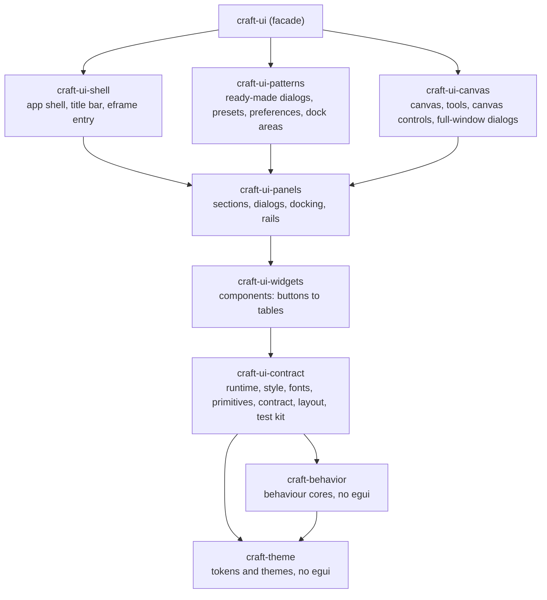

# Craft framework

The Craft framework is the shared layer under every Craft app: the design system, shells, canvas core, host convention and feature families, supplied by `craft-libs` as one dependency.

## Contents

- [1. Overview](#1-overview)
    - [1.1 What the Craft framework is](#11-what-the-craft-framework-is)
    - [1.2 Framework and design system](#12-framework-and-design-system)
    - [1.3 Principles](#13-principles)
- [2. Installation](#2-installation)
    - [2.1 Run the component gallery](#21-run-the-component-gallery)
    - [2.2 Depend on craft from an app](#22-depend-on-craft-from-an-app)
    - [2.3 Build, test and render a component](#23-build-test-and-render-a-component)
- [3. Architecture](#3-architecture)
    - [3.1 Crate tiers](#31-crate-tiers)
    - [3.2 The UI library crates](#32-the-ui-library-crates)
    - [3.3 The craft facade](#33-the-craft-facade)
    - [3.4 Crate taxonomy](#34-crate-taxonomy)
    - [3.5 The host convention: services in, edits out](#35-the-host-convention-services-in-edits-out)
    - [3.6 Runs and passes](#36-runs-and-passes)
    - [3.7 One egui revision](#37-one-egui-revision)
- [4. Design system](#4-design-system)
    - [4.1 Component layers](#41-component-layers)
    - [4.2 Ownership](#42-ownership)
    - [4.3 Generic or family component](#43-generic-or-family-component)
    - [4.4 Patterns and shells](#44-patterns-and-shells)
    - [4.5 Per-app look and feel](#45-per-app-look-and-feel)
    - [4.6 Customization ladder](#46-customization-ladder)
    - [4.7 Themes](#47-themes)
- [5. Foundations](#5-foundations)
    - [5.1 Colour](#51-colour)
    - [5.2 Typography](#52-typography)
    - [5.3 Iconography](#53-iconography)
    - [5.4 Dimensions](#54-dimensions)
    - [5.5 Elevation](#55-elevation)
    - [5.6 Motion](#56-motion)
    - [5.7 Appearance and contrast](#57-appearance-and-contrast)
- [6. Components](#6-components)
    - [6.1 What every component provides](#61-what-every-component-provides)
    - [6.2 Index](#62-index)
    - [6.3 Family components](#63-family-components)
- [7. Accessibility and translation](#7-accessibility-and-translation)
    - [7.1 Required for every component](#71-required-for-every-component)
    - [7.2 Translation rules](#72-translation-rules)
    - [7.3 Goals beyond the required list](#73-goals-beyond-the-required-list)
- [8. Tests and gates](#8-tests-and-gates)
    - [8.1 What gets a test](#81-what-gets-a-test)
    - [8.2 Gates](#82-gates)
    - [8.3 Design lint](#83-design-lint)
- [9. Migration and landing](#9-migration-and-landing)
    - [9.1 Migration strategy](#91-migration-strategy)
    - [9.2 Acceptance checklist](#92-acceptance-checklist)
    - [9.3 Steps](#93-steps)
    - [9.4 Critical path](#94-critical-path)
    - [9.5 What each step delivers](#95-what-each-step-delivers)
    - [9.6 Documentation for each step](#96-documentation-for-each-step)
    - [9.7 Landing strategy](#97-landing-strategy)
    - [9.8 Breaking changes](#98-breaking-changes)
    - [9.9 Status and open questions](#99-status-and-open-questions)
- [Appendix A. Component tokens](#appendix-a-component-tokens)
    - [Semantic colour tokens](#semantic-colour-tokens)
    - [Appearance settings](#appearance-settings)
    - [Built-in themes](#built-in-themes)
    - [Generic or family placement](#generic-or-family-placement)
    - [Docking details](#docking-details)
    - [Radius roles](#radius-roles)
    - [Size roles](#size-roles)
- [Appendix B. Crate and module layout](#appendix-b-crate-and-module-layout)
    - [Facade features](#facade-features)
    - [Host service rules](#host-service-rules)
    - [Where each concept lives](#where-each-concept-lives)

## 1. Overview

### 1.1 What the Craft framework is

The Craft framework is the shared layer under every Craft app, supplied by `craft-libs` as one library. It holds the design system, shells and canvas core, the host convention and the feature families. The framework builds each feature once and uses it everywhere, so copies cannot drift apart in look, behaviour, accessibility and translation.

### 1.2 Framework and design system

| Term | Meaning |
| --- | --- |
| Craft framework | The whole shared layer |
| Design system | Tokens, themes and component layers. One part of the framework |
| UI library | The design-system layers every family uses, with no document concept: six crates (`craft-ui-contract` to `craft-ui-shell`) and the `craft-ui` facade that re-exports them ([3.2](#32-the-ui-library-crates)) |
| Family | A set of features a developer looks for together (colour, layers, timeline). One crate each |

App engineers need the framework: sections 2 and 3. Component and theme authors need the design system: sections 4 to 8.

### 1.3 Principles

- **Apps ask for meaning.** A raised surface, a primary button, muted text. Never a colour or pixel size. A lint checks app code ([8](#8-tests-and-gates)).
- **Apps keep their layout and conventions.** The code and behaviour of the building blocks are shared ([4.5](#45-per-app-look-and-feel)).
- **Behaviour follows the industry original.** Without one, it follows the app's existing behaviour. Where an app draws one kind of component several ways, the library has one.
- **Apps own the document.** Features hold no document state or undo history.
- **Accessibility and translation are required** ([7](#7-accessibility-and-translation)). A missing translation never blocks.
- **Colour management goes through `craft-cms`.** A missing capability is added there.

## 2. Installation

### 2.1 Run the component gallery

The gallery shows every registered story of every crate with a `ui` feature, under every theme. Themes switch at run time. It needs Rust 1.95 or later.

```
git switch craft-framework
cargo run --profile gallery -p craft-ui-gallery
```

- The `gallery` profile is release optimisation with incremental builds; `cl build gallery` builds the debug gallery instead. Both are described in [development.md](development.md), with the story renderer (`cl render`), which writes one component's stories to PNG files without building the gallery.
- Update with `git pull` and rebuild.
- Candidate fonts are optional: check out a `craft-fonts` repository and set `CRAFT_FONTS_DIR=<absolute path>` before building ([craft-fonts-build](../crates/fonts-build/README.md)).

### 2.2 Depend on `craft` from an app

An app has one dependency, one pin and one import root.

```toml
[dependencies]
craft = { git = "https://github.com/storytold/craft-libs", rev = "...", features = [
    "ui", "color", "layers", "theme-store", "platform-clipboard",
] }
```

```rust
use craft::prelude::*;
use craft::color::ui::{ColorPicker, SwatchPalette};
```

The facade's rules and features are in [3.3](#33-the-craft-facade).

### 2.3 Build, test and render a component

Inside `craft-libs`, every local cargo command goes through `tools/cl`, which gives every build the same feature set so the framework is built once per target directory ([development.md](development.md)):

| What | Command |
| --- | --- |
| Check the crate you changed | `cl check <crate>` |
| Run its suite and trials | `cl test <crate>`, or `cl test <crate> -- <filter>` |
| One component's stories as PNG files | `cl render <crate> <Component>` (`ui` for the library's own components) |
| The gallery | `cl build gallery` (debug), or `cargo run --profile gallery -p craft-ui-gallery` |

Writing a component, its stories and its trials: [authoring.md](authoring.md).

## 3. Architecture

### 3.1 Crate tiers

Tiers describe dependency direction. A crate depends only on lower tiers. They are separate from the design-system layers in [4.1](#41-component-layers).

```text
Tier 3  craft              facade: re-exports and forwards features
          |
Tier 2  families           craft-color, craft-draw, craft-layers, ...
          |
Tier 1  UI library         craft-ui-contract, -widgets, -panels, -canvas, -patterns, -shell; the craft-ui facade
          |
Tier 0  engines, services  craft-behavior, craft-theme, craft-i18n, craft-settings, craft-cms, craft-host, ...
```

Rules:

- Tier 0 needs no egui. A tier-0 crate that converts to egui types does so behind a feature: `craft-theme`'s `ecolor`, `craft-host`'s `ui`, `craft-keymap`'s `egui`.
- The UI library names no document concept and never depends on a family.
- A family keeps core types at the crate root and egui UI in `ui` behind the `ui` feature, and may be UI-only.
- No family's `ui` depends on another family's `ui`, except on `craft-color`, the base family any family may use (`crates/craft/tests/families.rs` checks it). A widget two other families share moves down to the UI library.

### 3.2 The UI library crates

The UI library is six crates along the design-system layers ([4.1](#41-component-layers)), plus the `craft-ui` facade. An arrow points from a crate to a crate it depends on.



| Crate | Layer | Holds | Also depends on |
| --- | --- | --- | --- |
| `craft-ui-contract` | 2 to 4 | The runtime (per-pass services and the one egui adapter), style, fonts, primitives, the component contract and its pipeline, layout services, and the test kit (`testing`) | `craft-host`, `craft-keymap`, `craft-window`, `craft-quit`, `craft-i18n`, `craft-font-catalog`, `craft-fonts-build`, `craft-ui-macros` |
| `craft-ui-widgets` | 5 | Components: buttons, choices, display, forms, lists, menus, notices, text fields, value drags, pickers, tabs, tables, graphs, bars, and the layout components `Stack`, `Row`, `Grid` | |
| `craft-ui-panels` | 5 | Sections, dialogs and the dialog host, docking, rails, and the canvas data patterns read without the canvas | `craft-quit` |
| `craft-ui-canvas` | 5 and 6 | `Canvas` with its tool host, tools, rulers and navigator; the canvas controls; the full-window dialogs that show a canvas | |
| `craft-ui-patterns` | 6 | Ready-made dialogs (form dialogs, PDF export), presets, preferences, dock areas and panels | `craft-pdf` (the PDF export dialog) |
| `craft-ui-shell` | 7 | `AppShell`, the title bar, and with `app` the eframe entry point | `craft-window` |
| `craft-ui` | | The facade: re-exports the six crates under one root, so `craft_ui::buttons` is `craft_ui_widgets::buttons`. With `testing`, `craft_ui::testing` gathers every crate's test helpers | the six crates |

- Each crate above the contract re-exports the modules of the crates below it at its root, so code inside the library writes `crate::contract::…` in any crate.
- Every crate outside the library that uses it (the families, the services with a `ui` feature, the gallery, the story renderer and the `craft` facade) depends on the facade `craft-ui`. Apps do too, through `craft::ui`.
- Each crate has its own `testing` feature and its own integration binary (`tests/it`), which runs the shared suite over the types that crate registers. The facade's `it` binary holds the checks that need every crate linked: the components index and the API map.
- `craft-ui-macros` holds the derives every crate uses; `craft-ui-test-kit` holds test kits the crates' integration binaries share.

### 3.3 The `craft` facade

- Every public UI type is re-exported at `<crate>::ui`; every core type at the crate root: `craft::color::ui::ColorPicker`, `craft::color::Palette`.
- `craft::prelude` holds `AppInfo`, `Host`, `Section`, `Tokens`, `DialogStack` and `Outcome`. There are no other preludes.
- A feature can move between crates as long as `craft::<family>` stays.

Feature names: `ui` is the only UI feature name in every crate, and `screen-testing` adds stories and snapshot tests. The full table is in [Appendix B](#facade-features).

Native-only modules use `#[cfg(not(target_arch = "wasm32"))]`. A crate that cannot build for wasm says so in its first doc line, and the facade gates it.

### 3.4 Crate taxonomy

| Kind | Role | Crates |
| --- | --- | --- |
| Facade | One dependency for apps | `craft` |
| UI library | Shared UI infrastructure ([3.2](#32-the-ui-library-crates)) | `craft-ui` (facade), `craft-ui-contract`, `craft-ui-widgets`, `craft-ui-panels`, `craft-ui-canvas`, `craft-ui-patterns`, `craft-ui-shell`, `craft-ui-macros`, `craft-behavior` |
| Domain families | Features with core logic and egui UI | `craft-color`, `craft-draw`, `craft-imaging`, `craft-layers`, `craft-browse`, `craft-text`, `craft-font-manager`, `craft-pages`, `craft-review`, `craft-table`, `craft-timeline`; planned: `craft-code` |
| Infrastructure services | Egui-free logic that families and apps share | `craft-theme`, `craft-theme-store`, `craft-host`, `craft-i18n`, `craft-settings`, `craft-keymap`, `craft-menu`, `craft-automation`, `craft-update`, `craft-cms`, `craft-ai-core`, `craft-atomic`, `craft-docpath`, `craft-font-catalog`, `craft-font-store`, `craft-pdf`, `craft-prepress`, `craft-proof` |
| Formats and codecs | Clean-room readers and writers | `craft-audio`, `craft-crw`, `craft-jpeg`, `craft-media`, `craft-doc`, `craft-ecproj-format`, `craft-pcraft-format`, `craft-vectorcraft-format` |
| Platform adapters | One operating-system, window-system or browser service each | `craft-platform`, `craft-dialogs`, `craft-window`, `craft-win32`, `craft-quit`, `craft-print`, `craft-web-api`, `craft-web-host`; next: `craft-gpu` |
| Tooling | Not shipped in apps | `craft-ui-gallery`, `story-render`, `feature-root`, `craft-ui-bench`, `craft-ui-test-kit`, `craft-design-lint`, `craft-plate-test`, `craft-fonts-build`, `craft-media-testkit` |

`craft-win32` is the one crate that allows `unsafe` code: it wraps the Win32 window-procedure subclassing and window-handle calls behind a safe API, so no other crate needs `unsafe`. The workspace lint table sets `unsafe_code = "forbid"`; craft-win32 sets it to `deny` and allows it in `lib.rs`, and the design-lint rule `contract/unsafe-allow` names it. The benchmark's counting allocator (`craft-ui-bench`, `src/alloc.rs`) is the other allowed site.

Services and adapters may carry a `ui` feature (`craft-keymap`, `craft-update`, `craft-dialogs`) but name no document concept. Module tables: [Appendix B](#appendix-b-crate-and-module-layout).

### 3.5 The host convention: services in, edits out

`craft-host` is a small egui-free crate. The app builds a `Host` once and installs it on the egui context. Every feature reads it with `Host::of(ui)`. No feature takes an i18n or settings parameter.

```rust
fn setup(ctx: &egui::Context, app: &App) {
    Host::builder(app.info())
        .i18n(app.i18n.clone())
        .settings(app.settings.clone())
        .commands(app.keymap.clone())
        .files(app.files.clone())
        .jobs(Arc::new(craft::host::ThreadJobs))
        .install(ctx);
}
```

| Rule | Detail |
| --- | --- |
| Services in | Identity, language, settings sections, commands, files and jobs. Each is a trait the app or a library crate implements. |
| Document data in | Each feature defines one small trait (`TimelineModel`, `LayerTree`) that the app implements on its document view. Features own no document state |
| Edits out | Features return edit events (`Begin`, `Update`, `Commit`, `Cancel`, `Set`). The app applies them to its own undo stack |
| Dialogs | A feature dialog is a value the app opens on the library's `DialogHost`. Its result is a `DialogResult<T>` (`Ok(T)` or `Cancel`) the app takes on a later pass. No feature opens its own window |

The remaining service rules (settings keys, words, commands, files) are in [Appendix B](#host-service-rules). The examples show the shape, not settled APIs.

**Cancel and Escape.** Esc during a gesture ends it with `Cancel { reason: Escape }`. The app restores the value it held at `Begin` and makes no undo step.

```rust
match event {
    EditEvent::Begin { id, .. } => self.mark = Some(doc.undo_mark(id)),
    EditEvent::Update { value, .. } => doc.preview(FILL, value),
    EditEvent::Commit { after, .. } => doc.apply(Edit::set(FILL, after)),
    EditEvent::Cancel { reason, .. } => match self.mark.take() {
        Some(m) if !reason.document_moved() => doc.restore(m),
        _ => {}
    },
    EditEvent::Set { after, .. } => doc.apply(Edit::set(FILL, after)),
    _ => {}
}
```

**Interrupted gesture.** Besides Esc, other events end a gesture with `Cancel`; the `CancelReason` says which: `Refused`, `Dismissed`, `Escape`, `Blur`, `Removed`, `HostChanged`, `UndoDuringGesture`. For `HostChanged` and `UndoDuringGesture`, `reason.document_moved()` is true: the document changed under the gesture, so the app keeps it as it is, because a restore would also take back that change. The handler above covers all of them.

**Error.** A failing service call returns a typed error, and the feature shows it in its own UI without an edit. File calls return `Result<_, FileError>`. A dismissed picker answers `Picked::Cancelled`, not an error; a picker that cannot open answers `Picked::Unavailable(cause)`.

**Async job.** Work runs on the host's `Jobs`, never on a thread a feature starts. `JobQueue` adds priorities, one job per key, replacement and cancellation. Dropping a key sets the job's cancel flag, and a cancelled job's result is never delivered.

```rust
queue.submit(photo_id, Priority::VISIBLE, move |cancel| decode(&path, cancel));
while let Some(Finished { key, result }) = queue.try_recv() { show(key, result) } // on a later pass
```

### 3.6 Runs and passes

A pass shows the whole UI once. egui may repeat a pass within a frame (a discard pass); only the frame's last pass is painted. Within a pass, a container's contents run twice: a measuring run, then the real run. Both runs of a pass give the same result.

Content runs in every pass, and its sizes come from this pass. Layouts also read some state earlier passes left, for example a scroll area's offset and its last view and extent (step 4 and the scroll bars read them) and the sizes layout memory keeps (`runtime::layout_memory`; a changed size asks for a discard pass). The one exception to running in every pass is out-of-view content.

**Layout memory.** A record of layout memory holds a measure or a text. A body whose inputs did not change takes its kept measurement instead of running a measuring run. A text that a measuring run found for content outside the body (a value readout beside a story, for example) is kept with the measurement: `layout_memory::emit_text` hands it forward, `layout_memory::text` reads it, and a body that takes its kept measurement gives the text its measuring run found. A real run that finds another text marks the kept transcript as changed.

**Out-of-view content.** Content inside a scroll area that is out of view this pass does not run. It keeps what it last showed: the extent it had in the last pass that showed it, which changes only in a pass that shows the content, and the stops it registered there. One mechanism (`runtime::lazy`, one store) serves every use:

- Only content that meets the view runs. A `Lazy` child out of view registers the focus records of its last real run again in its place (its stops, the scopes it pushed and the roving groups of its stops; `focus::Transcript`), so Tab and F6 reach its stops; Tab onto one runs the child and the reveal scrolls it in.
- `Lazy::new(key, estimate).show(ui, |ui| ..)` wraps a large child of a scroll body (a card, a section of an app panel). Out of view it takes its remembered extent, also after the scroll area's room changed, and its closure does not run. It is a child in flow: in a `Grid` or spread `Row` body it holds one cell, its content is the one child that takes the cell, and out of view it takes the cell at its remembered extent. A card keyed by itself, not by its row, keeps its extent when a change of the column count regroups the rows. A child no pass showed yet takes its estimate (that long along the axes the area scrolls, nothing across them), so a first show runs only the children in view. It runs when its extent meets the view, and while a stop from its last run holds keyboard focus or is the target of a focus request. `.reveal(true)` in a pass asks its scroll body to glide until the child starts at the view's start, whether it ran yet or not: the offset follows the child's place on the motion service's follow curve (a Travel motion, so reduced motion jumps), while estimates before it resolve; a wheel, drag or other move of the body ends the glide. The key names the child among every `Lazy` of its scroll area. Outside a scroll area a `Lazy` always runs.
- The first run of a pass decides which children run, so the measuring run and the real run lay out the same children.
- Every scroll input moves the offset at step 4, before the content runs, so the decision sees the offset the pass paints. Wheel, page keys and reveals arrive there directly. A thumb drag, a track press or an AccessKit scroll action is sensed after the content ran: the pass queues it for step 4 and asks for a discard pass, so the move shows in the same frame.
- A scroll position the framework holds is also named by content: the first child at or after the view's start and its place in the view (`lazy::Anchor`, kept with the offset). When extents before that child change (estimates replaced by real extents, rows regrouped), the offset follows the child and the pass runs again, so the content in view does not move. An offset bound to the app (`Component::scroll`) is the app's plain offset, and a region that follows its end follows the end.
- A scroll area that does not run (a tab switched away) keeps its children's entries, and its content extent lives beside its offset (`ScrollState`) with the same lifetime, so it shows again at the same offset after any length of hide; one that runs drops the entries of the children it did not reach.
- A collection builds the rows in view, plus its lead, anchor, renaming and grabbed rows. Its rows are no Tab entries (Tab moves past the collection, arrows move its lead), so a row out of view has no stops to keep. It places the rows it does not build by the extents they had when last built, from the same store, and its output lists the rows in view and the kept rows. Rows it never built take its item layout's estimate, as a `Lazy` takes its own, so a long list is never built whole.
- Each built row is a run of the collection's item component, or, for a collection that sets `Collection::MEMBERS` (a tab strip's tabs, a colour table's cells), a member of the collection's own run: sensed with its parts in its arena, updated, painted and finished at its row, and reported as an access sub-node of the collection with its parts' nodes under it, with no run of its own. Its output gives the item event, as a run's does. Selection, activation, drags and AccessKit requests on the row are the collection's either way.
- The access tree covers the view, by the same rule: content that runs reports its access nodes (a collection's built rows and their section headings included). A component that lays out section rows as its own parts (TileGrid's group headings and tail rows) reports the nodes of those in view. Content out of view (`Lazy` children and collection rows) is absent from the access tree until it scrolls in. AccessKit scroll actions still reach it, because they move the offset.
- Content that was never shown has only its estimate and no stops: Tab reaches it once it was shown. An app brings it into view with `.reveal(true)`.

### 3.7 One egui revision

`craft-libs` pins one revision of an egui fork for every egui crate (`[patch.crates-io]` in the root `Cargo.toml`). Two revisions in one build would give two incompatible `Tokens` and `Ui` types. `craft::egui_fork::{GIT, REV}` name the fork and revision, and `craft::egui_fork::check_lockfile` checks that an app's `Cargo.lock` takes every egui package from them; an app's `xtask` calls it. An app must also patch egui to the same fork, because `[patch]` applies only at the workspace root.

**The fork.** This branch pins `github.com/aiongg/egui` at `3f56db2d`. That revision is the storytold egui fork's pinned revision (`6d518fc7`, the pin on storytold `craft-libs` main) plus 20 commits the framework needs:

- `TextEditState::preedit`, and a new IME context ends the old composition
- `InteractOptions::enabled` (disable one widget of an enabled `Ui`) and `InteractOptions::activate_on_space`
- `Memory::request_focus_with_filter`
- `Response::describe_for_accessibility` public, accessible names for `ScrollArea` scroll bars, `Context::set_accesskit_focus`, `Context::register_accesskit_parent` public
- a pointer press goes to the widget under the press position
- `DragAndDrop::aborted_by_escape`
- `Popup` swallows the press outside it that closes it
- `Context::set_layer_order`
- OpenType features per text section (epaint)
- `IdTypeMap::insert_temp_boxed` keeps the allocation of a value taken out, and `Context::ptr_eq`
- `Context::pass_mark`, `pass_records_since` and `replay_pass_records`: a settled region replays its last pass's records

The fork's `PATCHES.md` describes each patch and whether it is proposed upstream.

**What it means for landing.** Before craft-libs main can take the framework, these commits must be on the storytold egui fork and craft-libs must pin that revision; until then a build of this branch fetches egui from `github.com/aiongg/egui`. The storytold fork's `main` has commits the pin lacks, so the commits move onto whichever storytold revision the team picks, and `craft::egui_fork::GIT` changes with the pin ([9.7](#97-landing-strategy)).

## 4. Design system

The design system decides how apps look and how components compose. Its readers build components, themes and app looks.

### 4.1 Component layers

Each layer reads only the layer below it. The right column names the crate that holds the layer ([3.2](#32-the-ui-library-crates)); the crate docs number the layers from the bottom, with tokens and behaviour as layers 0 and 1 and the app as layer 8.

```text
Shells       title bar, rails, body and bars as slots; presets per kind of app          craft-ui-shell
  ^
Patterns     panel, dialog, inspector, dock area, options bar, status bar, title bar    craft-ui-patterns, craft-ui-canvas
  ^
Composites   field rows, property rows, headers, lists, tabs, toasts, menus             craft-ui-widgets, craft-ui-panels
  ^
Controls     buttons, fields, sliders, checkboxes, selects, swatches, tooltips          craft-ui-widgets
  ^
Primitives   surface, state layer, focus ring, divider, stack, interactive area, text, icon, handle
             (with the runtime, style and contract under them)                          craft-ui-contract
  ^
Tokens       scales, ramps, seeds, contrast, size presets, themes                       craft-theme, no egui
```

### 4.2 Ownership

| Concern | Owner | Responsibility |
| --- | --- | --- |
| Token model, themes, resolution, validation | `craft-theme` | The design language as data, with no egui |
| Theme files, machine-local library, suite selection | `craft-theme-store` | `selection.json`, lock and revision protocol, watcher, client |
| Tokens to egui styles | `craft_ui::style` (craft-ui-contract) | The one place data becomes egui styling, stock widgets included |
| Behaviour | `craft-behavior`, `craft_ui::runtime::{focus, keys}` (craft-ui-contract), `craft_ui::edit` (craft-ui-widgets) | Press, drag, navigation and edit events with no egui; focus and keys per pass; undo adapters |
| Generic components and shells | The UI library crates | Reusable UI |
| Domain components | Family crates | Feature UI on the UI library |
| Gallery, story renderer, lint | `craft-ui-gallery`, `story-render`, `craft-design-lint` | Inspect and enforce the system ([8](#8-tests-and-gates)) |

### 4.3 Generic or family component

A component goes in the UI library when both hold:

1. Its inputs are general data: values, ranges, points, text, a list of rows, or a small trait.
2. It names no document concept: layer, colour model, gradient, path, clip, page.

Otherwise it goes in the family crate that owns the concept. A component that two families need moves down to the UI library once its inputs are general.

Inside the library, a component goes in the lowest crate whose layer it belongs to: a control or composite in `craft-ui-widgets`; a section, dialog, dock part or rail in `craft-ui-panels`; anything that needs `Canvas` in `craft-ui-canvas`; an assembly of other components (a pattern) in `craft-ui-patterns`.

Borderline cases (curve editor, histogram, preset browser, menus, canvas overlays) and where the code places them are in [Appendix A](#generic-or-family-placement).

### 4.4 Patterns and shells

A pattern is a reusable region of a window. It works in any shell and decides nothing about the rest of the window: panel, dialog, inspector, dock area, options bar, status bar, title bar, rails.

A shell composes a whole window. It orders slots (title bar, top bars, rails, body, bottom bars), decides which show, scopes ids and state per window, and draws no bar or panel itself. Slots take patterns.

| Shell | State |
| --- | --- |
| Canvas: fixed document canvas, document tabs, tool rail, panel dock. Photo, vector, design, figure, PDF and CAD apps | Built |
| Workspace: equal panels in named workspaces. Film, effects and sound apps | Planned |
| Office-style: ribbon in the top slot, backstage view, task panes | Planned |

Docking details are in [Appendix A](#docking-details).

### 4.5 Per-app look and feel

An app has one layout in every theme and size. A theme never changes the layout. Different arrangements are workspaces, which are separate from themes. Studio, for example, is Pro's layout with Studio colours and the Comfortable size.

| The app decides | The framework shares |
| --- | --- |
| Layout and placement, following its industry original | Components and their behaviour |
| Conventions: menus, shortcuts, tool behaviour | Family patterns: dock and tool rail, ribbon |
| Default density: Compact or Comfortable | Focus and Tab order, Esc cancels, one undo step per drag |
| Default theme and mode: dark for creative apps, light for office-style apps | Themes, high contrast, translation, screen-reader support |
| Colour overrides for its own look | The token model that carries them |

### 4.6 Customization ladder

Use the first step that works.

1. **Density.** Compact or Comfortable.
2. **Size overrides.** The app ships a `sizes.json` that overrides base sizes (for example `size.control.md`). A base override carries to every size derived from it. To change one component, pin that component's token. Overrides stay within the validator's limits.
3. **Component tokens.** One named value changes a component app-wide.
4. **Builder options.** Options cover structural differences. A new need gets a new option, not a new component.
5. **Per-app colour overrides.** A theme file can carry a section per app. Values are theme roles or literal colours, so themes, dark mode and high contrast keep working.
6. **One-off app components.** A last resort, built from shared pieces. Allowed and not policed.

### 4.7 Themes

Ten built-in themes with 17 mode variants; the suite default is ArtCraft. A two-mode theme is one theme with a variant per mode, and a mode can carry a partial `seeds` override so each mode derives its own colours. Picking a two-variant theme sets both modes. A theme can name an icon pack that replaces the base icons it covers. The gallery is also the base of a theme editor. The themes are listed in [Appendix A](#built-in-themes).

## 5. Foundations

Foundations are the values every component reads. This section holds concepts only. Which component uses which token is in [Appendix A](#appendix-a-component-tokens).

### 5.1 Colour

```text
seeds -> ramps -> semantic tokens -> pins -> contrast pass -> resolved Tokens -> theme bridge
```

- **Seeds.** Neutral, accent and four status hues (good, warn, bad, info).
- **Ramps.** 12 steps per seed per mode, in OKLCH, on a fixed lightness curve.
- **Semantic tokens.** Mapped to ramp steps by meaning (groups below).
- **Pins.** Any token can be set by hand.
- **Anchoring.** Unpinned background greys keep their distance from the theme's panel colour, so they follow a pinned panel. Text greys stay on the curve.
- **Contrast pass.** Derived colours move to the minimums in [5.7](#57-appearance-and-contrast).

Semantic tokens fall in eight groups: surface, text, line, accent, status, state, canvas overlay and data. The tokens of each group are in [Appendix A](#semantic-colour-tokens).

Accent fills that carry text use the strong pair: the accent moved in lightness only as far as white text needs.

### 5.2 Typography

App text maps to the nearest named role. A real new need gets a new role. No role serves a single use.

| Role | Use | Compact (size / line, pt) | Comfortable |
| --- | --- | --- | --- |
| Caption | Small print | 10.5 / 14 | 11.5 / 16 |
| Label | Control labels | 11.5 / 16 | 12.5 / 18 |
| Body | Body text | 12 / 16 | 13 / 18 |
| Body strong | Emphasised body text (semibold) | 12 / 16 | 13 / 18 |
| Title | Panel and dialog titles (semibold) | 13 / 18 | 14 / 20 |
| Heading | Section headings (semibold) | 15 / 20 | 17 / 24 |
| Body large | Large regular text, such as a prominent field | 15 / 20 | 16 / 22 |
| Mono | Code, numbers in tables | 11.5 / 16 | 12.5 / 18 |

The Text size setting scales the roles only (0.83x, 1x, 1.17x, 1.33x), rounded to 0.5 pt. Control heights, icons and faces do not scale. The interface font setting can use the OS UI face; mono stays the suite's.

### 5.3 Iconography

- **Sets.** Phosphor is the base set. The gallery's active set defaults to Lucide. A theme may supply an icon pack that replaces the base icons it covers; missing icons fall back to the base set.
- **Strokes.** 1.25 pt at the small size, 1.5 pt at medium and large.

### 5.4 Dimensions

Sizes are runtime tokens. The rule runs from the general to the specific:

1. A **scale** holds the allowed values: spacing 0, 2, 4, 6, 8, 12, 16, 20, 24, 32; radius 0, 2, 3, 4, 6, 8, 12 and full; strokes hairline, 1, 1.5, 2, 3.
2. **Semantic role tokens** pick from the scale by meaning: control height, icon size, gap, padding, radius, bar height.
3. **Components** derive their own dimensions from the role tokens in their style: a role, or a role times a ratio named in the component's style with the rule it comes from. There are no component-specific theme values.

Components name semantic tokens and never a pixel value or shape of their own. [Appendix A](#appendix-a-component-tokens) says which component takes which role. Only drawing details (stroke widths, chevron geometry, dash lengths) stay constants.

**Semantic role tokens (pt).**

| Role | Compact | Comfortable |
| --- | --- | --- |
| Control height sm / md | 20 / 24 | 24 / 30 |
| Icon sm / md / lg | 12 / 16 / 20 | 14 / 18 / 22 |
| Gap inline / row / stack / section | 4 / 4 / 6 / 12 | 6 / 6 / 8 / 16 |
| Padding control / panel / dialog | 6 / 8 / 16 | 8 / 12 / 20 |
| Radius control / surface / window / panel | 3 / 4 / 6 / 0 | 6 / 8 / 12 / 0 |
| Stroke thin / medium / thick / heavy | 1 / 1.5 / 2 / 3 | 1 / 1.5 / 2 / 3 |
| Radius button / pill | full / full | full / full |
| Bar title / tab / status / options | 32 / 26 / 24 / 36 | 38 / 30 / 30 / 42 |
| Panel header | 28 | 34 |
| Rail width / button | 40 / 30 | 50 / 36 |

Push buttons take the button radius and the pill-shaped parts take the pill radius. Both are fully rounded by default and square in Classic, and each clamps to half the part's height.

Themes never set sizes. The Size preset sets them, and apps may override them within validator limits. Adwaita, Breeze, Soft and Classic define their own corner radii and edge style (flat or bevel; only the Surface primitive reads the edge). These change how a component is drawn, not its geometry, placement or the workspace structure.

### 5.5 Elevation

Shadow levels exist for popups, dialogs, floating panels and knobs. A bevel edge has none.

### 5.6 Motion

Durations are Fast (80 ms, hover and press feedback), Normal (150 ms, most state changes) and Slow (250 ms, large surfaces opening or moving). Easings are Standard, Enter and Exit. Reduced motion sets every duration to zero.

### 5.7 Appearance and contrast

#### 5.7.1 Settings

Nine settings: theme (per mode), mode, contrast, size, text size and reduced motion are suite settings; interface font, direction and UI scaling are app settings. Options, effects and storage are in [Appendix A](#appearance-settings).

#### 5.7.2 Precedence

Each field resolves on its own, in this order:

```text
app override  ->  suite choice (selection.json)  ->  app default
 (preferences)      (set once any app picks it)     (shipped by the app)
```

- **Theme, mode, size.** An override replaces one field, not a whole profile: an app can override only its size and still follow the suite's theme and mode. An override of the theme replaces both slots of the theme pair; a slot may name the app default.
- **Contrast, reduced motion, text size.** Suite choice only, then the built-in default (system, system, 1x). The app has neither default nor override.
- **Interface font, direction, UI scaling.** App settings only.
- **System values.** `system` resolves against what the OS reports. Mode falls back to the app's fallback mode, contrast to standard and motion to full.
- **Unknown theme.** An unknown theme id falls back to the app default's slot, then to ArtCraft.

#### 5.7.3 Contrast

Standard contrast follows each theme's design. Derived colours reach the minimums. Pinned colours that fall short are kept and reported (`craft-theme check`, the gallery token browser, a "Low contrast" label in the theme picker), never rewritten. High contrast fixes every failing pair in the table, pinned or not.

| Class | Pairs | Standard | High |
| --- | --- | --- | --- |
| Text | Text normal, muted, faint on surfaces and state fills; text on selected fills; accent text; status foregrounds; text on accent, strong accent and status solids | 4.5:1 | 7:1 |
| Non-text cue | Focus line; accent solid, check and radio marks on control surfaces; overlay stroke on its halo; marquee on its dash | 3:1 | 4.5:1 |
| State cue | Accent border of selected controls; selected anchor outline on its fill; curve and channel colours on their plot | none | 4.5:1 |
| Control edge | Field and button borders, slider tracks | none | 3:1 |
| Active popup row | The active row of a menu or list popup | 1.12:1 | 3:1 |
| No rule | Dividers, hover and pressed fills, disabled text and fills | none | none |
| Exempt | Guides, smart guides, path outlines and box lines: bare lines in a colour the user chooses | none | none |

## 6. Components

This section points to the component index. Examples and every state of each component are in the gallery ([2.1](#21-run-the-component-gallery)). Which tokens a component reads is in [Appendix A](#appendix-a-component-tokens).

### 6.1 What every component provides

- A builder API with semantic props only: no colour, pixel size or corner shape of its own. The idiom is `Type::new(required).option(..).show(ui)`. Panels take `&mut Model` in `new`. A dialog's per-pass answer is an `Outcome`; on the host it returns a `DialogResult<T>`.
- Gallery stories for every state.
- Everything in the checklist in [7.1](#71-required-for-every-component).

### Fill and content sizing

A content-sized column (a `Stack::new()`, a menu or popover body) holds the children that fill: they never set the column's width, and they are shown across the width it settles on. A leaf declares that it fills with `fills()`; a container declares it with `Sizing`. A host that shows arbitrary components (the gallery, a dialog body) offers them fill width with `fill_width()`, and a story that fills both axes takes its room from `testing::stage`, and a canvas story as tall as its content (a text being edited) from `testing::stage_fitting`.

Along a height its parent sizes from its content, a container that fills takes its content height, at most the room it is offered. Content taller than that room takes the room, and the children that fill share it, so a list scrolls above the bar under it. Inside a scrolling body the room is unbounded; a host offers a finite one with `room_height` (a gallery card offers the view's height).

### 6.2 Index

[components-index.md](components-index.md) lists every registered component and pattern of the UI library crates with its shape, module and purpose. It is generated from the component registry (`cl cargo run -p craft-ui-gallery --bin components-index`), and the facade's `components_index` trial fails when the file is out of date. [contract-api.md](contract-api.md) lists the public items of the shared modules (`contract`, `runtime`, `style`, `primitives`, `layout`, `layout_components`, `testing`) and of `craft-behavior`.

### 6.3 Family components

| Crate | Components |
| --- | --- |
| `craft-color` | ColorPicker, ColorArea, ColorWheel, ColorDisc, ColorRamp, ColorPopover, SwatchPair, SwatchPalette |
| `craft-draw` | GradientSwatch, GradientEditor, GradientPalette, gradient line, TransformFields, transform box, bezier paths, crop frame, perspective crop quad, pen draft |
| `craft-imaging` | LevelsEditor, CurveEditor, Histogram, warp grid |
| `craft-layers` | Layers panel, rows, filter bar, thumbnails |
| `craft-browse` | Tile grid, media bin, places, thumbnails, relink |

Other families ([3.4](#34-crate-taxonomy)) add theirs as they land.

## 7. Accessibility and translation

### 7.1 Required for every component

A component is not complete until each item has a story or test.

- [ ] **Keyboard.** Every control works from the keyboard. Behaviour follows the suite's own apps first, WAI-ARIA authoring patterns where no app has a convention.
- [ ] **Visible focus.** A keyboard-only focus ring, always visible.
- [ ] **AccessKit.** Roles, names and values on every widget (button, spin button, slider, text input, combo box, list option, radio, dialog, menu item, tab, tree item).
- [ ] **RTL.** Chrome mirrors. Sliders, number fields and key chords never mirror.
- [ ] **Reduced motion.** Animations resolve to zero.
- [ ] **Translation.** Words come from the catalog ([7.2](#72-translation-rules)).
- [ ] **Edit lifecycle.** Value controls report begin, update, commit, cancel and set. Esc restores the value held before the gesture. A drag or typing run is one undo step.

Keyboard conventions:

- Tab visits fields only in dialogs and every control elsewhere.
- A swatch palette and a guide set are one Tab stop with arrow keys inside. A tab strip is one Tab stop.
- Ctrl+Tab focuses a dialog's title row.
- Cmd or Ctrl+] and [ move the focused row in every reorderable list. F2 renames. Enter runs the row's default action.
- A step over a closed list control (an arrow, Home, End, the wheel, an AccessKit increment or decrement on `Select` or `ComboBox`) stops on the enabled entries marked as stepped (`Entry::stepped`, on by default) and skips the rest, such as a "Load…" command row. A value on none of those entries (mixed, or an entry only the open list offers) offers both steps: forward lands on the first stop, back on the last. `contract::step_stops` and `contract::step_stop` are the one rule every list control uses.

### 7.2 Translation rules

- Library words (button labels, dialog text, error text) are rows in the shared `craft-i18n` catalog (`common.tsv`). App labels win. Apps do not translate library words themselves.
- The app installs its translator through the host once per language change.
- Lookup order: the language's row, the English row, the built-in English.
- A translation with a missing placeholder is ignored.
- No test requires a translation to exist.

### 7.3 Goals beyond the required list

These guide design where no rule exists. They are not acceptance criteria.

- Size and Text size let users enlarge the interface without changing layout.

## 8. Tests and gates

### 8.1 What gets a test

Every test names the regression it guards against: a plausible change to the code that would break something without anyone noticing. If no such change comes to mind, there is no test.

Test:

- Shared mechanisms that many components rely on: the contract pipeline, measuring, focus and key routing, undo grouping, the suite's own checks. Test each once, at the mechanism.
- Logic with real room for mistakes: layout and room sharing, state machines, gesture sequences, geometry, parsing and saving our own file formats.
- A bug that was hard to find, where the fix isn't obvious from the code.

Don't test:

- Code you can verify by reading it: a few lines, a single branch, a swap, a clamp, a short loop with no state.
- Wiring: a button runs its command, a key calls a model function, a modifier picks copy instead of move.
- Defaults, getters and mappings.
- What the type system already guarantees.
- Library behaviour: egui, std, serde or any other dependency.
- Exact strings, values or sizes.
- One test per combination of cases.
- Per-component repeats of what the shared suite already checks on that type. The suite runs its shared cases on every type registered as a component; a pattern gets only the pattern trial.

Where a test goes:

- A component gets its own trial only for behaviour that is unique to it and not trivial.
- Check behaviour at the level the user meets it, through the component, not in the helpers it calls. When a user-level test already goes through a helper's code path, the helper has no test of its own.

New code follows the same rule. A new feature adds tests only for logic with real room for mistakes. A bug fix adds a test only when the bug was hard to find. A review finding needs no test case of its own.

### 8.2 Gates

| Gate | What it holds | Where |
| --- | --- | --- |
| Shared suite | The shared cases (required states, shows, access, Tab, values, mixed, activation, text size, motion, language, text input, container and collection cases) on every type registered as a component; the pattern trial on every pattern | Each library and family crate's `tests/it` binary ([authoring.md](authoring.md)) |
| Trials | Behaviour unique to a component or mechanism ([8.1](#81-what-gets-a-test)) | The same binaries |
| Gallery | Stories for every state of every component of every crate with a `ui` feature. Keep it in step with the features each app enables | `craft-ui-gallery`; its own trials cover the viewer's saved layouts and the Overview's cards |
| Components index | `docs/components-index.md` matches the registrations | The facade's `components_index` trial |
| API map | `migration/api-map/*.toml` have the shape the migration tools read ([9.8](#98-breaking-changes)) | The facade's `api_map` trial |
| Token dumps | Text files of resolved tokens per theme-mode variant, contrast (standard, high) and size (Compact, Comfortable). Rewrite with `UPDATE_DUMPS=1`; the dumps of the workspace stay under a line budget | `crates/theme/tests/dumps` |
| Facade checks | The `craft` features table matches the member crates; no family's `ui` depends on another family's `ui`; the egui fork check | `crates/craft/tests` |
| Theme check | `craft-theme check <file>`: contrast report, adjustments, invalid fields | The `craft-theme` binary |
| Design lint | `craft-design-lint check` (syn), `check-clippy` and `structure` (layer map, imports, exceptions, clones) | [8.3](#83-design-lint) |

Text dumps of every token are the regression gate for the theme. The story renderer (`cl render`) writes a component's stories to PNG files for a before-and-after look; no test compares pictures.

How to run each locally, and which of them CI runs, is in [development.md](development.md).

### 8.3 Design lint

- Rules: `literal-size/*`, `raw-colour/const`, `style-mutation`, `tooltip/stock`, `clippy/inner-allow`.
- Exemption marker: `// design: allow(reason)`. Empty, invalid and unused markers are findings.
- Baselines and `--deny-unused` are supported.
- Exit 0 clean, 1 findings, 2 error.

## 9. Migration and landing

How apps move onto the Craft framework, and how the work lands in `craft-libs`. This is a procedure document. The design is in [1](#1-overview) to [8](#8-tests-and-gates).

### 9.1 Migration strategy

Everything is built in `craft-libs` first: build each feature once, in one place, and use it one way. A feature one app has today is built in the library even when no second app needs it yet. Work goes step by step, so each step ends in a library the apps can use. It does not go family by family.

- **PhotoCraft migrates first.** It has the most UI and features. Its port branch runs on the library while the library grows.
- **VectorCraft migrates second.** It shares the Canvas shell and most of PhotoCraft's skeleton. If the two ports look alike, the library is general enough.
- **Other apps follow**, each adopting the steps it needs.
- **One branch per port.** The port adopts each step as it lands and deletes the code the step replaces. The app's main branch switches once, when the port merges.
- **A gap is library work.** A gap an app finds is fixed in the library first. The port then deletes its own code. No app workaround.
- **Review in small PRs.** Keep hand-written architecture changes in small, independently buildable PRs. Treat generated dumps and icon assets as reviewable data.

### 9.2 Acceptance checklist

Every app-port step passes all of these before it counts as done:

- [ ] Tests are green.
- [ ] Every story of the step's components is complete ([7.1](#71-required-for-every-component)).
- [ ] Screenshot comparison of the app's upstream build against the port covers each screen, and every difference a user would notice has a recorded decision. Users see no significant difference, or slightly more polish.
- [ ] Design lint is clean.
- [ ] The conformance test is clean.
- [ ] The app's duplicate implementation is removed. Where the app drew one kind of component several ways, the port uses one.

### 9.3 Steps

| Step | Delivers | Depends on | Status |
| --- | --- | --- | --- |
| 0 | PhotoCraft adopts the types the library already has; gaps become library work | none | done |
| 1 | Foundations: `ui` feature names, `craft-host`, module moves into family crates, the `craft` facade, gallery and word registry over every crate, one egui revision | 0 | done |
| 2 | Dialog framework: typed results, parameter and command dialogs, size dialogs, prompts, unsaved guard, startup modal queue; text and number control gaps | 1 | done |
| 3 | Shell (dock, panel menus, floating frames, workspaces, start screen, focus regions), keymap completion, canvas core, options bar cells, testing tools | 2 | done |
| 4 | Files, preferences, text and fonts, colour, previews and jobs | 2, 3 | done |
| 5 | Common controls, system services, value formatting, guides and About, align bars | 2 | done |
| 6 | 6a: layers, presets, history, navigator, browsing. 6b: pages, timeline, review, tables | 2, 3, 4 (6a); 2, 3, 5 (6b) | 6a done; 6b built, fix pass pending |
| 7 | Canvas tools and the image-editing workspaces | 3, 4, 6a | built |
| GPU | `craft-gpu`: GPU device, diagnostics, memory budget and the GPU canvas surface; PhotoCraft moves its GPU display onto it | 2, 3 | next |
| 8 | Office-style shell, audio, code editor and console, slideshow | 2, 3; 6b timeline for audio | planned |

Size: about 185 library tasks, plus about 28 PhotoCraft tasks and about 20 VectorCraft tasks. Step 3 is about 30 library tasks, step 4 about 35, step 6 about 44.

### 9.4 Critical path

```text
2 --> 3 --> 4 --> 6a --> 7 --> PhotoCraft full port --> VectorCraft full port
       |     |
       |     +--> 5 (off the path: PhotoCraft needs only guides and About)
       +--> 6b, 8 (off the path for PhotoCraft)
```

- Step 2 gates every feature that opens a dialog.
- Step 3 gates the canvas tools (7), the colour droppers and text editor (4), and every panel (6) through the dock's panel-menu host.
- Step 4's colour and font pickers gate the stroke, shape and text work in 7.
- Step 6a gates PhotoCraft's panels and the brush presets in 7.
- Steps 5, 6b and 8 run beside the path when capacity is free. Their inputs are other apps' code.

### 9.5 What each step delivers

**Step 0: adopt existing types.** PhotoCraft swaps widgets it shares in kind with the library for the library's. Each difference becomes a gap row. The port has recorded 108 gap rows. At least 26 are closed with a merged library change and 34 are scheduled in a later step. They range from a missing option on a slider row to a floating frame with no title-bar move, which is why the shell and common controls come before the tools.

**Step 1: foundations.** No pixel changes.

- The UI feature is `ui` in every crate, plus `screen-testing`.
- `craft-host` carries the services every feature reads.
- Domain code moves out of the UI library into `craft-draw`, `craft-imaging`, `craft-color` and `craft-print`.
- The `craft` facade gives one dependency and one pin.
- The gallery and word registry cover every `ui` crate.
- Each app's `xtask` checks the egui revision.

**Step 2: dialog framework.** A feature dialog is one value an app pushes and one result it reads.

- Delivers: `DialogHost` with typed `DialogResult`, `ParamDialog`, command forms, image and canvas size dialogs, confirmation prompts, `UnsavedChangesDialog`, properties and report dialogs, `PointPicker`, `Remembered<T>`, `craft-update`'s dialogs on the stack.
- PhotoCraft adopts: the stack for every dialog, parameter dialogs for filters, size dialogs, prompts, the unsaved guard, remembered options.
- PhotoCraft deletes: its dialog host and routing, parameter-dialog builder, field map, size-dialog code and prompt helpers.

**Step 3: shell, testing tools, canvas core, options bar.**

- Delivers: dock host and commands, panel menus, floating frames, Window menu and Arrange, named workspaces, start screen, region focus, shortcuts dialog, the keymap catalog as source of truth, zoom and navigation, cursors, snapping, raster display, the on-canvas tool host, options bar cells with scrubbing, `craft-automation`, the render harness.
- PhotoCraft adopts: the library dock, workspaces, `ScreenMode`, the shortcut catalog and dialog, canvas navigation, the tool host, options bar cells, automation.
- PhotoCraft deletes: its dock, panel-menu popups, floating card frames, shortcuts table, zoom ladder, cursor host, momentary-key and snapping code, options bar cell code, screenshot queue and control channel.
- VectorCraft maps to library components during this step. Its gaps feed the specs of steps 4 to 7.

**Step 4: files, preferences, text and fonts, colour, previews.**

- Delivers: the file service, New Document, export dialogs, print, file intake; preferences over a settings document with `AppearancePage` and recovery; font picker, canvas text editor, style panels; colour picker dialog, droppers, samplers, screen picker, swatch panel, palettes, CMS additions; preview panes and job progress.
- PhotoCraft deletes: its file dialogs, most preferences code, recovery and path code, family picker, colour panel and picker bodies, job UI.
- VectorCraft adopts steps 1 to 4 on its port branch in one pass.

**Step 5: common controls, system services, value formatting, guides, About.** A small step for PhotoCraft.

- Delivers: sortable tables, chips, date and tree pickers, linked fields, mixed values, split button, breadcrumb, rating; clipboard, file watcher, default-app registration, temp files, Save flow; dates, byte sizes and elision; New Guide and Guide Layout dialogs, About, align bars.
- PhotoCraft adopts guides, About, align bars, linked size fields, clipboard and the Save flow.

**Step 6: layers, presets, history, browsing (6a); pages, timeline, review, tables (6b).** 6a is on PhotoCraft's path. 6b serves other apps.

- 6a delivers: `LayersPanel` over a `LayerTree` trait, channels, the preset model and menus, a history panel with one-edit steps and snapshots, navigator, scopes, actions, thumbnails, browsing. PhotoCraft's panels then all run in the library dock; it deletes its layer, history, navigator and histogram panels and its preset model.
- 6b delivers: paged documents, timeline, comments and versions, spreadsheet tables. VectorCraft adopts layers and presets after 6a, and artboard lists after 6b.

**Step 7: canvas tools and image-editing workspaces.** PhotoCraft's last large deletion.

- Delivers: transform, warp, selection and mask tools, vector and shape tools, crop, measure, brush, and the full-window editors (select and mask, liquify, filter gallery, fill from surroundings, perspective plane, wide-angle correction, layer style, adjustments).
- PhotoCraft adopts every tool through the library tool host. Its port then runs the lint clean and passes conformance and the render matrix.
- VectorCraft adopts the draw family and finishes its port.

**GPU canvas.** `craft-gpu` delivers the GPU device, diagnostics, memory budget and the GPU canvas surface. PhotoCraft's only task is to move its GPU display onto it. Nothing visible changes.

**Step 8: office-style shell, audio, code editor, slideshow.** Mostly other apps' code.

- Delivers: ribbon, backstage view, keytips and the office-style preset; audio engine and mixer UI; code editor and console; slideshow presenter.

### 9.6 Documentation for each step

Each step also adds its families to the library docs: a page per family with the out-of-the-box recipe (the `Host`, the trait the app implements, the builder call, the `Outcome`) and a migration table from old path to new path.

### 9.7 Landing strategy

The size of the series, measured on 11 November 2026 as the difference between this branch (with the branches due to land on it) and its merge base with storytold `craft-libs` main (`a8b996d2`):

| Measure | Value |
| --- | --- |
| Files changed | 4,371 |
| Lines added | about 508,000 |
| Lines removed | about 128,000, of which about 42,000 in the old `crates/ui` (moved into the library crates) |
| UI library, `craft-behavior` and `craft-theme`: lines added | about 228,000 |
| Generated token dumps (`crates/theme/tests/dumps`) | about 17,000 lines |
| Docs and migration maps (`docs/`, `migration/`) | about 38,000 lines |
| Icon set files | about 700 (four sets: Phosphor, Lucide, Tabler, Carbon) |
| New crates | 28 |

The numbers change once the branch moves onto current main. A review reads dumps, icons and the migration maps as data.

It lands as a series of upstream pull requests, one at a time, bottom-up. Each PR builds and passes CI alone. Apps pin `craft-libs` by commit, so a merged PR changes nothing in an app until the app moves its pin.

| Order | PR | Contents |
| --- | --- | --- |
| 1 | egui patches | The fork's commits go to the storytold egui fork; craft-libs main moves its egui pin ([3.7](#37-one-egui-revision)). Everything else depends on this |
| 2 | Icon sets | Data only |
| 3 | Token model and themes | `craft-theme`, `craft-theme-store`, `craft-color`. New crates; nothing depends on them yet |
| 4 | Library core | `craft-behavior`, `craft-ui-macros`, `craft-ui-contract` (runtime, style, primitives, contract, test kit), `craft-ui-widgets` |
| 5 | Panels, canvas, patterns, shell | `craft-ui-panels`, `craft-ui-canvas`, `craft-ui-patterns`, `craft-ui-shell`, the `craft-ui` facade, with `craft-draw` and `craft-imaging` |
| 6 | Host, facade and changes to existing crates | `craft-host`, `craft`, and changes in `craft-menu`, `craft-keymap`, `craft-window` and `craft-platform` |
| 7 | Tooling | The gallery, the story renderer, `craft-design-lint` |

PR 5 replaces upstream's `craft-ui` crate (egui controls and icon catalogs) with the facade; [9.8](#98-breaking-changes) covers what that breaks.

**Timing.** A layer lands once PhotoCraft's port has used it in earnest. Bottom layers land first. Landing early stops drift from upstream. A landed layer's API is shared, and changes to it need the same care as any breaking change.

### 9.8 Breaking changes

The library replaces upstream's `craft-ui` crate, and changes public items in `craft-menu`, `craft-keymap`, `craft-window` and `craft-platform`. What exists for apps that move their pin:

- **The facade.** `crates/ui` is the `craft-ui` package, a re-export facade over the six library crates, so an app keeps one dependency and `craft_ui::…` paths. Upstream `craft-ui`'s modules `capture`, `combo`, `direction`, `icons`, `ime`, `localized`, `panes`, `printing` and `theme` are gone; `buttons`, `docking`, `fonts`, `layout`, `tabs`, `testing` and `text` keep their names and hold the library's types.
- **The API map.** `migration/api-map/*.toml`, one file per family, lists each public type and function an app calls today: its old path, its new path, setter renames, and a status (`same`, `moved`, `replaced` with a note, `removed`, or `pending`). About 2,900 entries; 19 are still `pending`. The facade's `api_map` trial checks the files' shape. `migration/check-crates.txt` lists the domain crates and features a compile check builds.
- **No deprecated aliases.** No old path is kept as a `#[deprecated]` alias or shim: an app's pin bump past PR 5 needs the app's code moved to the new paths in the same change. Whether the PRs should add aliases is a question for the team (9.9).

### 9.9 Status and open questions

#### What exists

| Area | State |
| --- | --- |
| Token model, ten built-in themes, store, bridge | built |
| Primitives, controls, composites, patterns | built |
| Canvas shell, docking with iconic column and flyouts, title bar | built |
| Dialog frame, prompts, full-window dialogs, preferences window, typed dialog stack | built |
| `craft-color`, `craft-draw`, `craft-imaging`, `craft-layers`, `craft-browse`, `craft-automation`, `craft-pages`, `craft-review`, `craft-table`, `craft-timeline` | built |
| `craft-host`, the `craft` facade, one egui revision check | built |
| UI library as six crates and the `craft-ui` facade, the API map | built |
| Gallery with Components and Theme workspaces, Variants, app preview; the story renderer | built |
| `cl` build loop with one feature set, dev and `gallery` profiles ([development.md](development.md)) | built |
| Design lint, `craft-theme check` | built |
| PhotoCraft | Builds against the library through step 6a and is moving its dialogs onto it. Most panels, dialogs, canvas overlays and adjustment editors are still its own code, restyled by the theme |
| macOS | The port builds on macOS; window, title bar and menu bar checks pass |
| Comparison | Screenshots of 59 screens, current PhotoCraft beside the port, refreshed after each port batch |

#### What is next

1. The GPU canvas (`craft-gpu`).
2. PhotoCraft's dialogs on the library, completing its port.
3. VectorCraft's port, then the other apps.
4. The upstream PR series, starting with the egui commits.

#### Questions for the team

| Topic | Question |
| --- | --- |
| Landing order | Is the bottom-up order right, or should the token model and the library core land together? Should the apps' PRs follow each layer, or wait for the whole series? |
| Deprecated aliases | No old path has a deprecated alias today; apps move with the API map in the pin bump that takes the library. Should the landing PRs add `#[deprecated]` aliases for the paths apps use (the icon-button and combo-box modules, the old rail and number-field types), and for how long: until every app has moved past them, or a fixed number of releases? |
| egui fork | The library builds against `github.com/aiongg/egui` (19 commits over the storytold fork's pin, [3.7](#37-one-egui-revision)). Which of them go to upstream egui, which stay in the storytold fork, and onto which storytold revision do they move? |
| Facade name | `craft` is the facade's name. If it clashes with an app crate, the alternative is `craft-kit` |
| Crate granularity | The layout adds 28 crates to upstream's 42, seven of them the UI library and its facade. Is there a family that should merge, or a crate that should split? |
| Review load | Is a series of about 508,000 added lines, much of it moved, generated or data, reviewable as laid out, or should it split further? |

## Appendix A. Component tokens

Maintainer reference. The rule is in [5.4 Dimensions](#54-dimensions): components name semantic tokens, and semantic tokens pick from the scale. This page lists which role each component takes.

### Semantic colour tokens

| Group | Tokens |
| --- | --- |
| Surface | background, canvas, canvas pattern, chrome, panel, raised, sunken, knob, scrim, shadow |
| Text | normal, muted, faint, disabled, on accent, on strong, on selected, on status |
| Line | divider, border, control edge, knob edge, mark, focus |
| Accent | solid, hover, pressed, strong (+ hover, pressed), soft, text |
| Status | good, warn, bad, info, each with fg, bg, border, solid |
| State | hover, pressed, selected, selected hover, disabled fill, stripe |
| Canvas overlay | stroke, halo, handle, marquee, guide, grid |
| Data | 8 series; histogram R, G, B, luma |

The strong accent pair fills the menu highlight, primary buttons and solid accent badges.

### Appearance settings

| Setting | Options | Changes | Stored |
| --- | --- | --- | --- |
| Theme | 10 built-ins or a JSON file, per mode (`theme_light`, `theme_dark`) | Colours; shape for four themes | Suite |
| Mode | light, dark, system | Palette | Suite |
| Contrast | standard, high, system (default) | Contrast minimums | Suite |
| Size | Compact, Comfortable | Heights, padding, gaps, type, corners | Suite |
| Text size | 0.83x, 1x, 1.17x, 1.33x | Type only | Suite |
| Reduced motion | full, reduced, system (default) | Animations to zero | Suite |
| Interface font | Suite face, System | UI face | App |
| Direction | Language (default), LTR, RTL | Mirroring; sliders, number fields and key chords never mirror | App |
| UI scaling | Auto, or 75 to 300 % (steps of 5 from 75 to 125, then 150, 175, 200, 250, 300) | Whole-interface zoom | App |

UI scaling omits sizes that would shrink the window below the app's minimum on the current screen; the size in use stays listed. Every app has a "Reset UI Scaling" command. Pointers an app draws grow with the scale.

### Built-in themes

Ten themes, 17 mode variants. The suite default is ArtCraft.

| Theme | Modes | Look |
| --- | --- | --- |
| ArtCraft | light, dark | Mid-grey panels; suite default |
| Pro | light, dark | Neutral greys |
| Pro Light Gray | light | Light grey panels |
| Graphite | light, dark | Near-black fields in dark |
| Studio | light, dark | PhotoCraft Studio colours |
| Solarized Dark | dark | Muted teal-tinted dark |
| Adwaita | light, dark | Rounded, light grey; radii 6 / 9 / 12 |
| Breeze | light, dark | Flat; 5 px corners |
| Soft | light, dark | Low contrast (declared); corners rounder by +1 / +2 / +2 |
| Classic | light | Square, bevelled; 1 pt bevel, all radii 0 |

### Generic or family placement

| Component | Placed in | Reason |
| --- | --- | --- |
| Button, Slider, List, Tab strip | `craft-ui-widgets` | General inputs |
| Menu | `craft-ui-widgets` (`menu`) | Takes rows and shortcuts; the app supplies the commands |
| Preset browser | `craft-ui-patterns` (`patterns::presets`) | Works on a generic preset library model |
| Canvas overlays: grid, guides, smart guides, marquee, rulers | `craft-ui-canvas` (`canvas`, `canvas_controls`) | Draw over any canvas; no document type |
| Crop frame, gradient overlay, transform box, bezier paths | `craft-draw` | Need shape and gradient types |
| Colour picker, wheel, swatch palette | `craft-color` | Need colour models |
| Levels editor, curve editor, histogram, warp grid | `craft-imaging` | Need image-adjustment types |
| Layers panel | `craft-layers` | Needs the `LayerTree` trait |

### Docking details

- Panels live as tabs in an expanded dock column or as icons in a collapsed (iconic) column, never both.
- A click on an icon opens its group in a flyout beside the column.
- Dialogs move by their title only.
- A floating panel group has square corners and the floating shadow.

### Radius roles

| Role | Components |
| --- | --- |
| `radius.control` | Fields, small controls, buttons that are not pills |
| `radius.surface` | Popups, menus, dialogs |
| `radius.window` | Windows, dialogs |
| `radius.panel` | Docked panels and side columns; themes round them or keep them square |
| `radius.button` | Push buttons. `full` in the built-in size sets; Classic sets it to 0 |
| `radius.pill` | Switch and slider tracks and knobs, progress bars, badges. Clamps to half the part's height; Classic sets it to 0 |

A theme with its own shape replaces the radii or adds an offset to control, surface and window. Panel, button and pill are not offset.

`shape.knob` is the shape of a value track's thumb (Slider, RangeSlider): `round`, the control's glyph across, or `tab`, an upright tab the control's icon side tall. Classic sets `tab`.

### Size roles

| Role | Components |
| --- | --- |
| `size.control.sm`, `size.control.md` | Controls, fields, buttons |
| `size.icon.sm`, `size.icon.md`, `size.icon.lg` | Icons |
| `size.icon.glyph_sm`, `size.icon.glyph_md` | The glyph in an icon-only button |
| `size.bar.title`, `size.bar.tab`, `size.bar.status`, `size.bar.options`, `size.bar.options_narrow` | Title bar, document tab bar, status bar, options bar |
| `size.panel_header` | Panel headers |
| `size.popup_min` | Least width of a popup surface (menus only; popup lists such as Select and ComboBox take their anchor's width) |
| `size.scroll_fade` | Length of the fade at an edge of a scroll region past which its content continues |
| `size.groove` | Groove of a value track |
| `size.ramp.bar` | Gradient ramp drawn as a bar of its own |
| `size.ramp.groove` | Gradient ramp drawn as the groove of a value track |
| `size.rail.width`, `size.rail.button` | Tool rail and panel rail |
| `size.length.field`, `size.length.track`, `size.length.short`, `size.length.number` | Text or value field, value track, short field, number field over a slider |
| `size.story.height`, `size.story.width_min`, `size.story.width_max` | The stage a story of a canvas control draws its canvas on: its height and the range of its width; `width_min` is also the least width of a column of a story grid |
| `size.thumb.card` | The picture side of a tile card at zoom 1 (tile grids, preset browsers, the start screen) |
| `space.gap.*`, `space.pad.*` | Gaps between and padding inside components |

Both size sets (`crates/theme/sizes/compact.json` and `comfortable.json`) hold every role above. NumberField is at least `size.length.number` wide; apps set other widths per field.

## Appendix B. Crate and module layout

Maintainer reference. The concepts are in [3. Architecture](#3-architecture). Crates are alphabetical, and modules are alphabetical inside each crate. The State column says whether a module exists in the repository, is planned, or is next, and in which migration step (see [Migration and landing](#9-migration-and-landing)). Crates without an entry (the file-format envelopes, `craft-doc`, `craft-proof`, `craft-web-api`, `craft-web-host`, `craft-media-testkit`) are described in their README.

Conventions:

- Crates are `craft-<family>`, one word where possible. No `-ui` or `-core` suffix on a family. The UI library's crates are `craft-ui-<layer>`.
- Modules are nouns, one level below the crate root. `ui` is the only module that nests a second level (`craft_pages::ui::table`).
- Types carry their full name (`LayersPanel`, not `layers::Panel`), so they read the same wherever they are imported.
- In a family crate, a module `ui::x` is the egui side and a bare `x` is core.

28 crates are new relative to storytold main: `craft`, `craft-automation`, `craft-behavior`, `craft-browse`, `craft-color`, `craft-design-lint`, `craft-draw`, `craft-host`, `craft-imaging`, `craft-layers`, `craft-pages`, `craft-review`, `craft-table`, `craft-theme`, `craft-theme-store`, `craft-timeline`, `craft-ui-bench`, `craft-ui-canvas`, `craft-ui-contract`, `craft-ui-gallery`, `craft-ui-macros`, `craft-ui-panels`, `craft-ui-patterns`, `craft-ui-shell`, `craft-ui-test-kit`, `craft-ui-widgets`, `craft-win32` and `story-render`. `craft-ui` keeps upstream's package name as the library's facade. `craft-gpu` is the next step, and `craft-code` is planned.

### Facade features

| Feature | Meaning |
| --- | --- |
| `ui` | The family's egui side, on `craft-ui`. The only UI feature name in every crate. The facade's `ui` turns on `?/ui` for every enabled family |
| `screen-testing` | Stories and snapshot tests; implies `ui` |
| `egui` | Converts a crate's types to egui's without `craft-ui`, where that is the whole feature (the model is `craft-theme`'s `ecolor`) |
| `serde`, `collab`, per-service features | Keep their names. `craft-platform` has one feature per service (`job`, `clipboard`, ...) |

### Host service rules

| Rule | Detail |
| --- | --- |
| Settings keys | Each feature exports a `serde` struct with a `const KEY`, which the app embeds in its settings file through `craft-settings` |
| Words | Library words are rows in the shared `craft-i18n` catalog, looked up through the host |
| Commands | A feature exports its command catalog. The app registers it with `craft-keymap` |
| Files | Features ask the host to pick, read and write. Native apps implement the service natively; web apps implement it over the browser |

### Where each concept lives

| Concept | Crate | Module (facade path) | More |
| --- | --- | --- | --- |
| Tokens, themes, contrast | `craft-theme` | `craft_theme` | [suite-themes.md](suite-themes.md) |
| Tokens to egui styling | `craft-ui-contract` | `craft_ui::style` | [4.2](#42-ownership) |
| Component contract, pipeline, `Lazy`, list entries | `craft-ui-contract` | `craft_ui::contract` | [authoring.md](authoring.md), [contract-api.md](contract-api.md) |
| Passes, focus, keys, layout memory, out-of-view content | `craft-ui-contract` | `craft_ui::runtime` | [3.6](#36-runs-and-passes) |
| Behaviour cores, edit events, dock model | `craft-behavior` | `craft_behavior` | [ui-docking.md](ui-docking.md) |
| Services an app installs | `craft-host` | `craft_host` (`craft::host`) | [3.5](#35-the-host-convention-services-in-edits-out) |
| Components | `craft-ui-widgets` | `craft_ui::{buttons, pickers, list, …}` | [components-index.md](components-index.md) |
| Dialogs and the dialog stack | `craft-ui-panels`, `craft-ui-canvas` (full-window) | `craft_ui::dialog` | [ui-dialogs.md](ui-dialogs.md) |
| Docking parts; dock areas and task panes | `craft-ui-panels`; `craft-ui-patterns` | `craft_ui::docking`; `craft_ui::patterns::dock` | [ui-docking.md](ui-docking.md) |
| Canvas, tools, canvas controls | `craft-ui-canvas` | `craft_ui::{canvas, canvas_controls}` | |
| Ready-made dialogs, presets, preferences | `craft-ui-patterns` | `craft_ui::patterns` | |
| App shell, title bar, eframe entry | `craft-ui-shell` | `craft_ui::shell` | [4.4](#44-patterns-and-shells) |
| Test kit: fixture, suite, stories, snapshots | `craft-ui-contract` (and each crate's helpers) | `craft_ui::testing` | [authoring.md](authoring.md), [8](#8-tests-and-gates) |
| Story viewer; story renderer | `craft-ui-gallery`; `story-render` | | [development.md](development.md) |
| Lint rules | `craft-design-lint` | | [8.3](#83-design-lint) |
| egui fork check | `craft` | `craft::egui_fork` | [3.7](#37-one-egui-revision) |

#### craft

The facade. New on the branch (step 1).

| Module | Holds | State |
| --- | --- | --- |
| `egui_fork` | Lockfile check: the egui revision matches the library's | exists |
| `prelude` | `AppInfo`, `Host`, `Section`, `Tokens`, `DialogStack`, `Outcome` | exists |
| crate re-exports | One module per crate, features forwarded | exists |

#### craft-ai-core

Shared data model for AI connections, roles, requests and jobs. No egui.

| Module | Holds | State |
| --- | --- | --- |
| `capability` | Modalities and what can be done to data | exists |
| `catalog`, `model`, `picks` | Models, what each can do, which to suggest for a job | exists |
| `connection`, `consent`, `endpoint`, `secret` | Where work is sent, what leaves the machine and whether the user agreed, secrets that cannot print | exists |
| `conformance`, `mock` | Checks every provider must pass; a scripted provider for tests | exists |
| `draft`, `store` | The "add a connection" form model; the shared versioned store | exists |
| `error`, `ids`, `job`, `history` | Error type, validated ids, job progress, request history | exists |
| `models` | Downloadable model manager | planned, step 4 |
| `payload`, `provider`, `request`, `role`, `spec` | The provider trait, requests and payloads, roles, declarative routes | exists |
| `ui::models`, `ui::settings` | Model download UI; AI settings page | planned, step 4 |

#### craft-atomic

Crash-safe atomic file writing. One module at the root; exists.

#### craft-audio

Audio file I/O and codecs (WAV and AIFF read and write, FLAC encoding) and waveform peaks, from upstream ([README](../crates/audio/README.md)). Step 8 adds the audio device, meter ballistics and the mixer UI.

| Module | Holds | State |
| --- | --- | --- |
| `buffer`, `layout`, `pcm`, `read`, `track`, `wav`, `write` | Sample buffers, channel layouts, file reading and writing | exists |
| `peaks` | Waveform peaks | exists |
| `db` | dB value text | planned, step 8 |
| `meter` | Meter ballistics | planned, step 8 |
| `output` | Output stream and device setup | planned, step 8 |
| `ui::controls` | Fader and pan knob | planned, step 8 |
| `ui::meter` | Level meter | planned, step 8 |
| `ui::mixer` | Channel strip mixer | planned, step 8 |
| `ui::panner` | Surround panner | planned, step 8 |
| `ui::piano_roll` | Piano-roll note editor | planned, step 8 |
| `ui::response` | Frequency response plot and editor | planned, step 8 |
| `ui::waveform` | Waveform view | planned, step 8 |

#### craft-automation

Control channel, screenshot queue, profiler and recorded actions for tests and scripting. Native only. New on the branch.

| Module | Holds | State |
| --- | --- | --- |
| `actions`, `ui::actions` | Recorded actions and the actions list | exists |
| `control` | Automation control channel | exists |
| `profiler` | Frame profiler | exists |
| `screenshot` | Screenshot request queue | exists |
| `trace` | Frame timing trace | exists |

#### craft-behavior

The behaviour cores of the UI library (layer 1), with no egui and no `Context`: press lifecycle, `ValueDrag`, navigation, item layouts, edit events, overlay placement, fitting and the dock model ([ui-docking.md](ui-docking.md)). Public modules, with the main types at the crate root: `anchor`, `arrangement`, `canvas`, `codec`, `columns`, `command`, `cursor`, `divider`, `doc_key`, `dock`, `edit_history`, `editor`, `eviction`, `fit`, `flow`, `focus`, `geometry`, `grid`, `hit`, `input`, `intent`, `item_layout`, `item_marquee`, `item_source`, `keys`, `label_column`, `layout_memory`, `monitor`, `motion`, `nav`, `one_press`, `overlay`, `part`, `pixel_size`, `placement`, `press`, `quantity`, `role_rule`, `scroll`, `selection`, `sense`, `sizing`, `typing`, `value`, `value_drag`, `wheel`. Every public item is listed in [contract-api.md](contract-api.md).

#### craft-browse

Thumbnails, media bin, tile grid, places and in-app file browsing. New on the branch.

| Module | Holds | State |
| --- | --- | --- |
| `browser`, `ui::browser` | In-app file browser | planned, step 4 |
| `places`, `ui::places` | Folder places tree | exists |
| `thumbs` | Thumbnail loader and cache | exists |
| `ui::bin` | Media bin browser | exists |
| `ui::compare` | Image compare tile | exists |
| `ui::grid` | Thumbnail tile grid | exists |
| `ui::relink` | Linked files and relink dialog | exists |

#### craft-cms

Colour management: ICC v2 and v4 profiles, transforms, rendering intents. No egui.

| Module | Holds | State |
| --- | --- | --- |
| `builtin`, `synth` | Built-in and synthetic CMYK profiles | exists |
| `clut`, `curve`, `lut3d`, `lutfile` | Lookup tables, tone curves, display LUTs, creative LUT files | exists |
| `convert` | CMYK models and gamut conversions the colour dialogs need | exists |
| `gamut` | Gamut checks against a proof profile | exists |
| `math` | Matrices, XYZ and Lab, chromatic adaptation | exists |
| `pipeline`, `transform` | Evaluation pipelines; transforms with intents and black point compensation | exists |
| `profile`, `write` | ICC profile model and reader; v4.3 writer | exists |

#### craft-code

Code editor field and console. UI-only family. New crate.

| Module | Holds | State |
| --- | --- | --- |
| `ui::console` | Script console panel | planned, step 8 |
| `ui::editor` | Syntax-coloured code field (syntax colours as a `data.code.*` token family) | planned, step 8 |

#### craft-color

Colour for apps: picker, wells, swatch tables, ramps, hex field. New on the branch.

| Module | Holds | State |
| --- | --- | --- |
| `display` | Display transform on `craft-cms` | exists |
| `gray` | Grey level of a colour | exists |
| `harmony` | Colour harmony and saved themes | exists |
| `hex` | Hex text for colours | exists |
| `mode` | What a colour area and its strip show | exists |
| `palette` | Palette data | exists |
| `ui::area`, `ui::strip` | 2D colour area and its strip | exists |
| `ui::choice` | Colour choice: named colours plus Custom | exists |
| `ui::disc`, `ui::wheel`, `ui::ramp` | Colour disc, wheel and ramp | exists |
| `ui::droppers`, `ui::eyedropper`, `ui::samplers`, `ui::screen_picker` | Dialog droppers, eyedropper tool, sample points, screen picker | exists |
| `ui::harmony` | Harmony wheel | exists |
| `ui::hex`, `ui::readout` | Hex field and channel readout | exists |
| `ui::lut_picker` | LUT picker | exists |
| `ui::paint_chip` | Paint chip | exists |
| `ui::paints` | Paint list | planned, step 4 |
| `ui::pair` | Foreground and background swatch pair | exists |
| `ui::palette` | Swatch palette | exists |
| `ui::panel` | Colour panel modes and menus | exists |
| `ui::picker`, `ui::popover` | The colour picker and its popover | exists |
| `ui::picker_dialog` | The complete colour picker dialog | exists |
| `ui::profile_prompts` | Profile mismatch prompts | exists |
| `ui::swatches` | Swatch panel | exists |
| `web` | Web-safe colours | exists |

#### craft-crw

Clean-room decoder for one camera raw format. `tables` holds frozen entropy-code data. Exists; no change.

#### craft-design-lint

Lint for app UI code: the clippy template that blocks stock egui widgets and raw colours, and the `syn` checker for literal sizes. New on the branch.

| Module | Holds | State |
| --- | --- | --- |
| `baseline` | Baseline files for existing findings | exists |
| `clippy` | Check that an app's `clippy.toml` carries the template | exists |
| `config` | Lint configuration | exists |
| `markers` | `// design: allow(reason)` markers | exists |
| `report` | Findings output | exists |
| `rules` | Rule implementations | exists |

#### craft-dialogs

Native file and message dialogs that never block the event loop.

| Module | Holds | State |
| --- | --- | --- |
| `filter` | File-type filters matching any letter case | exists |
| `macos` | macOS presentation | exists |
| `native` | Native dialogs on a worker thread | exists |
| `save` | Save and Save As flow with guards | exists |
| `service` | File dialog service behind the host's files | exists |
| `ui::file_list`, `ui::path_field` | File list picker; path field with Browse | exists |

#### craft-docpath

Decides whether a stored path or URL refers to a local file. Exists.

| Module | Holds | State |
| --- | --- | --- |
| `links` | Linked files, for relink | exists |
| `names` | Safe file names | exists |

#### craft-draw

Vector and shape tools, pen, stroke, gradient, crop, measure, symmetry, brush presets and free transform. UI-only family. New on the branch (step 1).

| Module | Holds | State |
| --- | --- | --- |
| `ui::add_beside`, `ui::artboard` | Add-beside buttons; artboard tool, bar and properties | exists |
| `ui::brush_presets`, `ui::brush_settings` | Brush preset picker, cards and chip; brush settings panel | exists |
| `ui::connector` | Connector tool, overlay and bar | exists |
| `ui::corner` | Corner radius widgets | exists |
| `ui::crop` | Crop frame and crop tool | exists |
| `ui::gradient` | Gradient swatch, editor, palette and on-canvas gradient line | exists |
| `ui::measure` | Ruler tool, bar and box distances | exists |
| `ui::pattern`, `ui::picture_fill` | Pattern fill picker; picture fill options | exists |
| `ui::pen` | Pen draft and bezier paths | exists |
| `ui::shape`, `ui::shape_drag` | Shape properties panel and options bar; shape drag tool and Create Shape dialog | exists |
| `ui::slice` | Slice tool, overlay, bar and dialogs | exists |
| `ui::stroke` | Stroke editor, button and preview | exists |
| `ui::symmetry` | Paint symmetry guides, menu and transform | exists |
| `ui::transform` | Free transform box and transform fields | exists |

#### craft-font-catalog

Installed fonts: discovery on every platform, family and style lookup, shared loading. Exists.

| Module | Holds | State |
| --- | --- | --- |
| `catalog` | Every installed face, found by any of its names | exists |
| `env`, `fontconfig`, `registry` | Font folders, fontconfig folders, registry-listed faces | exists |
| `scan` | Face records from font files | exists |
| `suitcase` | Classic suitcase font files | exists |
| `system` | The platform's font service | exists |

#### craft-font-manager

Search and filters over font indexes, installed fonts by family, and the font manager panel.

| Module | Holds | State |
| --- | --- | --- |
| `axes` | Variable font axes | exists |
| `filter` | Search by family, category, language, script | exists |
| `glyphs` | Glyphs panel | exists |
| `index` | The font indexes | exists |
| `installed` | Installed fonts grouped by family | exists |
| `missing` | Document fonts and missing-fonts dialog | exists |
| `panel`, `ui` | The egui `FontsPanel` and its story | exists |
| `picker` | Font picker: families, filters, previews, stars, recents, similar fonts (feature `font-picker`) | exists |
| `store` | What the panel needs from the font store | exists |

#### craft-font-store

The font store: indexes, exact lookup, verified installs into the suite's font folder. Exists.

| Module | Holds | State |
| --- | --- | --- |
| `http` | The one HTTPS client | exists |
| `index`, `source`, `sources` | Font indexes, one source's file and URLs, built-in sources | exists |
| `pin` | The index commit and hash this build trusts | exists |
| `store` | Store folder, consent, installs, manifest, removal | exists |
| `verify` | Checks a file against its index entry | exists |

#### craft-fonts-build

Build-script support that embeds optional faces from an app's `build.rs`. Exists.

| Module | Holds | State |
| --- | --- | --- |
| `cmap`, `coverage` | Which characters a face maps | exists |
| `embed`, `manifest` | Face selection and the generated table | exists |
| `sha256` | Hash for served file names | exists |
| `subset` | Cutting a face to the characters the catalogs use | exists |

#### craft-gpu

GPU device, diagnostics and memory budget, plus the GPU canvas surface. New crate; native.

| Module | Holds | State |
| --- | --- | --- |
| `budget` | Memory budget and probes | next |
| `canvas` | GPU canvas display surface | next |
| `device` | Device setup and diagnostics | next |
| `health` | Device loss, fallback and upload guard | next |
| `vector` | Vector canvas renderer | next |

#### craft-host

The `Host` bundle and service traits. Egui-free (egui only under `ui`, for `install`). New on the branch (step 1).

| Module | Holds | State |
| --- | --- | --- |
| root | `Host`, `HostBuilder`, `Host::of`, `install` | exists |
| `services` | `AppInfo`, `SectionStore`, `Section`, `Commands`, `Jobs`, `ThreadJobs`, `InlineJobs` and defaults | exists |
| `files` | File service | exists |

#### craft-i18n

Translations: embedded catalogs, lookup with fallback, plurals, numbers for a region, language names, locale, search folding, collation. No egui.

| Module | Holds | State |
| --- | --- | --- |
| `catalog` | Reading a catalog (the shared `common.tsv` holds library words) | exists |
| `collate` | Locale sorting for lists people see | exists |
| `fold` | Case- and accent-insensitive search matching | exists |
| `format` | Numbers, percentages and counts for a region | exists |
| `number` | Reading numbers people type | exists |
| `region`, `scripts` | Formatting region; scripts, direction and Han forms of a language | exists |
| `size` | Sizes and measures with a unit | exists |

#### craft-imaging

Raster image editing. New on the branch (step 1). Core at the root, widgets in `ui`.

| Module | Holds | State |
| --- | --- | --- |
| `layer_style` | Layer style blending model | exists |
| `selection` | Selection model | exists |
| `trace` | Mask outline tracing | exists |
| `ui::adjust` | Levels editor and the colour adjustment editors | exists |
| `ui::live_preview` | Live preview of an adjustment: keys, lanes, proxy plan |
| `ui::blend_keys` | Blend-mode key picker | exists |
| `ui::blur_pins` | Blur pins on the canvas | exists |
| `ui::channels` | Channels panel | exists |
| `ui::fill` | Fill-from-surroundings workspace | exists |
| `ui::filter_gallery` | Filter gallery workspace | exists |
| `ui::layer_style` | Layer style page and effect list | exists |
| `ui::liquify` | Push-and-warp (liquify) workspace | exists |
| `ui::mask_view` | Mask and selection overlay views | exists |
| `ui::scopes` | Scope panel: histogram, vectorscope, clipping | exists |
| `ui::select`, `ui::select_mask`, `ui::selection` | Outline selection tools; select-and-mask workspace; ants, matte and quick-mask overlay | exists |
| `ui::transform_preview` | Live transform preview | exists |
| `ui::vanishing_point`, `ui::wide_angle` | Perspective plane and wide-angle correction workspaces | exists |
| `ui::warp` | Warp grid; mesh, pin and perspective warp | exists |

#### craft-jpeg

Clean-room decoder for 12-bit and arithmetic-coded JPEG. Exists.

#### craft-keymap

Chords, keymaps, conflicts, overrides and shortcut-set import; the Keyboard Shortcuts dialog under `ui`.

| Module | Holds | State |
| --- | --- | --- |
| `chord` | Keys, modifiers, chords and text forms | exists |
| `command`, `commands` | Commands with parameters; command words for the host | exists |
| `editor` | Shortcut editor model with undo, recorder, conflicts | exists |
| `egui` | Key conversion and dispatch | exists |
| `import` | Import of another application's shortcut set | exists |
| `keymap` | Catalog with defaults, overrides, dispatch | exists |
| `layout` | Chord meaning on the active keyboard layout | exists |
| `profiles` | Named override sets | exists |
| `reserved` | Chords the OS takes first | exists |
| `scope` | Where a binding works | exists |
| `ui` | Shortcuts dialog | exists |
| `ui::import_offer` | First-launch import offer | exists |
| `ui::router` | Focus gate and key owners | exists |

#### craft-layers

Layers panel and its parts. UI-only family. New on the branch.

| Module | Holds | State |
| --- | --- | --- |
| `ui::filter` | Layer filter bar | exists |
| `ui::options` | Layers panel options dialog | exists |
| `ui::panel` | `LayersPanel` over a `LayerTree` trait | exists |
| `ui::rows` | Blend, opacity and lock rows | exists |
| `ui::thumbs` | Layer and mask thumbnails | exists |

#### craft-media

Bit-level I/O and clean-room MP4/MOV and Matroska/WebM demuxers and muxers. Exists.

| Module | Holds | State |
| --- | --- | --- |
| `bitstream` | Bit reading and writing | exists |
| `isobmff` | MP4 and MOV (ISO base media) | exists |
| `matroska` | MKV and WebM | exists |

#### craft-menu

Menus for macOS, Windows, Linux and the web, with shortcuts from `craft-keymap`.

| Module | Holds | State |
| --- | --- | --- |
| `bar` | The menu bar drawn with egui | exists |
| `context` | Panel and context menus from command entries | exists |
| `driver` | Events from the platform menu in, menu bars out | exists |
| `help`, `language` | Help menu kit; language menu | exists |
| `keymap` | Shortcuts and checked states from the keymap | exists |
| `keytips` | Alt keytips | planned, step 8 |
| `layout` | Platform layouts of an app's menus | exists |
| `mac` | macOS menu bar | exists |
| `model` | Menu tree and flat rows | exists |
| `palette` | Menu commands as command-palette entries | exists |
| `recent` | Recent files, over the host's files | planned, step 3 |
| `ribbon` | Ribbon with backstage, gallery, customize dialog and quick access toolbar | planned, step 8 |

#### craft-pages

Page geometry, setup, ranges, numbering and paged-document UI. New crate.

| Module | Holds | State |
| --- | --- | --- |
| `layout` | Paged layout: rectangles, columns, facing pages | exists |
| `numbering` | Page numbering styles | exists |
| `range` | Page range parsing | exists |
| `setup` | Page setup model | exists |
| `show` | Slideshow playback | planned, step 8 |
| `ui::access` | Accessibility bridge for a canvas of pages | exists |
| `ui::column_bar` | Column width bar | exists |
| `ui::flatten_preview` | Transparency flattener options and preview | planned, step 4 |
| `ui::grid` | Page grid overlay | exists |
| `ui::header_footer` | Header and footer zones | exists |
| `ui::list` | Page and artboard list | exists |
| `ui::margins` | Margin handles on rulers | exists |
| `ui::marks` | Text frame marks overlay | exists |
| `ui::preview` | Page preview overlay | exists |
| `ui::range` | Page range field | exists |
| `ui::reading` | Reading view | exists |
| `ui::setup` | Page setup dialog | exists |
| `ui::show` | Presenter window, transitions, timer, pen and laser | planned, step 8 |
| `ui::sync_views` | Synchronised side-by-side views | exists |
| `ui::table` | Document tables: edges, properties, size picker, cell selection | exists |
| `ui::text_selection` | Text selection layer over rendered pages | exists |
| `ui::thumbnails` | Page thumbnail strip | exists |
| `ui::view` | Paged document view | exists |

#### craft-pdf

Shared PDF reading, rendering and optional writing. Exists.

| Module | Holds | State |
| --- | --- | --- |
| `link` | Which link targets may become clickable links | exists |
| `raster` | Bounded RGBA8 raster output | exists |
| `read` | Bounded opening and interpreter guards | exists |
| `write` | PDF authoring | exists |

#### craft-plate-test

Print-colour test scenes and PDF structure checks. Exists (`gs`, `judge`, `reference`, `report`, `scene`, `structure`, `tiff`).

#### craft-platform

Small platform lifecycle services, one cargo feature per service. No craft-ui.

| Module | Holds | State |
| --- | --- | --- |
| `appearance` | Desktop colour, contrast and motion preferences | exists |
| `autosave` | Autosave | exists |
| `clock` | Clock service | exists |
| `ui::recovery` | Crash recovery | planned, step 4 |
| `browser` | Browser downloads | exists |
| `clipboard` | Clipboard with synthetic input and size limits | exists |
| `clock` | Injectable clock | exists |
| `default_app` | Default app registration | exists |
| `dialog_outcome`, `dialogs` | Dialog results with evidence; picker creation on the UI thread | exists |
| `job` | Background jobs and preview jobs | planned, step 4 |
| `logs` | Crash and command logs | exists |
| `open` | OS open requests, drops, open and reveal | exists |
| `pacing` | Frame pacing and work budgeting | exists |
| `pen` | Pen input: pressure, tilt, eraser end | planned, step 3 |
| `process` | Bounded output capture for one-shot programs | exists |
| `screen` | Screen colour sampling | exists |
| `session` | Reopen last session | exists |
| `temp` | Private temp files | exists |
| `usage` | Resource usage readout | exists |
| `watch` | File change watcher | exists |

#### craft-prepress

Ink model, plates from a PDF, coverage, ink limits, composite preview. Exists.

| Module | Holds | State |
| --- | --- | --- |
| `cms`, `composite` | Process colour conversion; composite from plates | exists |
| `coverage`, `ink`, `plates` | Ink coverage, ink model, page separation | exists |
| `flatten` | Display list for the transparency flattener | exists |

#### craft-print

System PDF print spooler (Unix and Windows) and the print dialog.

| Module | Holds | State |
| --- | --- | --- |
| `browser` | Browser print | planned, step 4 |
| `progress`, `sheets`, `ticket`, `windows` | Worker events, sheets of a print-ready PDF, print ticket, Windows spooler | exists |
| `spool` | Spooler front end for the print dialog | planned, step 4 |
| `ui` | Printer selection and job feedback | exists |
| `ui::layout` | Print layout sheet | planned, step 4 |

#### craft-quit

Quits an app the platform's way.

| Module | Holds | State |
| --- | --- | --- |
| `close` | Routes an egui window close through the platform quit | exists |
| `macos`, `menu` | `terminate:` on macOS; the app menu with a Quit that asks first | exists |

#### craft-review

Comments, annotations, signatures, versions and revisions; collaboration behind `collab`. New crate.

| Module | Holds | State |
| --- | --- | --- |
| `annotate`, `ui::annotate` | Page annotation tool | exists |
| `collab` (feature) | Presence, voting, chat, join by code, with `ui::chat`, `ui::presence`, `ui::vote` | exists |
| `comments`, `ui::comments`, `ui::thread` | Comments panel and threads | exists |
| `revisions`, `ui::revisions` | Revision compare list | exists |
| `signature`, `ui::signature` | Signature pad | exists |
| `versions`, `ui::versions` | Version history panel | exists |

#### craft-settings

Shared settings storage: platform folders, `config.toml`, atomic saves, recovery, migration. No egui.

| Module | Holds | State |
| --- | --- | --- |
| `document` | TOML documents, per-section parsing, comment-preserving merges | exists |
| `error` | Reports and errors | exists |
| `migrate` | Schema migrations and import of older files | exists |
| `paths` | Choosing the configuration folder | exists |
| `profiles` | Settings profiles | exists |
| `recovery` | Keeping damaged and previous files | exists |
| `remember` | `Remembered<T>`: last-used options for dialogs, panels and tools | exists |
| `store` | In-memory store | exists |

#### craft-table

Spreadsheet grid and related UI. UI-only family. New crate.

| Module | Holds | State |
| --- | --- | --- |
| `ui::chart` | Chart painting | exists |
| `ui::conditions` | Condition builder | exists |
| `ui::error_tag` | Error-checking tag | exists |
| `ui::fields` | Field list pane | exists |
| `ui::filter` | Filter buttons | exists |
| `ui::grid` | Spreadsheet cell grid | exists |
| `ui::outline` | Row and column outline | exists |
| `ui::refpick` | Cell reference picking | exists |
| `ui::slicer` | Slicer filter chips | exists |
| `ui::stats` | Selection statistics | exists |

#### craft-text

Text processing below the composer, and text UI.

| Module | Holds | State |
| --- | --- | --- |
| `bidi` | Bidirectional text (UAX #9) | exists |
| `find` | Find and replace | exists |
| `hyphen` | Hyphenation | exists |
| `linebreak` | Knuth-Plass line breaking | exists |
| `lists` | Bullet paragraph layout | exists |
| `quotes` | Smart quotes | exists |
| `segment` | Line-break opportunities | exists |
| `spell` | Spelling check | exists |
| `styles` | Named style list | exists |
| `ui::character`, `ui::style_panel` | Character format controls; text style panel | exists |
| `ui::columns`, `ui::hyperlink`, `ui::notes` | Columns dialog, hyperlink dialog, rich-text notes | exists |
| `ui::paragraph` | Paragraph format dialog | planned, step 6 |
| `ui::editor` | Canvas text editor | exists |
| `ui::find` | Find bar | exists |
| `ui::styles` | Named styles panel | planned, step 6 |
| `ui::ruler`, `ui::tabs_dialog` | Text ruler with tab stops; tab stops dialog | exists |
| `ui::spelling` | Spelling dialog | exists |

#### craft-theme

The theme model: colour, scale and token primitives, semantic tokens, contrast rules, the theme file format, built-in themes, and the `craft-theme check` command. No egui. New on the branch.

| Module | Holds | State |
| --- | --- | --- |
| `app_sizes` | An app's size overrides (`sizes.json`) | exists |
| `builtins` | The ten built-in themes | exists |
| `color`, `color_model` | sRGB, OKLab and OKLCH with gamut mapping; colour models a picker edits in; hex helpers | exists |
| `components` | Component tokens, one struct per family | exists |
| `contrast` | WCAG contrast and repair | exists |
| `derive`, `ramp` | Seeds to ramps to tokens; 12-step ramps | exists |
| `dump`, `explain`, `report` | Token text dump, why each colour has its value, contrast sweep | exists |
| `format` | Theme file schema version 1: parse, validate, write | exists |
| `resolve` | Theme and appearance to concrete tokens | exists |
| `scale` | Space, radius, stroke, elevation, motion, opacity | exists |
| `selection` | The user's pick: theme per mode, mode, contrast, motion, size, text size | exists |
| `sizes` | Size sets | exists |
| `theme`, `tokens`, `values` | What a theme supplies; semantic tokens; tunable numbers | exists |

#### craft-theme-store

The suite's theme files, machine-local library and shared selection, with a lock and revision protocol for concurrent apps. New on the branch.

| Module | Holds | State |
| --- | --- | --- |
| `backend`, `dir`, `disk` | Where the files live; atomic-rename disk store | exists |
| `client`, `watch` | App side of the selection protocol; folder watcher | exists |
| `copy` | Import as copy | exists |
| `selection`, `store` | `selection.json` and the lock and revision protocol; the theme library | exists |
| `testing` | Fixtures for adapter tests | exists |
| `ui::appearance` | `AppearancePage`: the whole appearance settings page | planned, step 4 |

#### craft-timeline

Time, clips, keyframes, markers, frame cache, playback clock, and timeline UI. New crate.

| Module | Holds | State |
| --- | --- | --- |
| `cache` | Frame cache with prefetch | exists |
| `clips` | Clip editing model | exists |
| `clock` | Playback clock and follow modes | exists |
| `frames` | Playback frame server | exists |
| `markers` | Markers | exists |
| `rates` | Media format presets | exists |
| `timecode` | Timecode and durations | exists |
| `ui::clips` | Clip editing UI | exists |
| `ui::graph` | Keyframe graph editor | exists |
| `ui::keyframes` | Keyframe lane | exists |
| `ui::markers` | Marker UI | exists |
| `ui::overview` | Overview strip | exists |
| `ui::panel` | Timeline panel with track headers | exists |
| `ui::preview` | Video frame painter and preview panel | exists |
| `ui::render_queue` | Render queue list | exists |
| `ui::ruler` | Time ruler | exists |
| `ui::timecode` | Timecode fields and readout | exists |
| `ui::transport` | Transport bar | exists |

#### craft-ui

The facade of the UI library ([3.2](#32-the-ui-library-crates)). It re-exports the modules of the six library crates under one root: every `craft_ui::<module>` path below names the module of the crate listed. `patterns::canvas` adds `NavigatorPanel` from craft-ui-canvas. With `testing`, `craft_ui::testing` gathers the test helpers of every crate and `library_registrations` lists the registrations of the library's own crates; `app` turns on craft-ui-shell's `app`.

#### craft-ui-bench

Release-mode benchmark of the library's performance scenarios: the scenario list, the measurement and the report, with a counting allocator. Not published.

#### craft-ui-canvas

| Module | Holds | State |
| --- | --- | --- |
| `canvas` | The `Canvas` container: tool host, tools, pasteboard, split views, rulers, navigator and `NavigatorPanel`, cursors, raster display, and its test helpers (`ToolFixture`, `tool_story`, `canvas_story`) | exists |
| `canvas_controls` | Leaves a `Canvas` body shows: brush cursor, grid, pixel grid, guides, smart guides, marquee, outline, line preview | exists |
| `dialog` | craft-ui-panels' `dialog`, plus `FullWindowDialog` and its parts | exists |

#### craft-ui-contract

The base of the library (layers 2 to 4). The `testing` feature adds `testing`, with the snapshot renderer.

| Module | Holds | State |
| --- | --- | --- |
| `contract` | The component traits, context types, `PaintUi`, `Looks`, the pipeline and its steps, the mount and overlay hosts, `Lazy`, `Entry` and the list step rule | exists |
| `fonts` | Font definitions and the script coverage policy | exists |
| `layout` | Layout services: `LabelColumn`, `ColumnGroup`, the `Grid` cursor, `arrange` | exists |
| `primitives` | Painters, `Draw`, the sensing core, the text adapter, `ImeSurface` | exists |
| `runtime` | Per-pass and per-frame services (focus, keys, layout memory, lazy content, overlays, windows) and the one egui adapter | exists |
| `style` | The state set and its resolver, style parts, `ComponentStyle`, `UiTokens`, `StyleCx`, the style cache | exists |
| `testing` | The fixture, the suite runner, the story types, dumps and the snapshot renderer | exists |
| `words` | The `words!` macro, from craft-ui-macros | exists |

#### craft-ui-gallery

The story viewer (desktop and web) over the registered stories of every `ui` crate. Not published. One cargo feature per domain crate whose stories it links; `apps`, the default, links them all.

| Module | Holds | State |
| --- | --- | --- |
| `chrome` | The options bar, the dock of panels and the window that holds them; the Overview (the cards of one level), a component's tab (one card per story group) and the Variants view; `StoryBody`, a story in its embedded shell | exists |
| `viewer` | The viewer's state and the data its chrome shows: the catalog of components by level, their story groups (a story's `group = ".."`, shown under its `title = ".."`), the saved dock layouts | exists |
| `theme` | The theme workspace: panels that explain a theme and its appearance | exists |
| `mock` | The mock editor window: shell, title bar, rails, dock, document tabs, canvas and dialogs | exists |
| `bin/components-index`, `bin/contract-api` | Write [components-index.md](components-index.md) and [contract-api.md](contract-api.md) | exists |
| `story-render` (crate `crates/story-render`) | Renders a component's stories to PNG files, offscreen, linking only the crates its features name | exists |

#### craft-ui-macros

The derives and macros of the UI library: `Component`, `Props`, `ComponentStyle`, `Pattern`, `CommandSet`, `EnvValue`, `TokenGroup`, words, stories and trials. Apps use them through `craft-ui`.

#### craft-ui-panels

| Module | Holds | State |
| --- | --- | --- |
| `canvas_data` | The canvas data patterns read and write without the canvas: guides and the navigator's panel options | exists |
| `dialog` | `Dialog`, `DialogFrame`, `BlockingOverlay`, `Prompt` and its configurations, `DialogStack`, `DialogHost` ([ui-dialogs.md](ui-dialogs.md)) | exists |
| `docking` | `SplitArea`, `Splitter`, `DockGroup`, floating groups, the dock column, drop resolution and the dock commands ([ui-docking.md](ui-docking.md)) | exists |
| `rails` | `PanelRail`, `ToolRail`, `FlyoutButton`, `ToolbarDrawer` | exists |
| `sections` | `TitleRow`, `FooterBar`, `Section`, `GroupBox`, `Panel` | exists |

#### craft-ui-patterns

| Module | Holds | State |
| --- | --- | --- |
| `patterns::dock` | `DockArea`, `DockPanels`, `PaneArea`, `WorkspaceSwitcher` | exists |
| `patterns::form_dialogs` | Form dialogs, among them `PdfExportDialog` over `craft-pdf`'s settings | exists |
| `patterns::panels` | `Inspector`, `CommandPalette`, `Tour` | exists |
| `patterns::preferences` | `PreferencesWindow` and its pages | exists |
| `patterns::presets` | The preset browser over a generic preset library model | exists |

#### craft-ui-shell

| Module | Holds | State |
| --- | --- | --- |
| `shell` | `AppShell` and its presets, `TitleBar`, captions, `ScreenMode`, `ToastHost`; with `app`, `app::run` | exists; office-style preset planned, step 8 |

#### craft-ui-test-kit

Test kits the library crates' integration binaries share: components written with the derives, and a frame driver for child viewports. Its registrations are its own, so no library suite runs them. Not published.

#### craft-ui-widgets

| Module | Holds | State |
| --- | --- | --- |
| `bars` | `Bar` and `BarItems`: the bar container and its strip of command items; `AlignBar`, `BreadcrumbBar`, `ConstraintFields`, the status readout | exists |
| `buttons` | `Button`, `IconButton`, `ToggleButton`, `SplitButton`, `Link` | exists |
| `choice` | `Checkbox`, `Switch`, `RadioGroup`, `Segmented`, `Rating` | exists |
| `controls` | `Disclosure` | exists |
| `display` | `Badge`, `Kbd`, `Progress`, `Spinner`, `Text`, `Icon`, `Picture`, `Divider` | exists |
| `edit` | Undo adapters over `EditHistory`, panel events and `DialogValue` | exists |
| `form` | `Field`, `FieldGroup`, `SliderField` | exists |
| `graph` | `NodeGraph`, `Node`, `NodeKind` | exists |
| `layout_components` | `Stack`, `Row`, `Grid` | exists |
| `list` | `List` and its rows: `ListRow`, `FindingsList`, `EventList`, `UndoList` | exists |
| `menu` | Menu presets with `MenuItem` rows, menu-bar keys and mnemonics | exists |
| `notices` | `Notice`, the settings notices and the notice center | exists |
| `pickers` | `Select`, `ComboBox`, `TreePicker`, `Autocomplete`, `DatePicker`, `IconPicker` | exists |
| `popover` | `Popover`, `PopupList`, `Tooltip`, `DropVeil` | exists |
| `story_kit` | Story helpers that show components (`props`, `story_props`) | exists |
| `table` | `Table` and `MetadataTable` | exists |
| `tabs` | `TabStrip`, `Tab`, `DocumentTabs` | exists |
| `text` | `TextField<C>` and `NumberField` on the text part | exists |
| `tile_grid` | `Tile` and `ThumbnailSlider` | exists |
| `value_drag` | `Slider`, `RangeSlider`, `AngleDial`, `PointPicker`, `ThumbRow`, on `ValueDrag` | exists |

#### craft-update

Release checking, downloading, installing and self-updating for the app suite and the launcher.

| Module | Holds | State |
| --- | --- | --- |
| `app`, `suite`, `version`, `pins` | Apps, releases and versions | exists |
| `desktop_entry`, `detect`, `distro`, `folders`, `install`, `manifest`, `msi_*`, `packages`, `paths`, `platform`, `portable`, `process`, `queue`, `status` | Installing, detecting and removing apps | exists |
| `dialog` | Startup update prompt | exists |
| `http`, `proxy`, `release`, `source`, `time` | Network access and release lookup | exists |
| `protocol` | Vocabulary jobs and results report in | exists |
| `self_update`, `updater` | Launcher self-update; the update flow of an egui app | exists |

#### craft-win32

The Win32 window-procedure subclassing and window-handle calls that need `unsafe`, behind a safe API; empty on other platforms. It is the one crate that allows `unsafe` code ([3.4](#34-crate-taxonomy)).

#### craft-window

Decides who draws the window frame, makes an app-drawn strip act as the title bar, and keeps the window list, placement and restore.

| Module | Holds | State |
| --- | --- | --- |
| `desktop` | Desktop and backend detection | exists |
| `layout` | Window button layout per desktop | exists |
| `list`, `menu` | Open windows; the Window menu | exists |
| `mac` | macOS traffic lights, measured | exists |
| `place` | Cascaded placement kept on screen | exists |
| `policy` | Frame policy | exists |
| `restore` | Window restore | exists |
| `title_bar` | An app strip as the title bar | exists |
| `viewports` | Immediate viewports per window | exists |
