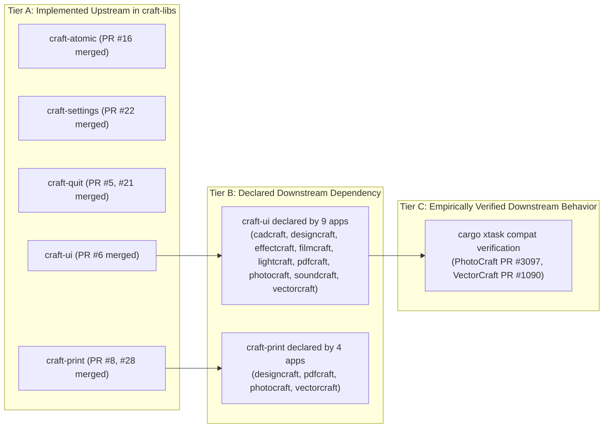
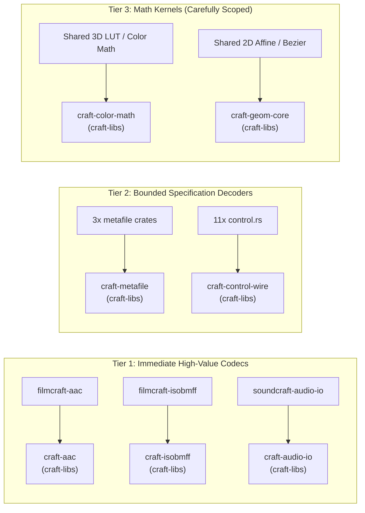

# Craft Ecosystem Crate Audit & Mainline Architectural Alignment

> **Date:** 2026-10-13  
> **Branch:** `crate-audit` (verified synchronized across all 14 repositories at latest `origin/main`)  
> **Scope:** 13 Craft Applications + Shared `craft-libs` (358 member crates across 14 workspace trees in `craft-compat` [351 app crates + 7 shared crates in `craft-libs`])

---

## 1. Executive Summary & Epistemic Framework

All 14 repositories in the Craft ecosystem have been fetched, fast-forwarded to upstream `main`, and checked out or synchronized.

This audit maps the **358 internal crates** across the suite (351 in the 13 applications and 7 in `craft-libs`; an earlier count of 356 dated prior to merging `craft-cms` and `craft-menu`), examines structural alignments and domain-level duplication, and provides an evidence-backed extraction assessment for candidate shared components. For the comprehensive system topology, see [ecosystem-architecture.md](ecosystem-architecture.md).

### 1.1 The Four-Tier Claim Taxonomy
In accordance with suite doctrine (`AGENTS.md` §7), this audit strictly distinguishes between levels of verification:

$$\text{Common Architectural Pattern} \not\equiv \text{Compatible Protocol Surface} \not\equiv \text{Identical Implementation} \not\equiv \text{Empirically Verified Interoperability}$$

* **Common Architectural Pattern**: Re-occurrence of design ideas (e.g. four-tier decoupling, command facades, loopback control servers). Does *not* imply shared code or wire compatibility.
* **Compatible Protocol Surface**: Separate implementations that parse or produce matching JSON schemas or wire formats.
* **Identical Implementation**: Direct code sharing via workspace dependencies or shared crates.
* **Empirically Verified Interoperability**: Proven cross-application behavior verified through executing automated test vectors (e.g. `cargo xtask compat`).

---

## 2. Repository Inventory & Revisions

| Repository | Role | Current Rev | Internal Crates | Declared `craft-libs` Dependencies | Cross-App Dependencies |
| :--- | :--- | :--- | :--- | :--- | :--- |
| **[craft-libs](craft-compat/craft-libs)** | Shared suite primitives | `e9546e1` | 7 | N/A | None |
| **[cadcraft](craft-compat/cadcraft)** | CAD drafting & precision geometry | `00c7613` | 16 | `craft-ui` (`5c874d5`) | None |
| **[deckcraft](craft-compat/deckcraft)** | Slide presentations & animations | `1660982` | 28 | None | None |
| **[designcraft](craft-compat/designcraft)** | Page layout & desktop publishing | `91263c9` | 20 | `craft-ui` (`5c874d5`), `craft-print` (`d991bf6`) | None |
| **[effectcraft](craft-compat/effectcraft)** | Motion graphics & compositing | `470ea7a3` | 36 | `craft-ui` (`5c874d5`) | Consumes **16 crates from FilmCraft** |
| **[figcraft](craft-compat/figcraft)** | Collaborative interface design & prototyping | `e56856f` | 21 | None | None |
| **[filmcraft](craft-compat/filmcraft)** | Non-linear video editing | `5e1ded33` | 54 | `craft-ui` (`5c874d5`) | Upstream provider for `effectcraft` |
| **[gridcraft](craft-compat/gridcraft)** | Spreadsheet & formula calculation | `84acf62` | 16 | None | None |
| **[lightcraft](craft-compat/lightcraft)** | Non-destructive RAW & catalog | `b3d392b4` | 31 | `craft-ui` (`5c874d5`) | None |
| **[pdfcraft](craft-compat/pdfcraft)** | PDF inspection, editing, forms | `e88dd728` | 35 | `craft-ui` (`5c874d5`), `craft-print` (`d991bf6`) | None |
| **[photocraft](craft-compat/photocraft)** | Raster imaging & digital painting | `29f3656f` | 29 | `craft-ui` (`5c874d5`), `craft-print` (`d991bf6`) | None |
| **[soundcraft](craft-compat/soundcraft)** | Digital audio workstation (DAW) | `6cf896e` | 18 | `craft-ui` (`5c874d5`) | None |
| **[vectorcraft](craft-compat/vectorcraft)** | Vector illustration & path geometry | `504e7192` | 27 | `craft-ui` (`5c874d5`), `craft-print` (`d991bf6`) | None |
| **[wordcraft](craft-compat/wordcraft)** | Rich text document processing | `159b84f` | 20 | None | None |

---

## 3. Shared Library Adoption Status & Subsystem Guarantees

### 3.1 Three-Tier Adoption State
To prevent mistaking upstream presence for completed application integration, the suite's shared crates are categorized into three distinct states:



* **`craft-ui`**: Implemented upstream (PR #6 merged) $\to$ Declared downstream by 9 apps (`cadcraft`, `designcraft`, `effectcraft`, `filmcraft`, `lightcraft`, `pdfcraft`, `photocraft`, `soundcraft`, `vectorcraft`) $\to$ Empirically verified in PhotoCraft and VectorCraft via `cargo xtask compat`. Pinned to `5c874d5`, with target migration to coordinated release tag `v0.1.0` (PR #41). DeckCraft and WordCraft maintain standalone UI implementations; `craft-libs` provides the upstream crate.
* **`craft-print`**: Implemented upstream (PR #8, #23, #25, #26, #27, #28 merged, featuring in-process native Windows printing without PowerShell) $\to$ Declared downstream by 4 document apps (`designcraft`, `pdfcraft`, `photocraft`, `vectorcraft`).
* **`craft-atomic`**: Implemented upstream (PR #16 merged). Candidate consumer adoption is active for PhotoCraft, VectorCraft, and LightCraft under qualification gates; PR #43 introduces `WriteOptions` supporting `PlatformDefault` creation permissions (0666 minus umask/ACL) for document/export saves alongside private staging (`0600`).
* **`craft-settings` & `craft-quit`**: Implemented upstream (PR #22, PR #5, PR #21 merged). Bundled in the `v0.1.0` release baseline (PR #41). Downstream integration requires consumer-specific document recovery and multi-window dirty-state testing.

### 3.2 Rigorous Boundaries of Persistence & Lifecycle Guarantees

#### Persistence Guarantees (`craft-atomic`)
* **Syscall Ordering vs Hardware Durability**: The sequence `sync_data < fs::rename < sync_dir` proves correct kernel dispatch and directory entry ordering. It does *not* guarantee survival across unbuffered drive controller cache drop or physical power loss without a battery-backed write cache.
* **New-File Permissions vs Private Staging (PR #43)**: By default, document saves and exports should receive standard platform creation permissions (`0666` minus umask or inherited directory ACLs) while settings and backup files explicitly opt into `Private` (`0600`).
* **Staging File Lifecycle**: Temporary files (`<path>.tmp.<pid>.<counter>`) are ephemeral. If an application process is forcibly killed before rename, orphaned staging files remain on disk and require application-owned recovery cleanup during startup.
* **Caller Intent Differences**:
  * *PhotoCraft*: Requires pre-existing parent directories on Save to prevent unintentional directory synthesis on offline volumes.
  * *LightCraft*: Distinguishes durable catalog metadata (sync required) from high-throughput image export and render caches (sync omitted for I/O throughput).

#### Lifecycle & Termination Guarantees (`craft-quit`)
* **Primitive vs Lifecycle Contract**: `craft-quit` routes platform termination (`-[NSApplication terminate:]` on macOS; `WM_CLOSE` on Windows). It is a native termination *primitive*, not an end-to-end multi-window lifecycle manager.
* **Application Responsibility**: Dirty document confirmation, modal save prompts, active render cancellation, and background thread joins must be owned and verified within each consuming application's UI coordinator.

---

## 4. Universal Architectural Patterns

Every application in the Craft suite adheres to a consistent four-layer structural topology:

```text
Tier 4: Runners         [Desktop: apps/<app>]     [Headless: apps/<app>-cli]     [Browser: apps/<app>-web]
                              │                                │                               │
Tier 3: Presentation          └───► [crates/ui-egui] ◄─────────┴─────────► [Loopback Control / MCP]
                                           │
Tier 2: Façade & Command                   ▼
                                   [crates/engine]  ──► Command Registry (cmd!, CommandSpec, Journal)
                                           │
Tier 1: Substrates            ┌────────────┼────────────┐
                              ▼            ▼            ▼
                        [crates/doc] [crates/render] [crates/format]
```

### 4.1 Structural Pattern Matrix

| Application | Engine Façade (`crates/engine`) | Command Registry (`cmd!`) | Loopback Control (`control.rs`) | Stdio MCP Server | Headless CLI (`apps/<app>-cli`) | Web Runner (`apps/<app>-web`) |
| :--- | :--- | :--- | :--- | :--- | :--- | :--- |
| **CadCraft** | `cadcraft-engine` | Yes (`CommandSpec`) | Yes (`--control`) | Yes (`cadcraft-mcp`) | Yes | Yes (WASM / WebGPU) |
| **DeckCraft** | `deckcraft-engine` | Yes (`CommandSpec`) | Yes (`--control`) | Yes (`deckcraft-mcp`) | Yes | Yes (WASM / WebGPU) |
| **DesignCraft** | `designcraft-engine` | Yes (`CommandSpec`) | Yes (`--control`) | Yes (`designcraft-mcp`) | Yes | Yes (WASM / WebGPU) |
| **EffectCraft** | `effectcraft-engine` | Yes (`CommandSpec`) | Yes (`--control`) | In CLI binary | Yes | Yes (WASM / WebGPU) |
| **FigCraft** | `figcraft-engine` | Yes (`CommandSpec`) | Yes (`--control`) | Yes (`figcraft-mcp`) | Yes | Yes (WASM / WebGPU) |
| **FilmCraft** | `filmcraft-engine` | Yes (`CommandSpec`) | Yes (`--control`) | In CLI binary | Yes | Yes (WASM / WebGPU) |
| **GridCraft** | `gridcraft-engine` | Yes (`CommandSpec`) | Yes (`--control`) | Yes (`gridcraft-mcp`) | Yes | Yes (WASM / WebGPU) |
| **LightCraft** | `lightcraft-engine` | Yes (`CommandSpec`) | Yes (`--control`) | Yes (`lightcraft-mcp`) | Yes | Yes (WASM / WebGPU) |
| **PdfCraft** | `pdfcraft-engine` | Yes (`CommandSpec`) | Yes (`--control`) | In CLI binary | Yes | Yes (WASM / WebGPU) |
| **PhotoCraft** | `photocraft-engine` | Yes (`CommandSpec`) | Yes (`--control`) | `photocraft-automation` | Yes | Yes (WASM / WebGPU) |
| **SoundCraft** | `soundcraft-engine` | Yes (`CommandSpec`) | Yes (`--control`) | `soundcraft-automation` | Yes | Yes (WASM / WebGPU) |
| **VectorCraft** | `vectorcraft-engine` | Yes (`CommandSpec`) | Yes (`--control`) | Yes (`vectorcraft-mcp`) | Yes | Yes (WASM / WebGPU) |
| **WordCraft** | `wordcraft-engine` | Yes (`CommandSpec`) | Yes (`--control`) | Yes (`wordcraft-mcp`) | Yes | Yes (WASM / WebGPU) |

### 4.2 Pattern Similarities vs Contract Variances

While the structural pattern is universal, exact contracts vary by domain:

1. **Command Signatures**:
   * *Structural Match*: Every app uses a `CommandSpec` declaring `id`, `label`, `menu`, `shortcut`, and `params`.
   * *Contract Variance*: The underlying `Session` type is domain-specific. `vectorcraft-engine` operates on `vectorcraft_doc::Document`, while `soundcraft-engine` operates on an audio timeline `soundcraft_model::Session` with real-time audio threads. Parameter schemas differ across apps.
2. **Loopback Wire Protocol**:
   * *Surface Match*: Methods `engine.execute`, `engine.commands`, `ui.screenshot`, and `app.quit` exist across all apps.
   * *Semantic Variance*: Coordinate systems in `ui.click` and `ui.drag` are in egui logical points, but canvas pan/zoom transforms differ between vector canvases (infinite zoom in VectorCraft/CadCraft) and fixed-raster viewports (PhotoCraft/LightCraft).

---

## 5. Evidence-Backed Extraction Assessment for Candidate Crates

A major finding of this audit is that **shared architecture does not imply shared implementation**. Below is an empirical assessment of candidate crates across the ecosystem, evaluating their true commonality versus divergence.

---

### Candidate 1: Audio Encoders & Containers (`filmcraft-aac`, `filmcraft-isobmff` $\to$ `craft-aac`, `craft-isobmff` / SoundCraft)

* **Current Reality**:
  * SoundCraft exports only WAV, AIFF, and FLAC via [`soundcraft-audio-io`](craft-compat/soundcraft/crates/audio-io). Compressed export is tracked as Gap G-21. SoundCraft #53 (resolving #47) explicitly refused `.m4a` and `.aac` to prevent writing uncompressed WAV under compressed extensions.
  * FilmCraft contains an in-tree pure-Rust AAC-LC encoder and decoder in [`filmcraft-aac`](craft-compat/filmcraft/crates/aac).
  * FilmCraft also contains an in-tree pure-Rust MP4/MOV container demuxer and faststart muxer in [`filmcraft-isobmff`](craft-compat/filmcraft/crates/isobmff).
  * EffectCraft imports both `filmcraft-aac` and `filmcraft-isobmff` directly via Git pin.
  * FilmCraft #232 requested standalone codec crates, and FilmCraft #1291 reported missing raw ADTS `.aac` import openers.
* **Extraction Assessment**:
  * **API Compatibility & Verified Capabilities**: High. Empirical source inspection confirms:
    * `filmcraft-aac` implements **both** `Encoder` and `Decoder`.
    * Implements **both** CBR and VBR (quality scale 1.0 to 5.0) via `BitrateMode`.
    * Supports channel configurations from **1 to 8 channels** (Mono, Stereo, 3.0, 4.0, 5.1, 7.1, 8ch).
    * Implements exact priming calculation (`priming_samples(&self) -> u32` = 1024 samples).
    * Operates on 32-bit floating-point planar audio buffers (`Vec<Vec<f32>>` or `AudioBufferRef`), cleanly compatible with `soundcraft-audio-io`.
  * **Empirical Verification**:
    * Ran local test suite: **101 tests passed, 0 failed** across `filmcraft-bitstream` (8), `filmcraft-aac` (31), and `filmcraft-isobmff` (62).
    * Passed FFmpeg oracle decodes, TDAC perfect reconstruction, and fuzz testing against hostile mutated bitstreams.
    * Static audit verified zero `unsafe` blocks.
    * WebAssembly verification: `cargo check --target wasm32-unknown-unknown` passed cleanly in 8.27s.
  * **Container Muxing**: `filmcraft-isobmff` already provides clean-room progressive faststart muxing, AAC AudioSpecificConfig parsing, and edit list (`elst`) priming delay support (`aac_priming_edit` test passing).
  * **Licensing & Clean-Room Provenance**: Dual-licensed MIT/Apache-2.0. Clean-room implementation from ISO/IEC 14496-3 (AAC) and ISO/IEC 14496-12 (ISOBMFF). Zero application dependencies.
  * **Integration Hurdles**:
    * *Sample Rate Support*: High-resolution DAW bounce mixes support sessions up to 192 kHz. AAC-LC limits native sampling to 96 kHz, requiring SoundCraft to integrate sample rate conversion (polyphase 2:1 decimation) before encoding.
* **Recommendation**: **Promote to `craft-libs` as `craft-bitstream`, `craft-aac`, and `craft-isobmff` (or unified `craft-media-enc`)**. Highest ROI item in the ecosystem; immediately unblocks SoundCraft Gap G-21 and decouples EffectCraft.

---

### Candidate 2: Geometry & Vector Math (`<app>-geom`)

* **Current Reality**: Ten separate crates (`cadcraft-geom`, `deckcraft-geom`, `designcraft-geom`, `effectcraft-geom`, `figcraft-geom`, `filmcraft-geom`, `lightcraft-geom`, `pdfcraft-geom`, `photocraft-geom`, `vectorcraft-geom`).
* **Extraction Assessment**:
  * **Divergence Analysis**:
    * **Numerical Precision & Units**:
      * `wordcraft-geom`: Operates on integer twips (1/1440") and EMU (English Metric Units, 1/360,000 cm) to match Office OpenXML without float drift.
      * `cadcraft-geom`: Requires high-precision double-precision floats (`f64`) with strict geometric tolerance factors (`EPSILON = 1e-9`) for CAD intersections.
      * `figcraft-geom`: Uses `kurbo` 2D affine transforms and cubic Bézier paths for responsive canvas rendering.
      * `filmcraft-geom`: Uses subpixel `f32` normalized screen coordinates.
      * `effectcraft-geom`: Requires 3D projective geometry (`Vec3`, `Mat4`) for spatial camera composition.
    * **Coordinate Conventions**: Screen space (top-left origin, Y-down) vs Cartesian CAD space (bottom-left origin, Y-up) vs Page Layout (bleed/slug margins).
* **Recommendation**: **Do NOT prematurely consolidate into a single monolithic `craft-geom`**. The apparent similarity hides incompatible domain invariants. A shared crate should only extract a zero-dependency 2D float primitive core (`Point2<f64>`, `Rect2<f64>`, `Affine2<f64>`), leaving domain units in application layers.

---

### Candidate 3: Color Models & Color Management (`<app>-color`, `craft-cms`)

* **Current Reality**: Nine separate crates (`cadcraft-color`, `deckcraft-color`, `designcraft-color`, `effectcraft-color`, `figcraft-color`, `filmcraft-color`, `lightcraft-color`, `photocraft-color`, `vectorcraft-color`).
* **Extraction Assessment**:
  * **Divergence Analysis**:
    * **Domain Models**:
      * `cadcraft-color`: Implements CAD Index Colors (ACI 1 to 255), TrueColor, and logical `BYLAYER`/`BYBLOCK` pen states.
      * `filmcraft-color`: Implements video broadcast colorimetry (SMPTE Rec.709, Rec.2020, Transfer curves PQ/HLG, full vs legal range).
      * `designcraft-color`: Implements pre-press CMYK separations, spot color names, and Pantone ink tint tables.
      * `photocraft-color`: Implements pixel formats across 8-bit, 16-bit, and 32-bit float channels, including Lab and Duotone.
      * `figcraft-color`: Implements CSS-compatible sRGB, Display P3, and hex/alpha string representations for interface design tokens.
  * **Active Upstream Work**: `aiongg` opened PR #39 (`craft-cms`), extracting PhotoCraft's pure-Rust ICC engine with a built-in FOGRA39 CMYK profile fitted via Yule-Nielsen Neugebauer to resolve DesignCraft CMYK color mismatches (DesignCraft #32, PhotoCraft #3499).
* **Recommendation**: Support `craft-cms` in review; retain domain color models (ACI, broadcast video ranges, spot separations) in their respective applications.

---

### Candidate 4: Windows Metafiles (`deckcraft-metafile`, `vectorcraft-metafile`, `wordcraft-metafile` $\to$ `craft-metafile`)

* **Current Reality**: Three independent parsers for legacy WMF (16-bit) and EMF (32-bit) [MS-WMF / MS-EMF] graphics.
  * VectorCraft contains a production-ready, pure-Rust hand-written EMF/WMF writer and reader in `crates/metafile/`.
  * DeckCraft #327 reports PPTX presentations with `image/x-emf` vector pictures failing to render (drawing grey placeholder boxes on screen and in PDF exports).
  * WordCraft #802 reports missing WMF picture insertion support.
* **Extraction Assessment**:
  * **Commonality**: High. All three parse identical binary specifications ([MS-WMF] and [MS-EMF]) and map GDI records (`META_POLYGON`, `EMR_POLYBEZIER`) into vector path segments and embedded bitmap records.
  * **Divergence**: Minimal. Downstream differences are confined to how the resulting paths are converted into the application's native document nodes.
* **Recommendation**: **Promote VectorCraft's `crates/metafile` to `craft-libs` as `craft-metafile`**. Clean, bounded, specification-driven extraction candidate with zero domain leakage that immediately resolves DeckCraft #327 and WordCraft #802.

---

### Candidate 5: Document Collaboration & Presence (`figcraft-collab`, `figcraft-collab-net`)

* **Current Reality**: FigCraft contains a dedicated in-tree collaborative editing and networking subsystem in `crates/collab` and `crates/collab-net`, implementing clean-room operational transforms / CRDT primitives and WebSocket synchronization for collaborative UI design.
* **Extraction Assessment**:
  * **Relevance to Current RFCs**: Informs the architectural boundary debates on `craft-libs#48` and `#52`.
  * **Layering**: Collaboration engines require strict separation between provider-neutral connection/presence primitives and application document semantics. FigCraft proves that collaborative document state can be modeled cleanly in pure Rust without coupling core engines to external SaaS infrastructure.
* **Recommendation**: Maintain `figcraft-collab` as an authoritative consumer reference when evaluating proposed shared presence and conversation primitives in `craft-libs`.

---

## 6. Strategic Promotion Roadmap & Quality Gate Architecture



### 6.1 Phased Execution Priorities

1. **Tier 1 (Immediate Codecs & Containers)**:
   * Promote `filmcraft-aac` to `craft-aac` and `filmcraft-isobmff` to `craft-isobmff`.
   * Add compressed AAC/M4A export to SoundCraft (`soundcraft-audio-io`), resolving Gap G-21.
   * Decouple EffectCraft's direct cross-repo Git pins into first-class `craft-libs` dependencies.
2. **Tier 2 (Bounded File Parsers & Control Protocols)**:
   * Consolidate EMF/WMF parsing into `craft-metafile`.
   * Standardize the JSON-lines wire protocol parser into `craft-control-wire`.
3. **Tier 3 (Math Kernels)**:
   * Restrict shared geometry and color work to pure, non-opinionated mathematical kernels (`Affine2`, 3D LUT interpolation), strictly respecting application-owned coordinate and color spaces.

### 6.2 The Three-Level Quality Gate Hierarchy

To prevent category errors and ensure reproducible stability, all candidates move through three strict verification levels:

* **Level 1: Crate Qualification (Standup Gates)**:
  Applies to every crate inside `craft-libs`: `cargo fmt --check`, `cargo clippy -- -D warnings`, 100% unit/proptest pass, and zero-error WebAssembly compilation (`cargo check --target wasm32-unknown-unknown`).
* **Level 2: Extraction Qualification (Parity Gates)**:
  Applies when code is decoupled from an application into `craft-libs`: satisfy the **Extraction Provenance Contract** (immutable source commit, stripped application coupling, baseline parity tests, typed domain errors via `thiserror`, and byte-level oracle validation against independent tools like `ffmpeg`).
* **Level 3: Adoption Qualification (Integration Gates)**:
  Applies when downstream consumers switch their dependency pins: verify sample-exact duration/priming compensation, objective audio SNR $> 45$ dB, and zero regressions across consumer test suites via `cargo xtask compat`.
