# Craft Ecosystem: Downstream Consumer Adoption and Integration Guide

> **Author:** Zach Shallbetter  
> **Date:** 2026-10-13  
> **Status:** Downstream Adoption Guide  
> **Target:** 13 Craft Applications Consuming `storytold/craft-libs`  
> **Scope:** Media encoding, vector metafile interchange, and release pin migration  

---

## 1. Multi-Milestone Staging Protocol

To prevent issue tracker noise and review fatigue across consumer application repositories, downstream integration work is organized into sequenced milestones. Each milestone defines strict entry triggers, implementation playbooks, and empirical verification gates:

```mermaid
graph LR
    subgraph M0 ["Milestone 0: Baseline Finalization"]
        direction LR
        M0_1["PR #43 (craft-atomic)<br>Merged into main"] --> M0_2["PR #41 (v0.1.0 Tag)<br>CI clearance confirmed"]
        M0_2 --> M0_3["PR #34 & PR #38<br>Merged/approved"]
    end

    subgraph M1 ["Milestone 1: Media Encoding & Containers"]
        direction LR
        M1_1["craft-media (#92)<br>Consensus & packaging"] --> M1_2["SoundCraft (Gap G-21)<br>M4A/AAC bounce export"]
        M1_2 --> M1_3["FilmCraft (ADTS #1291)<br>& EffectCraft decoupling"]
    end

    subgraph M2 ["Milestone 2: Windows Metafile Sharing"]
        direction LR
        M2_1["craft-metafile<br>Extract from VectorCraft"] --> M2_2["DeckCraft (#327)<br>PPTX EMF rendering"]
        M2_2 --> M2_3["WordCraft (#802)<br>WMF picture insertion"]
    end

    subgraph M3 ["Milestone 3: Release Alignment"]
        direction LR
        M3_1["Tag v0.1.0 Published"] --> M3_2["9-Application Pin Migration<br>Cargo.toml update"]
    end

    M0 --> M1
    M1 --> M2
    M2 --> M3
```



---

## 2. Downstream Media Codec & Container Integrations

### 2.1 SoundCraft: Compressed M4A/AAC Bounce Export (Gap G-21)

* **Target Repository:** `storytold/soundcraft`
* **Anchors & References:** `Refs #47`, `Refs #53`, `Refs #351`, `Refs #393`, `docs/gaps.md` (Gap G-21).
* **Context:** SoundCraft currently exports only to uncompressed and lossless formats (WAV, AIFF, FLAC). In pull request #53 (resolving #47), SoundCraft explicitly rejects compressed format extensions (`.m4a`, `.aac`, `.mp3`) in `file.bounce_mix` and `convert` to prevent writing uncompressed PCM WAV data under a compressed extension. Users mastering tracks or sharing rough mixes require compressed export (Gap G-21).

#### Proposed Integration:

1. **Format Registration:**
   - Register `.m4a` and `.aac` in `soundcraft-audio-io::encode_format_for`.
   - Update `ENCODE_EXTENSIONS` to include `m4a` and `aac`.
2. **Streaming Bounce Pipeline:**
   - Integrate with the chunked bounce architecture in pull request #393 (`grovebit:bounce-streaming`).
   - Feed interleaved 32-bit float audio blocks to the encoder, producing faststart M4A files with `ftyp`, `moov`, and `mdat`.
3. **Sample-Accurate Priming Compensation:**
   - AAC-LC introduces a standard 1024-sample encoder priming delay.
   - Populate the ISOBMFF edit list (`moov/trak/edts/elst`) with an initial media time offset of 1024 samples, ensuring players begin playback with sample accuracy and zero bounce latency (resolving concerns similar to #351).

#### Acceptance Criteria:

- `soundcraft-cli convert mix.wav mix.m4a` produces a valid M4A file readable by standard decoders (ffprobe, QuickTime, VLC).
- `file.bounce_mix` with format `m4a` exports stereo and surround mixes with user-selected bitrates (128 kbps, 256 kbps).
- Encoded M4A audio length matches the original mix timeline duration within 1 sample.

---

### 2.2 FilmCraft: Standalone ADTS Stream Import

* **Target Repository:** `storytold/filmcraft`
* **Anchors & References:** `Closes #1291`, `Refs #232`.
* **Context:** In FilmCraft 0.6.0, importing raw ADTS `.aac` files fails with `unrecognised format` (reported in #1291). While `.m4a` container files import correctly, standalone `.aac` files (including files written by FilmCraft's own Export > AAC Audio) cannot be imported back into the timeline. As analyzed in #1291, `audio::opener` in `crates/codecs/src/audio.rs` only recognizes `mp3 | mp2 | flac | ogg | oga | aif | aiff | aifc`. The required decoding pieces (`adts_split` and `filmcraft_aac::config::split_adts`) exist but are not connected to a standalone file opener.

#### Proposed Integration:

1. Register `aac` in the extension matching list of `audio::opener`.
2. Connect `Decoder::from_adts` to the audio stream reader pipeline.
3. Add content-based header verification to identify raw ADTS synchronization words (`0xFFF`) without falsely matching MPEG audio Layer 1/2/3.
4. Add a regression test importing a raw ADTS `.aac` file generated by `filmcraft-cli export`.

---

### 2.3 EffectCraft: Shared Codec Dependency Decoupling

* **Target Repository:** `storytold/effectcraft`
* **Anchors & References:** `Refs #366`, `Refs #1157`, `Refs storytold/filmcraft#1024`.
* **Context:** EffectCraft currently depends on 16 FilmCraft crates directly via Git pins in `Cargo.toml` (lines 74 to 93), including `filmcraft-aac`, `filmcraft-isobmff`, and `filmcraft-bitstream`. This tight cross-application coupling complicates independent release workflows and causes version drift during updates.

#### Proposed Integration:

1. Replace in-tree FilmCraft codec dependencies with the shared `craft-libs` crates (`craft-media-enc` or `craft-aac`/`craft-isobmff`).
2. Verify composition rendering and audio export against EffectCraft regression benchmarks.
3. Align with the cross-application interoperability initiative tracked in storytold/filmcraft#1024.

---

## 3. Downstream Vector Metafile Interchange Integrations

### 3.1 Shared Metafile Extraction (`craft-metafile`)

* **Target Repository:** `storytold/craft-libs`
* **Anchors & References:** `Refs #2` (Section 7, Document formats and interchange), `Refs storytold/deckcraft#327`, `Refs storytold/wordcraft#802`.
* **Context:** Windows Metafile (WMF) and Enhanced Metafile (EMF) are essential vector interchange formats across office and publishing documents. VectorCraft already contains a production-ready, pure-Rust implementation under `crates/metafile` (`vectorcraft-metafile`):
  - Hand-written EMF and WMF readers and writers.
  - GDI record playback, clipping paths, world transforms, gradient fills, and embedded bitmap extraction.
  - Pure Rust, `#![forbid(unsafe_code)]`, zero panics, and passes all tests under WASM.

Promoting `vectorcraft-metafile` to `craft-metafile` in `craft-libs` provides:
1. `craft-metafile::read`: Parse WMF and EMF records into a renderer-agnostic vector display list (paths, strokes, fills, text, images).
2. `craft-metafile::write`: Generate compliant EMF/WMF streams from vector primitives.
3. Bounded record counts and coordinate transforms to prevent memory exhaustion on corrupted files.

---

### 3.2 DeckCraft: PPTX EMF/WMF Picture Part Rendering

* **Target Repository:** `storytold/deckcraft`
* **Anchors & References:** `Closes #327`.
* **Context:** As reported in #327, presentation files (`.pptx`) containing EMF pictures (`image/x-emf`) render as grey placeholder boxes on screen, in `deckcraft-cli render`, and in PDF export.

#### Proposed Integration:

1. Detect `image/x-emf` and `image/x-wmf` content types in slide picture relationships.
2. Decode the metafile records into vector drawing primitives during slide layout.
3. Render paths and typography directly to the slide canvas and PDF vector stream.
4. Fall back to embedded raster previews if a record stream contains unhandled GDI extensions.
5. Add regression tests using public vector test fixtures (`TestCreatePen.emf`).

---

### 3.3 WordCraft: Standard WMF/EMF Picture Insertion and Retention

* **Target Repository:** `storytold/wordcraft`
* **Anchors & References:** `Closes #802`, `Refs #551`.
* **Context:** Follows up on #802 regarding WMF picture support in WordCraft. Rather than implementing an ad-hoc parser, this wires in `craft-metafile` (extracted from VectorCraft's battle-tested metafile reader).

#### Proposed Integration:

1. Support `.wmf` and `.emf` file insertion via Insert > Picture.
2. Decode vector records for inline and floating picture layout.
3. Retain original metafile bytes in saved `.docx` archives to preserve fidelity when round-tripped with standard office word processors.

---

## 4. Ecosystem Release Pin Migration Guide

### 4.1 Upstream Tag Publication (`v0.1.0`)

With the `v0.1.0` release tag published (tracked in `storytold/craft-libs#41`), downstream applications currently pinned to commit `5c874d51eeb3de70e735c8ce87a59a7dedd47675` can migrate their shared crate dependencies (`craft-ui`, `craft-atomic`, `craft-settings`, `craft-quit`, and `craft-print`) to `tag = "v0.1.0"`.

#### Consumer Migration Matrix:

| Application | Domain | Current Pin | Target Pin | Shared Crates Consumed |
| :--- | :--- | :--- | :--- | :--- |
| **PhotoCraft** | Raster Image Editing | `rev = "5c874d5..."` | `tag = "v0.1.0"` | `craft-ui`, `craft-atomic`, `craft-settings`, `craft-quit`, `craft-print` |
| **VectorCraft** | Vector Illustration | `rev = "5c874d5..."` | `tag = "v0.1.0"` | `craft-ui`, `craft-atomic`, `craft-settings`, `craft-quit`, `craft-print` |
| **DesignCraft** | Page Layout & Desktop Publishing | `rev = "5c874d5..."` | `tag = "v0.1.0"` | `craft-ui`, `craft-atomic`, `craft-settings`, `craft-quit`, `craft-print` |
| **PdfCraft** | PDF Inspection & Document UI | `rev = "5c874d5..."` | `tag = "v0.1.0"` | `craft-ui`, `craft-atomic`, `craft-settings`, `craft-quit`, `craft-print` |
| **LightCraft** | Non-Destructive RAW Grading | `rev = "5c874d5..."` | `tag = "v0.1.0"` | `craft-ui`, `craft-atomic`, `craft-settings`, `craft-quit` |
| **FilmCraft** | Nonlinear Video Editing | `rev = "5c874d5..."` | `tag = "v0.1.0"` | `craft-ui`, `craft-atomic`, `craft-settings`, `craft-quit` |
| **EffectCraft** | Motion Graphics & Compositing | `rev = "5c874d5..."` | `tag = "v0.1.0"` | `craft-ui`, `craft-atomic`, `craft-settings`, `craft-quit` |
| **CADCraft** | 2D/3D CAD Drafting | `rev = "5c874d5..."` | `tag = "v0.1.0"` | `craft-ui`, `craft-atomic`, `craft-settings`, `craft-quit` |
| **SoundCraft** | Digital Audio Workstation | `rev = "5c874d5..."` | `tag = "v0.1.0"` | `craft-ui`, `craft-atomic`, `craft-settings`, `craft-quit` |
| **WordCraft** | Structured Document Authoring | Component adoption | `tag = "v0.1.0"` | `craft-ui` (`ZoomBar`), `craft-atomic`, `craft-settings` |
| **DeckCraft** | Slide Presentations | Component adoption | `tag = "v0.1.0"` | `craft-ui` (`ZoomBar`), `craft-atomic`, `craft-settings` |
| **GridCraft** | High-Performance Spreadsheets | Component adoption | `tag = "v0.1.0"` | `craft-ui` (`ZoomBar`), `craft-atomic`, `craft-settings` |
| **FigCraft** | Collaborative Interface Design | Standalone UI | Optional | `craft-atomic`, `craft-settings` |

---

### 4.2 Application Migration Protocol

For each downstream application, update `Cargo.toml` dependency pins from the git commit hash to the official release tag:

```toml
[dependencies]
craft-ui = { git = "https://github.com/storytold/craft-libs", tag = "v0.1.0" }
craft-atomic = { git = "https://github.com/storytold/craft-libs", tag = "v0.1.0" }
craft-settings = { git = "https://github.com/storytold/craft-libs", tag = "v0.1.0" }
craft-quit = { git = "https://github.com/storytold/craft-libs", tag = "v0.1.0" }
craft-print = { git = "https://github.com/storytold/craft-libs", tag = "v0.1.0" }
```

Then execute dependency resolution and verify the locked workspace build:

```bash
cargo update -p craft-ui
cargo build --locked
cargo test --workspace
```
