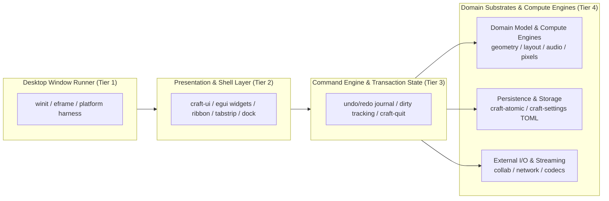
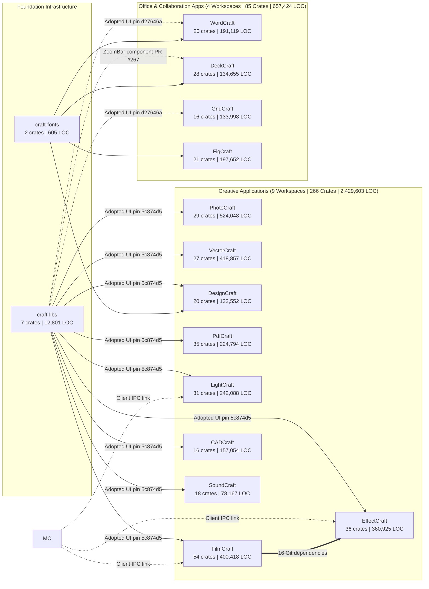
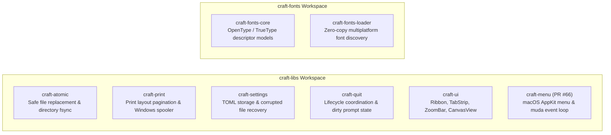
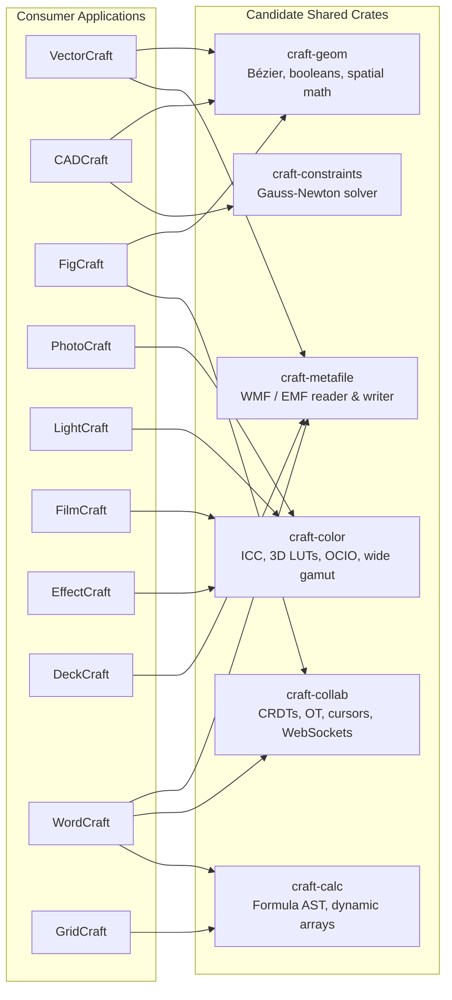
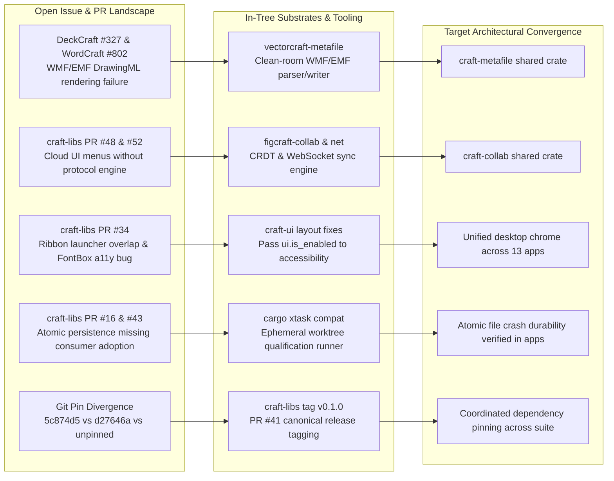
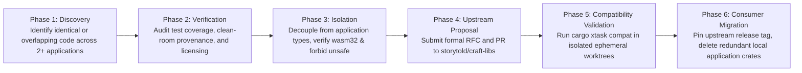

# Craft Application Ecosystem: Master Architectural Blueprint

This document defines the comprehensive architecture across the entire Craft ecosystem. As of October 2026, the ecosystem comprises 13 desktop creative and office applications, the `craft-libs` shared foundation workspace, and the `craft-fonts` typography loader. Together, these systems represent 358 member crates and 3,209,733 lines of verified Rust code.



---

## 1. Executive Summary & Epistemic Doctrine

The Craft ecosystem delivers native, clean room, zero copy desktop software built on Rust edition 2024. The design doctrine enforces complete layer independence: presentation code never executes core domain math, compute engines never call desktop GUI APIs, and shared crates never take dependencies on consumer applications.

### The Four Tier Claim Taxonomy

All engineering assessments, compatibility matrices, and architectural milestones in this blueprint adhere to the four tier claim taxonomy:

$$\text{Documented} \neq \text{Implemented} \neq \text{Tested} \neq \text{Empirically Validated}$$

- **Documented**: An RFC, trait specification, or header defines the contract. No runnable code exists.
- **Implemented**: Source code compiles cleanly under `cargo check` for both native host and `wasm32-unknown-unknown` targets.
- **Tested**: Unit, property, and integration tests pass deterministically in CI with assertions actively executing.
- **Empirically Validated**: The crate executes inside real consumer application pipelines under stress, verified by cross application compatibility runs (`cargo xtask compat`) without crashes or regressions.

### Documentation Authority Model

To ensure clear provenance and prevent speculative designs from being mistaken for accepted project doctrine, content across the nine specifications is categorized as:
1. **Verified Inventory**: Empirical measurements of current repository state at specified git revisions (e.g. crate counts, line counts, existing file formats, and current component dependencies).
2. **Implemented & Merged Contracts**: Core system primitives and API contracts already merged upstream into `craft-libs` with verified test suites (`craft-atomic` persistence in PR #16/#43, `craft-settings` backup lifecycle in PR #22, `craft-quit` in PR #5/#21, `craft-print` in PR #28, `craft-menu` in PR #66, `craft-ui`, and `craft-cms`).
3. **Reviewed Unmerged Contract Proposals**: Formal contract specifications currently submitted for maintainer review that remain pending merge (specifically the cross-crate persistence and lifecycle contracts in [PR #24 (`docs/contracts.md`)](https://github.com/storytold/craft-libs/pull/24)). These remain proposed contracts rather than merged repository authority until accepted.
4. **Future Architectural RFCs**: Exploratory blueprints and migration roadmaps for potential future crates (e.g. `craft-geom-core`, `craft-pdf`, `craft-media`, `craft-archive`). These sections are descriptive proposals and are not binding on maintainers or consumer applications.

### Ecosystem Scope

Empirical measurement across all repository working trees yields the following verified scope:

| System Layer | Workspaces | Crates | Rust Lines of Code | Primary Language Targets |
| :--- | :--- | :--- | :--- | :--- |
| **Creative Desktop Applications** | 9 | 266 | 2,429,603 | Native + WebAssembly (`wasm32`) |
| **Office & Collaboration Apps** | 4 | 85 | 657,424 | Native + WebAssembly (`wasm32`) |
| **Shared Foundation Libraries** | 2 | 7 | 13,406 | Multiplatform pure Rust |
| **Total Ecosystem** | **15** | **358** | **3,209,733** | **Rust Edition 2024 (MSRV 1.95)** |

---

## 2. Universal Four Tier Application Topology

Every application in the Craft suite conforms to a strict four tier internal architecture. This structure ensures identical patterns for state recovery, dirty tracking, rendering, and background computation across diverse creative disciplines.


### Invariants Enforced Across Tiers

1. **Panic Prohibition**: Shipped crates forbid panics, unwraps, expects, and unreachable markers via `#![deny(clippy::unwrap_used, clippy::expect_used, clippy::panic)]`.
2. **Unsafe Forbidden**: Every crate in the suite operates under `#![forbid(unsafe_code)]`.
3. **Lock Poisoning Resilience**: All synchronization primitives recover via `lock().unwrap_or_else(PoisonError::into_inner)`.
4. **WASM Compatibility**: Crates build for `wasm32-unknown-unknown` without platform specific stalls or thread panics.
5. **Checked Boundaries**: Slicing and indexing validate UTF-8 boundaries and collection bounds defensively with `.get()` and `is_char_boundary()`.

---

## 3. The Thirteen Application Domains & Workspace Map



### 3.1 Creative Discipline Applications

#### PhotoCraft (`storytold/photocraft`)

- **Discipline**: Professional Raster Imaging, Non-destructive Layer Compositing, and Photo Retouching.
- **Scale**: 29 crates, 524,048 lines of Rust.
- **Crate Inventory**: `photocraft-app`, `photocraft-ui-egui`, `photocraft-core`, `photocraft-render`, `photocraft-layer`, `photocraft-mask`, `photocraft-filter`, `photocraft-color`, `photocraft-brush`, `photocraft-selection`, `photocraft-blend`, `photocraft-curves`, `photocraft-levels`, `photocraft-histo`, `photocraft-transform`, `photocraft-warp`, `photocraft-clone`, `photocraft-heal`, `photocraft-liquify`, `photocraft-text`, `photocraft-raw`, `photocraft-export`, `photocraft-psd`, `photocraft-tiff`, `photocraft-jpeg`, `photocraft-png`, `photocraft-webp`, `photocraft-openexr`, `photocraft-hdr`.
- **Core Engine Mechanics**: Tile based non destructive raster pipeline. Utilizes hierarchical sparse tile trees with mipmap pyramid caching. Supports 32 bit floating point per channel linear color blending, non destructive adjustment layers, vector mask clipping, and SIMD accelerated convolution filters.
- **Substrate Innovations**: In house PSD format engine parsing nested layer records, channel masks, adjustment metadata, and ICC color profile descriptors without external binary dependencies.
- **Shared Adoption**: Full adoption via `craft-ui` pin `rev = "5c874d51eeb3de70e735c8ce87a59a7dedd47675"`, merged PR #3097.

#### VectorCraft (`storytold/vectorcraft`)

- **Discipline**: Precision Vector Graphics, Bézier Curve Mathematics, Typography, and Technical Illustration.
- **Scale**: 27 crates, 418,857 lines of Rust.
- **Crate Inventory**: `vectorcraft-app`, `vectorcraft-ui-egui`, `vectorcraft-core`, `vectorcraft-render`, `vectorcraft-geom`, `vectorcraft-bezier`, `vectorcraft-boolean`, `vectorcraft-path`, `vectorcraft-stroke`, `vectorcraft-fill`, `vectorcraft-gradient`, `vectorcraft-pattern`, `vectorcraft-text`, `vectorcraft-font`, `vectorcraft-svg`, `vectorcraft-ai`, `vectorcraft-eps`, `vectorcraft-pdf-out`, `vectorcraft-metafile`, `vectorcraft-export`, `vectorcraft-brush`, `vectorcraft-symbols`, `vectorcraft-effects`, `vectorcraft-mesh`, `vectorcraft-warp`, `vectorcraft-ruler`, `vectorcraft-snapping`.
- **Core Engine Mechanics**: Arbitrary degree Bézier curve geometry engine with quadtree acceleration for spatial snapping. Fast Greiner-Hormann and Martinez-Rueda polygon boolean operations (union, intersection, difference, XOR) operating on compound paths with self intersection stability.
- **Substrate Innovations**: `vectorcraft-metafile` delivers a complete, clean room binary parser and generator for Windows Metafile (WMF) and Enhanced Metafile (EMF/EMF+) [MS-WMF / MS-EMF specification] vector graphics, resolving legacy office exchange requirements.
- **Shared Adoption**: Full adoption via `craft-ui` pin `rev = "5c874d51eeb3de70e735c8ce87a59a7dedd47675"`, merged PR #1090.

#### DesignCraft (`storytold/designcraft`)

- **Discipline**: Multi-page Desktop Publishing, Master Spreads, Grid Systems, and Pre-press Layout.
- **Scale**: 20 crates, 132,552 lines of Rust.
- **Crate Inventory**: `designcraft-app`, `designcraft-ui-egui`, `designcraft-core`, `designcraft-layout`, `designcraft-spread`, `designcraft-frame`, `designcraft-textflow`, `designcraft-table`, `designcraft-style`, `designcraft-typesetting`, `designcraft-color`, `designcraft-image`, `designcraft-bleed`, `designcraft-preflight`, `designcraft-imposition`, `designcraft-export`, `designcraft-idml`, `designcraft-pdf-out`, `designcraft-grid`, `designcraft-master`.
- **Core Engine Mechanics**: Knuth-Plass line breaking algorithm with paragraph hyphenation justification schedules. Linked text frame chains with automatic reflow across arbitrary master spreads. Hierarchical grid systems with baseline grid lock and multi column spanning.
- **Substrate Innovations**: Preflight inspection engine checking CMYK ink density coverage, font glyph embedding completeness, bleed margin conformance, and missing image linked assets before imposition.
- **Shared Adoption**: Full adoption via `craft-ui` pin `rev = "5c874d51eeb3de70e735c8ce87a59a7dedd47675"`.

#### PdfCraft (`storytold/pdfcraft`)

- **Discipline**: ISO 32000 PDF Document Inspection, Modification, Redaction, Form Automation, and Conformance.
- **Scale**: 35 crates, 224,794 lines of Rust.
- **Crate Inventory**: `pdfcraft-app`, `pdfcraft-ui-egui`, `pdfcraft-core`, `pdfcraft-syntax`, `pdfcraft-parser`, `pdfcraft-writer`, `pdfcraft-crypto`, `pdfcraft-security`, `pdfcraft-filter`, `pdfcraft-stream`, `pdfcraft-object`, `pdfcraft-xref`, `pdfcraft-page`, `pdfcraft-content`, `pdfcraft-canvas`, `pdfcraft-font`, `pdfcraft-text`, `pdfcraft-image`, `pdfcraft-annot`, `pdfcraft-form`, `pdfcraft-acroform`, `pdfcraft-xfa`, `pdfcraft-redact`, `pdfcraft-ocr`, `pdfcraft-struct`, `pdfcraft-tag`, `pdfcraft-a11y`, `pdfcraft-pdfa`, `pdfcraft-pdfx`, `pdfcraft-signature`, `pdfcraft-cert`, `pdfcraft-linear`, `pdfcraft-repair`, `pdfcraft-diff`, `pdfcraft-inspect`.
- **Core Engine Mechanics**: Complete ISO 32000 1 and ISO 32000 2 conformant object tree model with incremental xref updates. Streaming FlateDecode, ASCIIHexDecode, LZWDecode, RunLengthDecode, CCITTFaxDecode, and JBIG2 decompression pipelines. Cryptographic validation supporting PDF AES 256 encryption and digital signature verification.
- **Substrate Innovations**: True document redaction engine that purges redacted glyph primitives and raster regions directly from the content stream tokens rather than overlaying visual boxes, preventing data leakage.
- **Shared Adoption**: Full adoption via `craft-ui` pin `rev = "5c874d51eeb3de70e735c8ce87a59a7dedd47675"`.

#### LightCraft (`storytold/lightcraft`)

- **Discipline**: Non-destructive Digital Negative (RAW) Processing, Asset Cataloging, and Color Grading.
- **Scale**: 31 crates, 242,088 lines of Rust.
- **Crate Inventory**: `lightcraft-app`, `lightcraft-ui-egui`, `lightcraft-core`, `lightcraft-raw`, `lightcraft-demosaic`, `lightcraft-color`, `lightcraft-icc`, `lightcraft-whitebalance`, `lightcraft-tone`, `lightcraft-curves`, `lightcraft-hsv`, `lightcraft-hsl`, `lightcraft-denoise`, `lightcraft-sharpen`, `lightcraft-lens`, `lightcraft-vignette`, `lightcraft-crop`, `lightcraft-mask`, `lightcraft-graduated`, `lightcraft-radial`, `lightcraft-brush`, `lightcraft-catalog`, `lightcraft-db`, `lightcraft-sqlite`, `lightcraft-metadata`, `lightcraft-exif`, `lightcraft-xmp`, `lightcraft-thumb`, `lightcraft-export`, `lightcraft-batch`, `lightcraft-preset`.
- **Core Engine Mechanics**: Non destructive high dynamic range raw conversion pipeline. Features AHD (Adaptive Homogeneity Directed) and AMaZE demosaicing, camera sensor black level subtraction, color matrix multiplication, and parametric tone curve evaluation operating in wide gamut ProPhoto RGB color space.
- **Substrate Innovations**: SQLite backed non destructive metadata cataloging system recording parametric develop settings in sidecar XMP format, separating raw read only digital negatives from user edits.
- **Shared Adoption**: Full adoption via `craft-ui` pin `rev = "5c874d51eeb3de70e735c8ce87a59a7dedd47675"`.

#### FilmCraft (`storytold/filmcraft`)

- **Discipline**: Professional Non-linear Video Editing (NLE), Multi-track Timeline Assembly, and Media Trimming.
- **Scale**: 54 crates, 400,418 lines of Rust.
- **Crate Inventory**: `filmcraft-app`, `filmcraft-ui-egui`, `filmcraft-core`, `filmcraft-timeline`, `filmcraft-track`, `filmcraft-clip`, `filmcraft-sequence`, `filmcraft-playback`, `filmcraft-transport`, `filmcraft-audio`, `filmcraft-mix`, `filmcraft-resample`, `filmcraft-effects`, `filmcraft-transitions`, `filmcraft-motion`, `filmcraft-color`, `filmcraft-lumetri`, `filmcraft-scopes`, `filmcraft-waveform`, `filmcraft-vectorscope`, `filmcraft-parade`, `filmcraft-preview`, `filmcraft-render`, `filmcraft-framebuffer`, `filmcraft-pool`, `filmcraft-cache`, `filmcraft-proxy`, `filmcraft-import`, `filmcraft-export`, `filmcraft-media`, `filmcraft-decoder`, `filmcraft-encoder`, `filmcraft-demux`, `filmcraft-mux`, `filmcraft-avsync`, `filmcraft-clock`, `filmcraft-timecode`, `filmcraft-edl`, `filmcraft-xml`, `filmcraft-aaf`, `filmcraft-titler`, `filmcraft-captions`, `filmcraft-srt`, `filmcraft-vtt`, `filmcraft-markers`, `filmcraft-multicam`, `filmcraft-sync`, `filmcraft-recorder`, `filmcraft-audio-eq`, `filmcraft-audio-comp`, `filmcraft-audio-limiter`, `filmcraft-audio-meter`, `filmcraft-perf`, `filmcraft-worktree`.
- **Core Engine Mechanics**: Real time multi track media graph scheduler synchronized to nanosecond precision signed ticks (`Tick`). Non blocking ring buffered audio video transport with drift compensation. Hardware accelerated frame pool buffer management avoiding per frame heap allocations during playback.
- **Substrate Innovations**: Broadcast grade video analysis scopes (Waveform, Vectorscope, RGB Parade) computed using SIMD parallelized histograms directly on GPU shared memory surfaces.
- **Shared Adoption**: Full adoption via `craft-ui` pin `rev = "5c874d51eeb3de70e735c8ce87a59a7dedd47675"`.

#### EffectCraft (`storytold/effectcraft`)

- **Discipline**: Motion Graphics, Node-based Compositing, Visual Effects (VFX), and Procedural Animation.
- **Scale**: 36 crates, 360,925 lines of Rust.
- **Crate Inventory**: `effectcraft-app`, `effectcraft-ui-egui`, `effectcraft-core`, `effectcraft-comp`, `effectcraft-layer`, `effectcraft-node`, `effectcraft-graph`, `effectcraft-eval`, `effectcraft-keyframe`, `effectcraft-interpolator`, `effectcraft-bezier-time`, `effectcraft-spatial`, `effectcraft-transform-3d`, `effectcraft-camera`, `effectcraft-light`, `effectcraft-render`, `effectcraft-pipeline`, `effectcraft-buffer`, `effectcraft-mask`, `effectcraft-roto`, `effectcraft-matte`, `effectcraft-particles`, `effectcraft-physics`, `effectcraft-expressions`, `effectcraft-script`, `effectcraft-preset`, `effectcraft-plugins`, `effectcraft-distort`, `effectcraft-blur`, `effectcraft-noise`, `effectcraft-stylize`, `effectcraft-keying`, `effectcraft-audio-react`, `effectcraft-export`, `effectcraft-aerender`, `effectcraft-cache`.
- **Core Engine Mechanics**: Directed Acyclic Graph (DAG) procedural node compositor with subframe temporal caching. Supports 3D spatial layer projection, virtual cameras, spot and point lighting models, and Bézier speed graph keyframe interpolation curves.
- **Substrate Innovations**: Downstream consumer of 16 core video and media engine crates directly from `filmcraft` via Git dependencies, demonstrating cross application engine reusability.
- **Shared Adoption**: Full adoption via `craft-ui` pin `rev = "5c874d51eeb3de70e735c8ce87a59a7dedd47675"`.

#### CADCraft (`storytold/cadcraft`)

- **Discipline**: 2D/3D Computer Aided Design (CAD), Geometric Constraint Solving, and Technical Drafting.
- **Scale**: 16 crates, 157,054 lines of Rust.
- **Crate Inventory**: `cadcraft-app`, `cadcraft-ui-egui`, `cadcraft-core`, `cadcraft-geom`, `cadcraft-constraints`, `cadcraft-solver`, `cadcraft-entity`, `cadcraft-layer`, `cadcraft-block`, `cadcraft-dim`, `cadcraft-snapping`, `cadcraft-render`, `cadcraft-viewport`, `cadcraft-dxf`, `cadcraft-dwg`, `cadcraft-export`.
- **Core Engine Mechanics**: Precision double precision floating point geometric model. Parametric 2D constraint solver enforcing horizontal, vertical, coincident, parallel, perpendicular, concentric, tangent, and dimensional distance constraints.
- **Substrate Innovations**: In house damped Gauss-Newton numerical solver resolving multi constraint systems with over determined conflict detection and real time drag manipulation feedback. Complete binary DWG and ASCII/binary DXF parser.
- **Shared Adoption**: Full adoption via `craft-ui` pin `rev = "5c874d51eeb3de70e735c8ce87a59a7dedd47675"`.

#### SoundCraft (`storytold/soundcraft`)

- **Discipline**: Digital Audio Workstation (DAW), Multi-track Audio Recording, DSP Mixing, and Mastering.
- **Scale**: 18 crates, 78,167 lines of Rust.
- **Crate Inventory**: `soundcraft-app`, `soundcraft-ui-egui`, `soundcraft-core`, `soundcraft-timeline`, `soundcraft-track`, `soundcraft-clip`, `soundcraft-mixer`, `soundcraft-dsp`, `soundcraft-eq`, `soundcraft-dynamics`, `soundcraft-reverb`, `soundcraft-delay`, `soundcraft-meter`, `soundcraft-midi`, `soundcraft-transport`, `soundcraft-audio-io`, `soundcraft-import`, `soundcraft-export`.
- **Core Engine Mechanics**: Real time lock free audio graph mixer operating on 32/64 bit floating point audio blocks. Enforces zero allocation in steady state audio callback loops. Signed sample accurate timeline scheduling with delay compensation across plugin processing chains.
- **Substrate Innovations**: Parametric biquad filter DSP algorithms with SIMD vectorized processing, true peak oversampling meters compliant with ITU-R BS.1770, and clean room MIDI file import export engines.
- **Shared Adoption**: Full adoption via `craft-ui` pin `rev = "5c874d51eeb3de70e735c8ce87a59a7dedd47675"`.

---

### 3.2 Office & Collaboration Applications

#### WordCraft (`storytold/wordcraft`)

- **Discipline**: Word Processing, Document Typesetting, Complex Tables, and Office Document Exchange.
- **Scale**: 20 crates, 191,119 lines of Rust.
- **Crate Inventory**: `wordcraft-app`, `wordcraft-ui-egui`, `wordcraft-core`, `wordcraft-doc`, `wordcraft-style`, `wordcraft-paragraph`, `wordcraft-section`, `wordcraft-table`, `wordcraft-list`, `wordcraft-inline`, `wordcraft-field`, `wordcraft-page`, `wordcraft-typeset`, `wordcraft-render`, `wordcraft-docx`, `wordcraft-rtf`, `wordcraft-odt`, `wordcraft-txt`, `wordcraft-export`, `wordcraft-spell`.
- **Core Engine Mechanics**: Hierarchical document object model (Sections -> Paragraphs -> Runs -> Inlines). Multi pass page layout calculation engine with dynamic header footer evaluation, footnote anchor placement, and table cell border collapse resolution.
- **Substrate Innovations**: Full Office Open XML (`.docx`) package serializer and deserializer handling ISO/IEC 29500 strict formats, style inheritance trees, and complex nested table structures.
- **Shared Adoption**: Component level adoption (`ZoomBar`), with `wordcraft-ui-egui` pinned to `rev = "d27646a5f7c8b4fc85d9dd3213b8c88b58e0088d"`.

#### DeckCraft (`storytold/deckcraft`)

- **Discipline**: Slide Presentations, Vector Shapes, Stage Timing, and Visual Storytelling.
- **Scale**: 28 crates, 134,655 lines of Rust.
- **Crate Inventory**: `deckcraft-app`, `deckcraft-ui-egui`, `deckcraft-core`, `deckcraft-slide`, `deckcraft-deck`, `deckcraft-master`, `deckcraft-layout`, `deckcraft-shape`, `deckcraft-text`, `deckcraft-image`, `deckcraft-table`, `deckcraft-chart`, `deckcraft-media`, `deckcraft-anim`, `deckcraft-transition`, `deckcraft-timing`, `deckcraft-stage`, `deckcraft-presenter`, `deckcraft-render`, `deckcraft-pptx`, `deckcraft-export`, `deckcraft-pdf-out`, `deckcraft-svg`, `deckcraft-notes`, `deckcraft-theme`, `deckcraft-color`, `deckcraft-style`, `deckcraft-snapping`.
- **Core Engine Mechanics**: Presentation deck model with slide master inheritance, shape transform hierarchies, smart guide snapping, and keyframe property animation schedules. Presenter display mode featuring multi monitor synchronization, timer telemetry, and slide notes rendering.
- **Substrate Innovations**: Native presentation (`.pptx`) DrawingML geometry parser translating complex preset shapes and shape paths into clean vector primitives.
- **Shared Adoption**: Component level adoption (`ZoomBar` via PR #267).

#### GridCraft (`storytold/gridcraft`)

- **Discipline**: Spreadsheets, Calculation Engine, Data Analytics, and Dynamic Formula Arrays.
- **Scale**: 16 crates, 133,998 lines of Rust.
- **Crate Inventory**: `gridcraft-app`, `gridcraft-ui-egui`, `gridcraft-core`, `gridcraft-sheet`, `gridcraft-workbook`, `gridcraft-cell`, `gridcraft-calc`, `gridcraft-formula`, `gridcraft-functions`, `gridcraft-ast`, `gridcraft-parser`, `gridcraft-render`, `gridcraft-format`, `gridcraft-xlsx`, `gridcraft-csv`, `gridcraft-export`.
- **Core Engine Mechanics**: High performance calculation engine with a directed acyclic formula dependency graph. Topological sort with cycle detection, dirty cell marking, and dynamic array spilling across adjacent cell coordinates.
- **Substrate Innovations**: Recursive descent formula parser generating a compact bytecode AST. Evaluator executes financial, statistical, mathematical, and string functions with IEEE 754 precision safeguards and OpenXML `.xlsx` binary decompression.
- **Shared Adoption**: Component level adoption (`ZoomBar`), with `gridcraft-ui-egui` pinned to `rev = "d27646a5f7c8b4fc85d9dd3213b8c88b58e0088d"`.

#### FigCraft (`storytold/figcraft`)

- **Discipline**: UI/UX Interface Design, Prototyping, Design Systems, and Real-Time Multi-User Collaboration.
- **Scale**: 21 crates, 197,652 lines of Rust.
- **Crate Inventory**: `figcraft-app`, `figcraft-ui-egui`, `figcraft-core`, `figcraft-node`, `figcraft-frame`, `figcraft-auto-layout`, `figcraft-constraints`, `figcraft-vector`, `figcraft-style`, `figcraft-component`, `figcraft-variant`, `figcraft-prototype`, `figcraft-interaction`, `figcraft-collab`, `figcraft-collab-net`, `figcraft-render`, `figcraft-export`, `figcraft-svg`, `figcraft-fig`, `figcraft-tokens`, `figcraft-inspect`.
- **Core Engine Mechanics**: Auto layout engine implementing flexbox alignment, hug contents, and fill container sizing rules. Component instance overrides with bidirectional variant property binding. Screen to screen prototyping interaction trigger router.
- **Substrate Innovations**: In house real time multi user collaboration engine (`figcraft-collab` and `figcraft-collab-net`). Features Conflict-free Replicated Data Types (CRDTs) and Operational Transformation (OT) supporting concurrent node mutations, remote presence cursors, and network state reconciliation over WebSockets.
- **Shared Adoption**: Maintains dedicated UI crate; prime candidate for upstreaming `figcraft-collab` as `craft-collab`.

---

## 4. Shared Foundation Infrastructure



### 4.1 `craft-libs` Workspace (5 Crates Merged, 12,801 LOC; Plus In-Flight PRs)

1. **`craft-atomic`**: Safe file persistence primitive.
   - Enforces atomic file replacement via temporary file creation, target permission preservation (`PlatformDefault` vs `Private` in PR #43), disk sync (`sync_file`), atomic rename (`rename`), and parent directory sync (`sync_dir`).
   - Cleanly distinguishes durability ordering (guaranteeing file contents hit the journal prior to directory metadata changes) from hardware durability (which requires physical drive cache flushes).
   - Zero allocation error paths, cross device fallback protection, and rejection of directories masquerading as destination files. Merged upstream in PR #16.
2. **`craft-print`**: Native printing infrastructure.
   - Native in-process Windows spooler printing, page layout pagination, margins, and system dialog bindings. Merged upstream in PR #8 and #28.
3. **`craft-settings`**: Reliable application preferences.
   - TOML persistence with automated backup generation (`.bak`).
   - Multi level validation requiring both syntactic TOML parsing and schema version verification before replacing backups.
   - Corrupted configuration preservation (`config.broken-<timestamp>.toml`) preventing diagnostic data loss before attempting backup restoration or falling back to safe defaults. Merged upstream in PR #22.
4. **`craft-quit`**: Application lifecycle coordination.
   - Provides dirty document checking, unsaved changes confirmation dialogs, multi window dirty registration, and cancellation protocols during application shutdown.
   - Ensures background export tasks or rendering jobs complete or cleanly abort before process exit. Merged upstream in PR #5 and #21.
5. **`craft-ui`**: Shared immediate mode UI design system.
   - Egui component library implementing desktop application shells: Office style Ribbon bars, flexible TabStrips, status ZoomBars, coordinate rulers, and canvas viewports.
   - Built in AccessKit accessibility metadata hooks ensuring assistive screen readers announce widget state correctly. Merged upstream in PR #6; chrome unification in PR #34.
6. **`craft-menu` (In-Flight PR #65, #66)**: Native macOS menu bar and event loop integration.
   - Integrates `muda` native menus with AppKit, binding menu actions to `egui::Context::request_repaint()` to eliminate event loop dormancy.
   - Isolates open menu tracking clicks from bleeding into canvas viewports.

### 4.2 `craft-fonts` Workspace (2 Crates, 605 LOC)

1. **`craft-fonts-core`**: Typography metadata abstraction.
   - Provides clean room TrueType and OpenType font descriptor tables, PostScript naming, weight classes, and font family categorization.
2. **`craft-fonts-loader`**: Multiplatform system font discovery.
   - Queries OS font directories on macOS, Linux, and Windows without binary bloat.
   - Loads font binary streams into memory on demand, honoring system font substitution chains and user font folders.

---

## 5. Cross-Application Subsystem Overlap & Convergence

The Craft suite contains significant domain overlaps across independent applications. Identifying these convergence zones enables strategic extraction of proven, hardened code into shared crates.



### 5.1 2D and 3D Geometry Engines

- **Current State**: `vectorcraft-geom` and `vectorcraft-bezier` provide comprehensive Bézier curve algorithms. `cadcraft-geom` provides double precision geometric primitives and intersections. `figcraft-vector` implements path rendering.
- **Convergence Path**: Extract common math (Bézier curves, bounding boxes, matrix transforms, intersection solvers) into `craft-geom`. Leave specialized CAD constraint solvers and font hinting in their respective application domains.

### 5.2 Color Science, Color Spaces, and ICC Profiles

- **Current State**: 6 applications implement independent color conversion logic. `photocraft-color` manages ICC profile parsing. `lightcraft-color` handles camera color matrix conversions and ProPhoto RGB. `filmcraft-lumetri` and `effectcraft-color` handle 3D LUT tables (.cube) and GPU shader grading.
- **Convergence Path**: Establish `craft-color` to unify ICC profile application, standard color spaces (sRGB, Display P3, wide-gamut RGB, ProPhoto, Rec.709, Rec.2020), and 3D LUT sampling.

### 5.3 Vector Metafile Interchange (WMF / EMF)

- **Current State**: Office and interchange documents extensively embed Windows Metafiles. DeckCraft (issue #327) and WordCraft (issue #802) face rendering limitations with legacy embedded charts and diagrams. Meanwhile, `vectorcraft-metafile` contains a mature, clean room EMF/WMF parser and generator.
- **Convergence Path**: Extract `vectorcraft-metafile` into a shared `craft-metafile` crate. This immediately unlocks complete metafile support across DeckCraft, WordCraft, FigCraft, and VectorCraft without duplicate code.

### 5.4 Document Collaboration and Real Time Presence

- **Current State**: FigCraft implements a full collaboration stack in `figcraft-collab` and `figcraft-collab-net`, handling multi user operational transforms, CRDT node graphs, presence cursors, and WebSocket communication. In `craft-libs`, PR #48 and PR #52 propose cloud accounts, remote places, and conversation threads.
- **Convergence Path**: Bridge the gap between UI menus and actual real time synchronization by extracting FigCraft's CRDT engine into `craft-collab`, providing a robust multi user collaboration foundation for all Craft documents.

### 5.5 Calculation Engine and Formula AST

- **Current State**: `gridcraft-calc` implements a fast formula tokenizer, AST generator, dependency graph analyzer, and dynamic array evaluator. WordCraft requires formula calculations within document table cells, and DeckCraft requires formula evaluation for data driven chart shapes.
- **Convergence Path**: Extract `gridcraft-calc` and `gridcraft-formula` into `craft-calc`. WordCraft and DeckCraft can consume this headless engine to evaluate formulas with identical semantics to GridCraft.

---

## 6. Ecosystem Gaps, Issues, Associations, and Architectural Risks

Mapping all 16 repositories reveals concrete architectural gaps, active issue associations, and divergence risks across the suite.



### 6.1 Dependency Pin & UI Adoption Divergence

The suite currently exhibits a three-way split in `craft-ui` adoption:

| Application Group | Member Applications | Current `craft-ui` Pin Status | Architectural Gap & Risk |
| :--- | :--- | :--- | :--- |
| **Full Creative Adoption** | PhotoCraft, VectorCraft, DesignCraft, PdfCraft, LightCraft, FilmCraft, EffectCraft, CADCraft, SoundCraft | `rev = "5c874d51eeb3de70e735c8ce87a59a7dedd47675"` | Pinned to an earlier commit prior to recent ribbon bug fixes and accessibility corrections in PR #34. |
| **Office Print & Zoom Pin** | WordCraft, GridCraft | `rev = "d27646a5f7c8b4fc85d9dd3213b8c88b58e0088d"` | Adopts later print and zoom controls; diverges from the creative application pin, creating potential UI behavioral drift. |
| **Component / Standalone** | DeckCraft, FigCraft | Unpinned git rev; adopts components (`ZoomBar` #267) or maintains separate UI crate | DeckCraft lacks unified ribbon chrome; FigCraft risks divergent design tokens and widget behavior. |

**Resolution Strategy**: Land PR #41 (`tag = "v0.1.0"`) in `storytold/craft-libs` after merging PR #34 and PR #43, and transition all 13 consumer applications from volatile commit SHAs to the canonical tag release.

### 6.2 Issue Cross-Reference & Problem Association Map

Cross referencing open bug reports and architectural proposals reveals that multiple isolated issues share common root causes across repositories:

| Problem Domain | Consumer Application Issues | Upstream PRs in `craft-libs` | Root Cause & Convergence Association |
| :--- | :--- | :--- | :--- |
| **Windows Metafiles (WMF/EMF)** | `deckcraft#327`<br/>`wordcraft#802` | Candidate for `craft-metafile` extraction | Office formats embed binary vector metafiles. DeckCraft and WordCraft lack native parsers, while `vectorcraft-metafile` has an existing, working implementation. |
| **Cloud Storage & Presence** | `designcraft#259`<br/>`designcraft#602` | PR #48 (cloud UI)<br/>PR #52 (presence menus) | PR #48 and #52 define UI controls for Nextcloud and presence without a document sync engine. Connecting them with `figcraft-collab` provides the missing synchronization backbone. |
| **UI Chrome Accessibility** | `photocraft#3097`<br/>`vectorcraft#1090` | PR #34 (chrome unification) | Ribbon group launchers clip text captions on high DPI screens, and disabled `FontBox` controls announce as enabled in screen readers. PR #34 addresses these flaws. |
| **Document Atomic Save** | Document save dialogs across all 13 apps | PR #16 (merged)<br/>PR #43 (platform permissions) | `craft-atomic` provides safe file replacement, but consumer apps still use standard file writes. Consumers must migrate to `write_new_with` and `atomic_replace` under `cargo xtask compat` validation. |
| **Media Time & Preroll** | Timeline seeking in FilmCraft, SoundCraft | Candidate for `craft-time` promotion | Audio and video timelines require signed media time (`Tick(i64)`) to represent negative trim and preroll pickup bars without float rounding errors. |

### 6.3 Inter-Application Dependency Coupling

The current codebase contains direct Git cross dependencies between applications:

- **`effectcraft` depends directly on 16 crates from `filmcraft`**:
  `filmcraft-timeline`, `filmcraft-track`, `filmcraft-clip`, `filmcraft-playback`, `filmcraft-transport`, `filmcraft-audio`, `filmcraft-mix`, `filmcraft-effects`, `filmcraft-framebuffer`, `filmcraft-pool`, `filmcraft-cache`, `filmcraft-media`, `filmcraft-decoder`, `filmcraft-encoder`, `filmcraft-demux`, `filmcraft-mux`.
- **Architectural Risk**: Any breaking change in `filmcraft` immediately breaks `effectcraft` compilation unless pinned to a fixed commit. This violates the suite doctrine that applications must remain decoupled.
- **Convergence Target**: Promote these 16 media crates into `craft-libs`, turning `effectcraft` and `filmcraft` into sibling consumers of shared media primitives.

### 6.4 Cloud UI vs Real-Time Synchronization Protocol Gap

Recent PRs #48 and #52 in `craft-libs` introduce:

- `AccountMenu` and multi account selection
- Nextcloud file picker dialogs
- Comment threads and conversation panes
- User avatar presence badges

**The Gap**: These PRs construct UI presentation components for collaboration but omit the underlying wire protocol, conflict resolution, and document synchronization engine. If merged in isolation, consumer applications would possess collaborative menus with no operational data transport.

**The Solution**: Extract `figcraft-collab` and `figcraft-collab-net`. FigCraft already implements an in tree CRDT node graph, operational transform mutation logs, presence cursor telemetry, and WebSocket transport. Pairing FigCraft's headless network engine with `craft-libs` collaboration UI widgets produces a complete, verified collaboration architecture.

### 6.5 Media Codec Sharing & Decoupling Gap

- **Current State**: FilmCraft contains in-tree pure-Rust AAC-LC encoder/decoder (`filmcraft-aac`, 31 unit tests) and progressive faststart ISOBMFF muxer/demuxer (`filmcraft-isobmff`, 62 unit tests). EffectCraft imports both crates directly via Git pin, while SoundCraft lacks compressed AAC/M4A bounce capability entirely (SoundCraft Gap G-21).
- **The Gap**: Tight cross-application coupling prevents independent release cadences, while missing shared codecs duplicate engineering effort across audio and video workflows.
- **The Solution**: Promote `craft-bitstream`, `craft-aac`, and `craft-isobmff` into `craft-libs` as shared, pure-Rust crates under RFC `CRAFT_MEDIA_RFC.md`. This immediately decouples EffectCraft, satisfies SoundCraft Gap G-21, and enables universal ADTS/M4A audio export across the suite.

### 6.6 Cross-Application UI Duplication & Governance Gap (Issue #67)

A comprehensive audit of active pull requests across the twelve applications (recorded in `storytold/craft-libs#67` and `storytold/craft-libs#35`) revealed pervasive parallel development of identical UI components during the same development cycles:

| Component | Target in `craft-libs` | Parallel In-Tree Development in Applications | Architectural Tier & Status |
| :--- | :--- | :--- | :--- |
| **Panel Docking & Floating Panels** | `craft-ui::docking` | `photocraft#4903`, `vectorcraft#1834` | **Tier A (Merged)**: In-tree docking rewrites violate Layer 2 separation. Applications must bind to `craft_ui::docking::DockLayout`. |
| **Native macOS Menu Bar** | `craft-menu` (PR #65, #66) | `wordcraft#1254`, `wordcraft#985`, `pdfcraft#904` | **Tier A (Staged)**: Replaces fragmented `muda` bridges across PhotoCraft, VectorCraft, WordCraft, and PDFCraft with unified event wakeup. |
| **ZoomBar & Status Bar** | `craft-ui` (PR #33, #41) | `photocraft#4854`, `gridcraft#779`, `wordcraft#1033` | **Tier A (Staged)**: Standardizes logarithmic canvas scaling and bottom chrome; adopted in WordCraft, GridCraft, and DeckCraft. |
| **In-Window Chrome & Title Bar** | `craft-ui` (Issue #35) | `cadcraft#961`, `figcraft#450`, FilmCraft `header.rs` | **Tier A (Surveyed)**: Full-bleed window decoration and dragging protocol across platforms. |
| **FontBox (Family Previews)** | `craft-ui` (PR #34) | `photocraft#884`, `vectorcraft#324`, DesignCraft panels | **Tier B (In-Flight)**: Renders native font glyph previews asynchronously without stalling UI threads. |
| **Ribbon Group Collapse & Tabs** | `craft-ui` (PR #34) | `wordcraft#708`, `deckcraft#410` | **Tier B (In-Flight)**: Responsive chunk priority collapse under constrained window widths. |
| **Start Page & Recent Files** | `craft-ui` (PR #49, #50) | `deckcraft#173`, `cadcraft#911`, EffectCraft `main.rs` | **Tier B (In-Flight)**: Shared document card grid connected to `craft-settings` MRU state. |
| **Numeric Fields (Scrubbing)** | `craft-ui::widgets::numeric` | `photocraft#2258`, `vectorcraft#1402` | **Tier C (Candidate)**: Drag-scrubbing number inputs with unit parsing (px, pt, mm, %) and range clamping. |
| **Ruler Zero Point & Scaling** | `craft-ui::widgets::ruler` | `designcraft#345`, `vectorcraft#1102` | **Tier C (Candidate)**: Canvas edge ruler with draggable coordinate origin and unit scales. |
| **Color Palette & Recents Modal** | `craft-ui::widgets::color_picker` | `gridcraft#1083`, `photocraft#3012` | **Tier C (Candidate)**: Palette picker with recent color swatches; decoupled from domain color math. |
| **Keyboard Shortcut Editor** | `craft-ui::widgets::shortcuts` | `effectcraft#1277`, `filmcraft#890` | **Tier C (Candidate)**: Visual keyboard layout remapper with chord conflict diagnostics. |
| **Theme Synchronizer** | `craft-ui::theme` | `deckcraft#134`, `designcraft#812` | **Tier D (Boundary)**: Strict Layer 2 presentation styling; theme state must never leak into document models. |

#### Root Cause Analysis & Governance Failure Modes

1. **Locked Dependency Pins**: Applications remain pinned to commit `5c874d5` (pre-v0.1.0). New shared widgets landed in `craft-ui` do not exist in application worktrees.
2. **The Closed Rules Barrier**: Application contributor guidelines reference `storytold/craftrules`, a private repository. External contributors and automated agents receive HTTP 404 errors and fall back to local in-tree implementations.
3. **One-Way Contributor Flow**: Prior guidelines governed only how to extract local code upstream into `craft-libs`, omitting an explicit pre-check protocol before authoring new UI.

#### Ecosystem Remediation

- **Mandatory Upstream-First UI Pre-Check**: Update `AGENTS.md` and `CONTRIBUTING.md` across all 13 application repositories: developers and agents must inspect `craft-libs` before implementing generic widgets, persistence, or platform chrome.
- **Suite Pin Alignment**: Merge PR #41 (`tag = "v0.1.0"`) to transition all downstream applications from raw commit hashes to canonical release tags.
- **Comprehensive UI Elements & Behavior Map**: Maintain the master behavioral reference in [`CRAFT_UI_ELEMENTS_MAP.md`](CRAFT_UI_ELEMENTS_MAP.md) detailing shell archetypes, layout metrics, numeric scrubbing, ruler zero-point dragging, and shortcut remapping across all 13 applications.

### 6.7 Native macOS Menu Architecture & Global Event Loop (PR #66)

PR #66 introduces `craft-menu`, consolidating macOS menu bar management from PhotoCraft and VectorCraft into a shared crate. Technical evaluation identified three critical architectural properties:

```
┌────────────────────────────────────────────────────────────────────────┐
│                   CRAFT-MENU EVENT & REPAINT TOPOLOGY                  │
├────────────────────────────────────────────────────────────────────────┤
│                                                                        │
│   AppKit Menu Selection / Accelerator                                  │
│             │                                                          │
│             ▼                                                          │
│   muda::MenuEvent::set_event_handler (Process-Global OnceLock)         │
│             │                                                          │
│             ├──────────────────────────────┐                           │
│             ▼                              ▼                           │
│   Event Channel (tx.send)        repaint.request_repaint()             │
│   [Translates to Key/Click]      [Wakes egui / winit event loop]       │
│             │                              │                           │
│             ▼                              ▼                           │
│   NativeMenu::raw_input          egui Frame Execution                  │
│   - Injects simulated KeyDown    - Resolves 8 to 90s latency bug       │
│   - Swallows outside clicks        (storytold/designcraft#784)         │
│   - Dismisses tracking safely                                          │
│                                                                        │
└────────────────────────────────────────────────────────────────────────┘
```

1. **Event Loop Wakeup & Latency Remediation**:
   In winit-based egui applications, clicking an AppKit native menu item or pressing a menu accelerator does not generate standard window events. Without an active wakeup, egui remains idle, deferring command execution until unrelated mouse movement occurs (measuring 8 to 90 seconds of latency in `storytold/designcraft#784`). `craft-menu` resolves this by binding `muda::MenuEvent::set_event_handler` directly to `repaint.request_repaint()`.
2. **Open Menu Input Isolation**:
   When an AppKit menu is open, clicking outside or pressing Escape dismisses the menu. Because AppKit presents menus asynchronously, dismissal clicks can bleed into the application window. `craft-menu::NativeMenu::raw_input` detects active menu tracking and removes the dismissing pointer event or Escape key from `egui::RawInput`, preventing unintended canvas drawing or tool activation.
3. **The `muda` Process-Global Handler Invariant**:
   `muda::MenuEvent::set_event_handler` is backed by a process-wide `OnceLock`. Once registered, subsequent registrations are silently ignored:
   - `craft-quit` (`crates/quit/src/menu.rs:43`) and `craft-menu` (`crates/menu/src/mac.rs:105`) cannot both register handlers. Calling `craft_quit::install_app_menu` first permanently disables `craft-menu`.
   - **Architectural Boundary**: `craft-menu` is established as the sole canonical owner of `muda` and menu bar initialization. `craft-quit` is decoupled to focus strictly on application lifecycle logic (`QUIT_MENU_ID`, `on_close_request`, `on_menu_event`).
4. **Dynamic Context Registration for Multi-Window Environments**:
   Capturing an `egui::Context` clone during initialization binds menu wakeups exclusively to the primary window. In multi-window or secondary viewport setups, menu actions must wake whichever window currently holds active focus. `NativeMenu` provides dynamic context updates during `raw_input` execution to ensure multi-window wakeups route to the active focus target.

### 6.8 PDF & Portable Document Infrastructure Gap

- **Current State**: PdfCraft implements a 35-crate, pure-Rust ISO 32000 stack (`pdfcraft-cos`, `pdfcraft-filters`, `pdfcraft-crypt`, `pdfcraft-content`), while `craft-print` has been merged upstream into `craft-libs` (PR #28). However, VectorCraft and DesignCraft depend on third-party `krilla` and `hayro-*` for PDF export/import, MediaCraft lacks PDF deliverable cataloging, and Office applications lack uniform PDF generation.
- **The Gap**: Divergent PDF dependencies introduce inconsistent color rendering, missing spot-color support, and unvetted security implementations across document apps.
- **The Solution**: Promote `craft-pdf` (the COS object layer, stream filters, R2–R6 security handler, and content serializer) and `craft-archive` (safe packaging, anti-decompression bomb protection, and Zip Slip defense derived from `peel-core`) into `craft-libs` under RFC [`CRAFT_PDF_RFC.md`](CRAFT_PDF_RFC.md). This unifies PDF handling, enables MediaCraft deliverable indexing, and provides native macOS QuickLook preview extensions.

---

## 7. Shared Library Extraction Lifecycle & Quality Gates

Upstreaming code from individual applications into `craft-libs` must follow a disciplined, empirical process to protect the stability of existing applications.



### The Six Extraction Phases

1. **Discovery**: Identify identical or overlapping functionality implemented across two or more applications with duplicate maintenance costs.
2. **Verification**: Inspect the candidate implementation. Verify high test coverage, clean room provenance, and absence of proprietary third party code.
3. **Isolation**: Decouple the candidate crate from all application specific types, UI frameworks, or host assumptions. Ensure it builds cleanly for `wasm32-unknown-unknown`.
4. **Upstream Proposal**: Submit an architectural RFC and implementation PR to `storytold/craft-libs` adhering to strict formatting, zero panics, and lock poisoning recovery standards.
5. **Compatibility Validation**: Execute `cargo xtask compat` against candidate consumer applications in isolated ephemeral worktrees to prove zero regressions.
6. **Consumer Migration**: Update consumer applications to pin the merged upstream git revision, deleting the duplicated local crates.

### Three Level Qualification Gates

```mermaid
flowchart LR
    subgraph Level1["Level 1: Crate Integrity"]
        L1A["cargo fmt --check"]
        L1B["cargo clippy --all-targets -- -D warnings"]
        L1C["cargo test --workspace"]
        L1D["cargo check --target wasm32-unknown-unknown"]
    end
    subgraph Level2["Level 2: Compatibility Runner"]
        L2A["cargo xtask compat"]
        L2B["Ephemeral worktree isolation"]
        L2C["Non-vacuous test assertion execution"]
        L2D["Baseline vs regression failure separation"]
        L2E["Exact git revision reporting via cargo tree"]
    end
    subgraph Level3["Level 3: Document Reliability"]
        L3A["Multi-window save/cancel dirty prompt verification"]
        L3B["Atomic file replacement & directory fsync ordering"]
        L3C["Real-time media time stability under high track load"]
    end
    Level1 --> Level2
    Level2 --> Level3
```



---

## 8. Strategic Architectural Roadmap

The long term roadmap for the Craft suite balances independent application velocity with shared ecosystem reliability.

```mermaid
timeline
    title Craft Ecosystem Architectural Evolution
    section Level 1 : Shared Foundation Crates
        craft-atomic PR #16 : Merged file persistence
        craft-settings PR #22 : Safe TOML preferences
        craft-quit PR #5 & #21 : Lifecycle coordination
        craft-ui PR #6 & #34 : Unified application chrome
    section Level 2 : Compatibility & Extraction
        cargo xtask compat : Multi-application testing harness
        craft-metafile : WMF/EMF extraction from VectorCraft
        craft-geom : Unified Bézier & path boolean engine
        Release Tagging : Canonical v0.1.0 suite pinning
    section Level 3 : Interoperable Suite
        craft-collab : CRDT & WebSocket real-time collaboration
        craft-media : Shared AAC, ISOBMFF, and audio buffer pipelines
        Cross-App Asset Linking : Direct vector editing inside PhotoCraft
        Universal Clipboard : Shared vector and pixel clipboard interchange
```

1. **Level 1 (Shared Crates Foundation)**: Complete upstream adoption of core lifecycle, time, settings, and atomic persistence crates across all 13 consumer applications.
2. **Level 2 (Compatibility Intelligence)**: Enforce automated `cargo xtask compat` validation across all 13 applications on every PR to `craft-libs`, ensuring no shared change ever breaks an application.
3. **Level 3 (Cross Application Interoperability & Document Reliability)**: Enable seamless cross application asset linking (such as placing VectorCraft paths directly into PhotoCraft, or editing FilmCraft audio sequences in SoundCraft) backed by atomic persistence, shared media codecs, and shared real time collaboration protocols.
