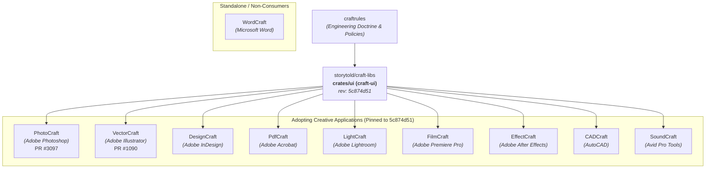
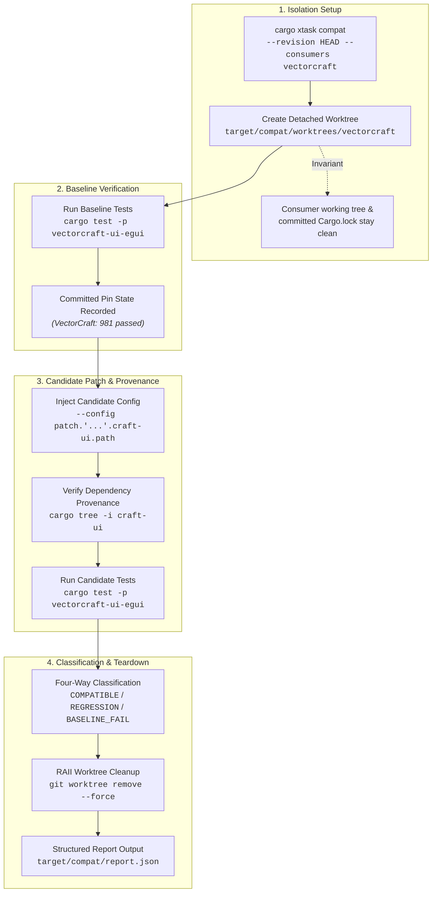

# Craft suite ecosystem inventory & compatibility architecture

This document records the ecosystem architecture, contributor conventions, toolchain baselines, and validation strategy for cross-application compatibility testing across the Craft application suite.

---

## 1. Ecosystem Map: Repositories, shared libraries, and consumers

The Storytold Craft suite operates as a coordinated creative software ecosystem. As of October 2026, nine creative applications have merged shared UI integrations adopting `craft-ui` pinned to revision `5c874d51eeb3de70e735c8ce87a59a7dedd47675`.



### Dependency inventory

| Application | Target product | Application role | `craft-ui` adoption status | Pinned revision (`craft-libs`) | Active features | Primary integration crate |
| :--- | :--- | :--- | :--- | :--- | :--- | :--- |
| **PhotoCraft** | Adobe Photoshop | Image editing, compositing, color, formats | Adopted (PR #3097 merged) | [`5c874d51eeb3`](https://github.com/storytold/craft-libs/commit/5c874d51eeb3de70e735c8ce87a59a7dedd47675) | `["serde"]` | `photocraft-ui-egui` |
| **VectorCraft** | Adobe Illustrator | Vector illustration, geometry, typography | Adopted (PR #1090 merged) | [`5c874d51eeb3`](https://github.com/storytold/craft-libs/commit/5c874d51eeb3de70e735c8ce87a59a7dedd47675) | `["serde"]` | `vectorcraft-ui-egui` |
| **DesignCraft** | Adobe InDesign | Page layout, typography, document UI | Adopted | [`5c874d51eeb3`](https://github.com/storytold/craft-libs/commit/5c874d51eeb3de70e735c8ce87a59a7dedd47675) | `["serde"]` | `designcraft-ui-egui` |
| **PdfCraft** | Adobe Acrobat | PDF inspection, document utility | Adopted | [`5c874d51eeb3`](https://github.com/storytold/craft-libs/commit/5c874d51eeb3de70e735c8ce87a59a7dedd47675) | `["serde"]` | `pdfcraft-ui-egui` |
| **LightCraft** | Adobe Lightroom | RAW image processing, non-destructive color | Adopted | [`5c874d51eeb3`](https://github.com/storytold/craft-libs/commit/5c874d51eeb3de70e735c8ce87a59a7dedd47675) | `["serde"]` | `lightcraft-ui-egui` |
| **FilmCraft** | Adobe Premiere Pro | Video editing, timeline, media playback UI | Adopted | [`5c874d51eeb3`](https://github.com/storytold/craft-libs/commit/5c874d51eeb3de70e735c8ce87a59a7dedd47675) | `["serde"]` | `filmcraft-ui-egui` |
| **EffectCraft** | Adobe After Effects | Motion graphics, visual effects, compositing | Adopted | [`5c874d51eeb3`](https://github.com/storytold/craft-libs/commit/5c874d51eeb3de70e735c8ce87a59a7dedd47675) | `["serde"]` | `effectcraft-ui-egui` |
| **CADCraft** | AutoCAD | CAD drafting, precision technical geometry | Adopted | [`5c874d51eeb3`](https://github.com/storytold/craft-libs/commit/5c874d51eeb3de70e735c8ce87a59a7dedd47675) | `["serde"]` | `cadcraft-ui-egui` |
| **SoundCraft** | Avid Pro Tools | Digital audio workstation, timing, tracks | Adopted | [`5c874d51eeb3`](https://github.com/storytold/craft-libs/commit/5c874d51eeb3de70e735c8ce87a59a7dedd47675) | `["serde"]` | `soundcraft-ui-egui` |
| **WordCraft** | Microsoft Word | Rich text processing, layout | Not currently consuming `craft-ui` | None | None | None |

> [!NOTE]
> **Revision Delta**: All nine adopting applications are currently pinned to commit [`5c874d51eeb3`](https://github.com/storytold/craft-libs/commit/5c874d51eeb3de70e735c8ce87a59a7dedd47675) (*"UI.8: shape dock action labels with logical accessibility"*). The default branch (`main`) of `craft-libs` is at [`af2b0918d2c5`](https://github.com/storytold/craft-libs/commit/af2b0918d2c5) (*PR #6 merge*). Compatibility validation verifies that candidate commits on `craft-libs` maintain source and binary compatibility across consumers before applications bump their pins.

---

## 2. Contribution Map: Maintainers, standards, and workflow patterns

The Craft suite operates across three clear architectural layers:

1. **`craftrules`**: High-level engineering doctrines (licensing, clean-room policy, never-crash guarantees).
2. **`craft-libs`**: Shared, application-agnostic Rust library crates. Shared crates must be useful to multiple applications and **must not depend on any application crate**.
3. **Application repositories**: Product features, user interaction, command dispatch, and document engines.

### Community & Review Patterns
- **Active review paths**: Core shared UI extractions and cross-app rollouts are led by Skylar Taylor (`skylart`), with ecosystem coordination, release management, and PR approvals regularly handled by `echelon`.
- **Contribution style**: Small, incremental extractions with concrete reference implementations and headless test coverage (demonstrated in `craft-libs#6`, `photocraft#3097`, and `vectorcraft#1090`).
- **Strict safety non-negotiables**:
  - Unsafe code is forbidden across workspaces (`unsafe_code = "forbid"`).
  - Production code denies all panicking constructs:
    ```rust
    #![deny(clippy::unwrap_used, clippy::expect_used, clippy::panic, clippy::unimplemented, clippy::todo, clippy::unreachable)]
    ```
  - Dual-licensed MIT OR Apache-2.0. Clean-room implementation only.

---

## 3. CI Baseline: Toolchains, quality gates, and failure analysis

### Toolchain comparison matrix

| Dimension | `craft-libs` | `photocraft` | `vectorcraft` |
| :--- | :--- | :--- | :--- |
| **Default branch commit** | `af2b0918d2c5` | `97136485ff7f` | `389f75fa7be3` |
| **Rust toolchain** | 2024 edition, MSRV 1.95 | 2024 edition, MSRV 1.95 | 2024 edition, MSRV 1.95 |
| **Cargo resolver** | 3 | 3 | 3 |
| **GUI backend** | `egui = "0.36"` | `egui = "0.36"` | `egui = "0.36"` |
| **Consuming crate** | Source provider (`crates/ui`) | `crates/ui-egui` | `crates/ui-egui` |
| **Authoritative verification** | `cargo xtask ci`<br>Targeted: `cargo test --workspace` | `cargo xtask ci`<br>Targeted: `cargo test -p photocraft-ui-egui` | `cargo xtask ci`<br>Targeted: `cargo test -p vectorcraft-ui-egui` |
| **Committed lockfile policy** | Committed in repository | Committed in repository | Committed in repository |

### The validation blind spot & failure model

Before this work, the ecosystem had a distinct gap in its test coverage:
1. `craft-libs` on `origin/main` has no cross-repository CI workflows. Its internal tests exercise only `craft-ui` in isolation.
2. Downstream applications (`photocraft`, `vectorcraft`) test only their pinned Git revision (`5c874d51`).
3. **When `craft-libs` changes, downstream CI does not trigger.**

**The smallest realistic failure**:
- Adding a required field to a docking layout struct (such as `Floating`), altering an enum variant in `Zone` or `Action`, or tightening `Layout::validate()`.
- **Result in existing CI**: `craft-libs` tests pass internally. Downstream application CI remains green because it never runs against unmerged `craft-libs` commits. The failure remains latent until days or weeks later when an application engineer attempts to bump the pin, at which point downstream compilation or layout tests fail.

---

## 4. Compatibility Plan: First consumers, implementation, and validation strategy

### Recommended first consumers
PhotoCraft and VectorCraft were chosen as the initial validation pair because:
1. Both have merged `craft-ui` integrations pinned to the exact same revision (`5c874d51`).
2. Both enforce identical Rust 2024 toolchain and MSRV 1.95 requirements.
3. Both have headless, deterministic UI test suites (`photocraft-ui-egui`, `vectorcraft-ui-egui`) that run without requiring physical display hardware.
4. They represent two distinct creative domains: raster compositing and vector illustration.

### Execution architecture (`cargo xtask compat`)



### Protocol non-negotiables
1. **Zero consumer mutations**: No modifications to consumer working trees, indices, or committed `Cargo.lock` files.
2. **Deterministic isolation**: Ephemeral worktrees with automatic RAII drop cleanup.
3. **Verified provenance**: Explicit check via `cargo tree` that the candidate code was compiled, not the upstream git pin.
4. **Failure discrimination**: Four-way classification (`COMPATIBLE`, `CANDIDATE_REGRESSION`, `BASELINE_FAILURE`, `FIXED_IN_CANDIDATE`) to prevent pre-existing failures from masquerading as shared library regressions.
