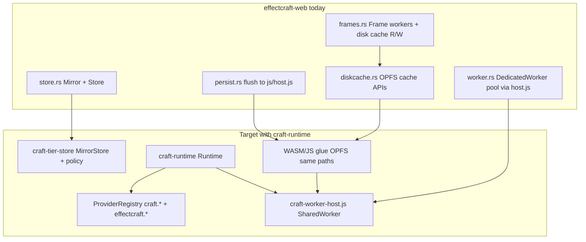

# Pilot: migrate EffectCraft-web to craft-runtime

Step-by-step checklist for wiring [`storytold/effectcraft`](https://github.com/storytold/effectcraft) `apps/effectcraft-web` onto **craft-runtime** (tier store, SharedWorker RPC, GPU provider registry) while **preserving every engine-visible storage key and disk-cache identity**. This document lives in craft-libs for the lab tracker; it does not change the effectcraft repo by itself.

| Tracker | Link |
| --- | --- |
| Lab pilot | [wdunn001/craft-libs#9](https://github.com/wdunn001/craft-libs/issues/9) — *Pilot: wire effectcraft-web to craft-runtime* |
| Upstream epic | [storytold/craft-libs#132](https://github.com/storytold/craft-libs/issues/132) |
| Depends on | craft-libs lab [#4](https://github.com/wdunn001/craft-libs/issues/4) tier-store, [#5](https://github.com/wdunn001/craft-libs/issues/5) worker-host, [#6](https://github.com/wdunn001/craft-libs/issues/6) craft-gpu, [#7](https://github.com/wdunn001/craft-libs/issues/7) gpu-providers, [#8](https://github.com/wdunn001/craft-libs/issues/8) runtime facade |
| Runtime overview | [web-runtime.md](./web-runtime.md) |
| GPU rules | [gpu-providers.md](./gpu-providers.md), [gpu-backends.md](./gpu-backends.md) |

**Source revision reviewed:** `storytold/effectcraft` `main` (2026-10-14), paths under `apps/effectcraft-web/src/{store,worker,diskcache}.rs` and related modules cited below.

**Repin order** (from [web-runtime.md](./web-runtime.md)): craft-libs → CollabCraft static host → application `-web` crates.

---

## 1. What “done” means for this pilot

1. **Browser persistence** still uses the same OPFS / IndexedDB / memory layout and **string keys** the engine and existing users already have (`config/*`, `files…`).
2. **Disk cache** still uses `effectcraft-cache/v1` entry names derived from `effectcraft_engine::render::disk_cache` (frame / layer / matte), not a new naming scheme.
3. **Dedicated job and frame workers** can coexist with a **SharedWorker** that handles `craft_worker_host::HostMessage` (init, `StorageFlush`, `GpuJobs`, cancel) per [craft-runtime `Runtime`](https://github.com/storytold/craft-libs/blob/main/crates/runtime/src/runtime.rs).
4. App-specific GPU work is dispatched via **`effectcraft.*` provider ids** registered in application wasm; shared ops use **`craft.*`** only ([gpu-providers.md](./gpu-providers.md)).
5. All existing **`store.rs` unit tests** (native) still pass; wasm smoke covers load, session restore, render offload, and disk-cache hit/miss.

---

## 2. Engine key contract (do not change)

These are defined in [`store.rs`](https://github.com/storytold/effectcraft/blob/main/apps/effectcraft-web/src/store.rs) and consumed by `WebConfig` / `WebFiles`, `persist`, `files`, and worker file shipping (`file_versioned`).

### 2.1 Persistent store keys (OPFS / IDB mirror)

| Key pattern | Constant / helper | Semantics |
| --- | --- | --- |
| `config/<name>` | `CONFIG` = `"config/"` | Settings, shortcuts, recovery sentinel, session snapshot files |
| `config/session.ecproj` | `SNAPSHOT` | Project JSON for crash/reload recovery |
| `config/session.json` | `SNAPSHOT_META` | `SnapshotMeta` (path, dirty, UI state, saved timestamp) |
| `files/<path>` or `files<path>` | `file_key(path)` | Virtual file table; `path` is absolute POSIX-style (`/clip.mp4`) |

**`file_key` / `key_path` rules (must round-trip):**

- `/a b/c.mov` → `files/a b/c.mov`
- `c.mov` (no leading slash) → `files/c.mov`
- `key_path("files/a b/c.mov")` → `Some("/a b/c.mov")`; `config/…` → `None`

**Non-persisted files:** render outputs use `persist: false` on `Mirror::put`; they must **not** generate flush entries, but may remain in the in-memory table until removed. Replacing a persisted file with an unpersisted one must flush a **delete** for the old key (see `store.rs` tests).

**Per-key versioning:** every write bumps `Entry::version` (workers resend footage when version changes — effectcraft #218). This is **not** present on `craft_tier_store::MirrorStore` today; preserve it in an EffectCraft adapter layer or tier-store extension.

**Flush semantics:** pending queue is **first-change order**, coalesced to **latest payload per key**; failed writes stay pending and `retry(key)` re-queues (#215). `HostMessage::StorageFlush` in craft-runtime should ultimately drive the same flush loop as [`persist::schedule_flush`](https://github.com/storytold/effectcraft/blob/main/apps/effectcraft-web/src/persist.rs).

### 2.2 Disk cache (separate OPFS tree)

Defined in [`diskcache.rs`](https://github.com/storytold/effectcraft/blob/main/apps/effectcraft-web/src/diskcache.rs); index types from `effectcraft_engine::render::disk_cache`.

| Kind | OPFS relative name | Key |
| --- | --- | --- |
| Frame | `{entry_name(u128)}` | `u128` disk-cache key |
| Layer | `layers/{entry_name(u128)}` | 32-hex layer id |
| Matte | `mattes/{entry_name(u128)}` | segmentation cache |

Folder label exposed in stats: **`Origin Private File System: effectcraft-cache/v1 (frames, layers)`**. Layer prefetch uses **32 lowercase hex** strings (`layer_prefetch`).

**Do not** map disk-cache blobs into `StoreKey` strings for this pilot unless you also migrate existing OPFS files and update `DiskIndex` — out of scope for key preservation.

### 2.3 `craft_tier_store::DefaultTierPolicy` alignment

For any key that **does** use `StoreKey`:

| Prefix | `KeyClass` |
| --- | --- |
| `config/` | Config |
| `cache/` | Cache (LRU byte budget) |
| `render/` | RenderTemp |
| else (includes all `files/…`) | Media |

EffectCraft’s live keys already match this for config + files. Disk cache remains a **parallel warm tier** until a deliberate consolidation project moves frame bytes under `cache/…` with a migration tool.

---

## 3. Architecture map (today → craft-runtime)

| Concern | Today | After pilot |
| --- | --- | --- |
| Hot mirror | `store::Mirror` in `Store` | `MirrorStore<EffectCraftPolicy>` **or** thin wrapper keeping `Mirror` API but delegating bytes to `StoreKey` |
| Async persistence | `persist.rs` → `storeOpen` / `storePut` / `storeDelete` | Same JS entry points; coordinator may live in craft-runtime wasm glue; flush triggered by store hook **and** `HostMessage::StorageFlush` |
| Job offload | `WorkerOffload` → `workerRun` JSON + file versions | Phase A: keep dedicated workers for full `WorkerRequest`; Phase B: route **GPU batches** through SharedWorker `GpuJobs` where engine uses `GpuJob` |
| Frame preview | Dedicated frame workers in `frames.rs` | Unchanged short-term; optional later: composite passes as `effectcraft.compositor.*` jobs |
| Disk cache | `diskcache.rs` + `cache_*` in `host.js` | Unchanged paths; `configure` / `init` / stats still page-owned |
| Cold folders | `browse.rs` + FS Access handles in IDB | Align picker metadata with `craft_tier_store::ExternalVolume` when cold-tier UI lands (#4) |

---

## 4. Prerequisites (craft-libs #4–#8)

Complete or stub-verify before effectcraft dependency pins move:

- [ ] **#4** — `craft-tier-store`: mirror, pending coalescing, policy, `ExternalVolume` / cloud ref types; wasm OPFS shims documented.
- [ ] **#5** — `assets/craft-worker-host.js` shipped (and brotli) from CollabCraft; MessagePort `init` / `gpu_jobs` wired to serde `HostMessage` / `WorkerMessage`.
- [ ] **#6–#7** — `GpuJob`, `ProviderRegistry`, `craft.noop` + shared providers; lint: no `effectcraft-*` inside `craft-gpu-providers`.
- [ ] **#8** — `craft-runtime` crate published from monorepo; `Runtime::handle_host_message` covers Init, GpuJobs, StorageFlush (flush body in glue), Cancel.

EffectCraft `-web` adds path dependency or git pin on **craft-runtime** with features: `web`, `shared-worker`, and optionally `cloud-delegate` when browse/cloud paths are wired.

---

## 5. Migration phases (order matters)

### Phase A — Dependencies and assets (no behavior change)

1. Pin `craft-runtime` (and transitive `craft-tier-store`, `craft-worker-host`, `craft-gpu*`) in `apps/effectcraft-web/Cargo.toml`.
2. Ensure CollabCraft (or effectcraft static host) serves [`craft-worker-host.js`](../assets/craft-worker-host.js) at the URL the app will load (same origin as today’s `worker.js`).
3. Add a **feature flag** (e.g. `craft-runtime`) default-off until Phase C passes CI.

### Phase B — Store layer (keys frozen; native tests gate)

Replace internals while keeping **public** `store` module surface: `Store`, `Mirror`, `WebConfig`, `WebFiles`, `file_key`, `key_path`, `FileKind`, `SnapshotMeta`, constants `CONFIG`, `FILES`, `SNAPSHOT`, `SNAPSHOT_META`.

### Phase C — Persistence glue

Point flush/load at shared coordinator; verify OPFS backend string (`opfs` / `indexeddb` / `memory`) unchanged in `storage.info`.

### Phase D — SharedWorker + GPU registry

Connect tab to SharedWorker; register `effectcraft.*` providers on worker init; keep dedicated workers for full engine offload until parity.

### Phase E — Disk cache and browse (parallel tracks)

Disk cache: no key changes, only optional delegation to shared JS helpers. Browse: map remembered folder handles to `ExternalVolume` without renaming virtual paths (`/Folders/…`).

---

## 6. File-by-file checklist (effectcraft-web)

Paths relative to `apps/effectcraft-web/`.

### 6.1 `src/store.rs` (primary tier-store target)

**Role:** Synchronous mirror; implements engine `ConfigStore` / `FileOps`; defines all **persistent string keys**.

| Step | Action | Key preservation |
| --- | --- | --- |
| 1 | Inventory exports used elsewhere: `Store`, `Mirror`, `Pending`, `Entry`, `WebConfig`, `WebFiles`, `FileKind`, helpers, tests module. | No renames. |
| 2 | Map each logical key to `StoreKey::new(...)` internally; use `file_key` / `format!("{CONFIG}{name}")` exactly as today. | §2.1 |
| 3 | Implement or retain **persist flag**, **modified ms**, **version**, **delete pending**, **retry** on top of `MirrorStore` (craft-libs mirror has put-only + coalesced pending — gap). | Tests: `unpersisted_entries_never_flush`, `versions_change_with_every_write`, `failed_writes_retry` |
| 4 | Keep `on_change` → flush scheduling; do not require JS from this module. | — |
| 5 | Run `cargo test -p effectcraft-web store::tests` natively after each refactor slice. | All 8+ tests green |

**Acceptance:** Byte-for-byte same pending keys as before for scenarios in `config_store_and_file_ops` test.

### 6.2 `src/persist.rs` (async warm tier)

**Role:** Load all keys into mirror at startup; background flush with retry/backoff; session snapshot/restore.

| Step | Action | Key preservation |
| --- | --- | --- |
| 1 | `load`: still calls `storeOpen` / `storeLoadAll`; each entry’s `key` string passed to `Mirror::load` unchanged. | §2.1 |
| 2 | Flush loop: still `storePut(key, …)` / `storeDelete(key)` with same keys from `take_pending()`. | §2.1 |
| 3 | Wire `schedule_flush` to craft-runtime coordinator when enabled; fallback to current loop when flag off. | Same API |
| 4 | `snapshot` / `restore`: still read/write `SNAPSHOT` and `SNAPSHOT_META` via `WebConfig` → `config/session.ecproj`, `config/session.json`. | §2.1 |
| 5 | Implement `HostMessage::StorageFlush` handler (worker or main) that calls the same flush entry point as `on_change`. | — |

**Acceptance:** Reload after edit preserves project; forced quota error retries (#215); `persist::backend()` unchanged for OPFS-first.

### 6.3 `src/files.rs` (consumer of `Store`)

| Step | Action | Key preservation |
| --- | --- | --- |
| 1 | Keep `STORE` static and `put_file` / `file_versioned` behavior. | Version bump on every write |
| 2 | `WebServices::store_file` paths still go through `put` → `files/…` keys. | §2.1 |
| 3 | `usage()` for storage manager still uses `Store::usage()` / `FileKind`. | JSON shape unchanged |

### 6.4 `src/diskcache.rs` (OPFS cache — stay on engine names)

**Role:** Page-owned `DiskIndex`; async read; worker write via `cacheWrite`; LRU eviction.

| Step | Action | Key preservation |
| --- | --- | --- |
| 1 | **Do not** route frame/layer/matte blobs through `StoreKey` in pilot. | §2.2 |
| 2 | Keep `name_of`, `parse_name`, `entry_name` / `parse_entry_name` from engine crate. | §2.2 |
| 3 | Optional: move `cache_*` JS imports to a shared craft-runtime JS module that still uses **same** OPFS directory and file names. | §2.2 |
| 4 | Preserve `stats()` JSON field names (`diskCache` in `storage.info`). | API contract |

**Acceptance:** Settings ▸ Disk cache stats match pre-migration; cache hit reads same `u128` key after reload.

### 6.5 `src/worker.rs` (offload + worker-side session)

**Role:** Page: `WorkerOffload` implements `effectcraft_engine::offload::Offload`. Worker: `workerInit`, `workerFile`, `workerJobInit`, `workerJob`.

| Step | Action | Key preservation |
| --- | --- | --- |
| 1 | **Page — file shipping:** keep `files::get_versioned` → `[path, bytes, version]` triple in `workerRun`. | Version tied to store keys |
| 2 | **Page — messages:** preserve `reply` / `file` / `store` / error handling; `store` still calls `files::put` → persisted `files/…`. | §2.1 |
| 3 | **Worker — `workerFile`:** still `STORE.put_file(..., persist: false)` + media pool. | Worker-local mirror, not browser keys |
| 4 | **SharedWorker:** on Init, build `craft_runtime::Runtime` with `with_default_providers()` + register **EffectCraft** providers (`effectcraft.*`); handle `GpuJobs` batches. | [gpu-providers.md](./gpu-providers.md) |
| 5 | **Defer:** replacing entire `WorkerRequest` JSON pipeline with SharedWorker — not required for first merge if dedicated `worker.js` remains. | — |
| 6 | `post_store` / Content-Aware sequences: still persist via page `store` message → `files/…`. | §2.1 |

**Acceptance:** Render queue job completes; CAF sequence files appear under same virtual paths; `workerStats()` still meaningful.

### 6.6 `src/frames.rs` (disk cache + frame workers)

| Step | Action | Key preservation |
| --- | --- | --- |
| 1 | Keep `diskcache::layer_prefetch`, `contains`, `read`, `stored`, `note_layers` call pattern. | §2.2 |
| 2 | Frame worker continues `cache_write` / `cache_read` with `diskcache::name_of`. | §2.2 |
| 3 | Long-term: composite GPU passes may become `GpuJob` with `effectcraft.compositor.frame` (or similar) — register provider before switching dispatch. | Provider id convention |

### 6.7 `src/storage.rs` (storage manager API)

| Step | Action | Key preservation |
| --- | --- | --- |
| 1 | `StorageHost::info` JSON: keep `files`, `diskCache`, `backend`, `error` fields. | Engine / UI contract |
| 2 | `clear("projects" \| "media" \| "autoSaves" \| "diskCache" \| "all")` still uses `FileKind` + `diskcache::clear()`. | §2.1 + §2.2 |

### 6.8 `src/app.rs` (startup wiring)

| Step | Action |
| --- | --- |
| 1 | After `persist::load`, optionally connect SharedWorker (`Init { app_id: "effectcraft", capabilities: ["gpu", "storage"] }`). |
| 2 | Keep ordering: `load` → `browse::restore` → `diskcache::init` → session / frames (see existing `startup` flow). |
| 3 | Feature-flagged path: swap `WorkerOffload` only when SharedWorker job routing is ready. |

### 6.9 `js/host.js` (browser I/O)

| Step | Action | Key preservation |
| --- | --- | --- |
| 1 | Document and freeze storage key strings passed to OPFS/IDB (must match §2.1). | Critical |
| 2 | Document cache folder layout (`effectcraft-cache/v1`, layer/matte subpaths). | §2.2 |
| 3 | Add SharedWorker script URL alongside existing `workerRun` pool; do not break dedicated worker module sharing (`WebAssembly.Module` reuse). | — |
| 4 | Optionally factor shared OPFS helpers with CollabCraft/craft-runtime host bundle. | Same paths |

### 6.10 `src/lib.rs` / `Cargo.toml`

| Step | Action |
| --- | --- |
| 1 | `store` stays available on all targets; wasm modules unchanged in `cfg`. |
| 2 | Add `craft-runtime` dependency; enable `web` + `shared-worker` on wasm32 build. |
| 3 | Do **not** pull `effectcraft-*` into craft-libs crates (reverse dependency only). |

### 6.11 Related (out of trio but pilot-owned)

| File | Note |
| --- | --- |
| `src/browse.rs` | Virtual paths `/Browser Storage/…`, `/Folders/…`; cold tier handles → `ExternalVolume` when #4 UI lands. |
| `src/api.rs` | `storage.info`, save-to-browser — must reflect same stats keys. |

---

## 7. craft-runtime integration sketch (effectcraft-side only)

When the feature flag is on:

1. **Main thread:** open SharedWorker → post JSON matching `HostMessage::Init` (serde tag `type`: `init` in JS shim maps to Rust enum).
2. **Worker wasm:** static `Runtime::builder().with_default_providers().wgpu_context().build()`; `registry_mut().register(...)` for each EffectCraft GPU provider.
3. **On storage change:** post `StorageFlush` or call shared flush function coalesced with existing `schedule_flush`.
4. **GPU:** frame/worker code paths build `GpuJob { provider_id: "effectcraft.…", … }` → `HostMessage::GpuJobs { batch_id, jobs }` → `WorkerMessage::GpuBatchDone`.

Reference implementation pieces in craft-libs:

- Protocol: [`crates/worker-host/src/protocol.rs`](../crates/worker-host/src/protocol.rs)
- Facade: [`crates/runtime/src/runtime.rs`](../crates/runtime/src/runtime.rs)
- Policy / keys: [`crates/tier-store/src/policy.rs`](../crates/tier-store/src/policy.rs), [`key.rs`](../crates/tier-store/src/key.rs)
- JS stub: [`assets/craft-worker-host.js`](../assets/craft-worker-host.js) (replace stub outcomes with wasm dispatch when wired)

---

## 8. Verification matrix

| Check | How |
| --- | --- |
| Store keys | Native `store.rs` tests; manual inspect OPFS keys after import/save/auto-save |
| Session recovery | Kill tab; reload — `config/session.ecproj` + `session.json` restore |
| Worker footage | Replace file same size — new version sent to worker (#218) |
| Failed flush | Simulate quota error — pending retry (#215) |
| Disk cache | Enable cache; scrub timeline; reload — hits increment; corrupt file evicted |
| Storage UI | `storage.info` / Settings ▸ Disk — counts match |
| SharedWorker | Init → `Ready { caps }`; noop `craft.noop` job batch returns outcomes |
| Compat runner | `cargo xtask compat` against `effectcraft-web` when xtask knows wasm consumers (future) |

---

## 9. Known gaps (craft-libs vs EffectCraft mirror)

Plan explicitly for these so key preservation is not accidentally broken:

| EffectCraft `Mirror` | `craft_tier_store::MirrorStore` today |
| --- | --- |
| Delete + non-persisted entries | Put-only; no tombstone pending |
| `modified: f64` on flush | PendingWrite has bytes only |
| `Entry::version` | Not tracked |
| `persist: bool` per entry | All puts enqueue pending |
| LRU on **cache-class** keys only | Policy-driven; `files/*` is Media, not LRU |

**Recommendation:** keep `store.rs` public API; implement EffectCraft-specific mirror semantics in effectcraft-web (or extend tier-store with optional metadata) rather than forcing a thin rename to raw `MirrorStore`.

---

## 10. Out of scope for this pilot doc

- Renaming OPFS roots or migrating disk-cache files into `cache/…` `StoreKey`s.
- Removing dedicated `worker.js` / frame workers entirely.
- Changing engine trait signatures in `effectcraft_engine`.
- Commits or dependency pin changes inside `storytold/effectcraft` (handled in effectcraft PRs after craft-libs #4–#8 merge).

---

## 11. Suggested PR sequence (effectcraft repo, when ready)

1. **PR1:** Dependency + feature flag only; zero runtime behavior change.
2. **PR2:** `store.rs` internal refactor + native tests; still same JS persist.
3. **PR3:** SharedWorker connect + `StorageFlush` + `craft.noop` GPU smoke test.
4. **PR4:** Register first real `effectcraft.*` provider; route one GPU path from frames or job worker.
5. **PR5:** Browse / cold tier metadata with `ExternalVolume` (optional, after #4 UI).

Each PR should cite [wdunn001/craft-libs#9](https://github.com/wdunn001/craft-libs/issues/9) and confirm §2 key tables unchanged.
