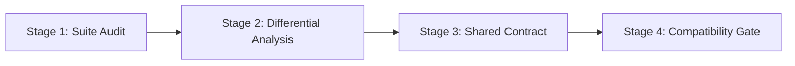

# RFC: Shared Capabilities, Acceptance Protocol, and Evidence Standards (`RFC-CRAFT-LIBS-001`)

- **Status**: Proposed
- **Author**: Zach Shallbetter (`zachshallbetter@icloud.com`)
- **Date**: 2026-10-11
- **Target Repository**: `storytold/craft-libs`

---

## 1. Motivation & Context

The `craft-libs` workspace has transitioned from an internal UI component extraction into an active, multi-contributor shared foundation:
- Contributors are reviewing and hardening foundation crates (`craft-atomic`, `craft-time`).
- Second-order shared dependencies are emerging (`craft-atomic` $\to$ `craft-settings` $\to$ consuming applications).
- Platform-specific defects are reproducing on real hardware (`craft-quit` Touch Bar crash mitigation).

Without an explicit architecture and acceptance contract, shared libraries risk introducing tight coupling, uncoordinated breaking changes, and silent regressions across the 10 Craft applications. This RFC defines the intended architectural role of `craft-libs`, the acceptance protocol for new capabilities, and the evidence required before promotion.

---

## 2. The Architectural Role of `craft-libs`

### 2.1 The Five-Layer Craft Ecosystem
The Craft ecosystem consists of five architectural tiers:
1. **Engineering Standards (`craftrules`)**: Shared repository invariants, safety doctrine, zero-panic policy, and clean-room licensing.
2. **Shared Foundation Libraries (`craft-libs`)**: Reusable domain algorithms (`craft-time`), UI primitives (`craft-ui`), atomic persistence (`craft-atomic`), and settings storage (`craft-settings`).
3. **Platform Adapters**: OS-specific abstractions for native menus, window lifecycle (`craft-quit`), sandboxing, and file dialogs.
4. **Application Engines**: Creative suites providing product-specific functionality (PhotoCraft, VectorCraft, DesignCraft, FilmCraft, etc.).
5. **Ecosystem Infrastructure**: Automated cross-application compatibility runners (`cargo xtask compat-check`) and regression gates.

### 2.2 Core Doctrines
- **Zero App Code**: Shared crates must be useful to multiple applications and **must never depend on any application crate**.
- **Decoupled Evolution**: Applications consume shared crates via explicit Cargo Git pins (`rev = "<commit>"`). Shared crates must never force synchronous, lockstep upgrades across the entire suite.
- **Never Crash**: Every crate in `craft-libs` enforces `#![forbid(unsafe_code)]` and `#![deny(clippy::unwrap_used, clippy::expect_used, clippy::panic, clippy::unimplemented, clippy::todo, clippy::unreachable)]`.

---

## 3. Shared Capability Acceptance Protocol

To promote code from an application into `craft-libs`, contributors must follow a four-stage extraction lifecycle:

### Stage 1: Identification & Suite Audit
A candidate capability must exist in or be needed by at least two applications. The author inventories the existing implementations across the suite, noting diverging data structures, edge-case treatments, and platform assumptions.

### Stage 2: Correctness vs. Compatibility Distinction
Shared extraction is not simply choosing one application's code and standardizing on it. Authors must answer two independent questions:
1. **Is the implementation mathematically and mechanically correct?**
2. **Does it preserve the established behavior that existing consumers depend on?**

Authors perform differential testing against existing implementations and explicitly classify discrepancies:
- **Defects**: True arithmetic overflows, memory leaks, or race conditions. These must be resolved upstream.
- **Intentional Differences**: Deliberate product choices (e.g. EffectCraft's unpadded timecode hours vs FilmCraft's padded hours). The shared library must support both via explicit APIs (e.g. `format_timecode_ae` vs `format_timecode_frames`).
- **Unresolved Discrepancies**: Incompatible domain assumptions that cannot be bridged cleanly. These must remain application-owned rather than prematurely forced into shared code.

### Stage 3: Crate Contract & Failure Semantics
The crate must define an explicit failure model complying with [`shared-crate-contract.md`](shared-crate-contract.md):
- Safety-critical operations provide fallible checked APIs (`Result` / `Option`).
- Total operator overloads implement documented, non-panicking saturating fallbacks.
- Post-failure states guarantee data integrity (e.g. all-or-nothing replacement).
- Platform behaviors (e.g. atomic rename vs physical media flush) are explicitly declared.

### Stage 4: Release Gating & Verification
Before merging into `main`, the contribution must pass the progressive verification pipeline:
$$\text{Unit Tests} \to \text{Differential Tests} \to \text{Consumer Compatibility} \to \text{Platform Verification} \to \text{Maintainer Merge}$$

1. **Unit & Property Tests**: Local workspace tests pass cleanly (`cargo test --workspace`).
2. **Consumer Compatibility**: The proposed change is evaluated by the cross-application runner against pinned consumers defined in [`consumer-dependency-map.json`](consumer-dependency-map.json). The run must enforce:
   - **Isolation**: Ephemeral worktrees; no consumer working tree modifications.
   - **Provenance**: Explicit candidate Git SHAs / dirty snapshots recorded.
   - **Non-Vacuous Success**: At least one valid comparison executed.
3. **Platform Hardware Verification**: For crates interacting with OS lifecycle or filesystem boundaries (`craft-quit`, `craft-atomic`), empirical verification is performed on the designated target environment defined in [`platform-test-inventory.json`](platform-test-inventory.json).

---

## 4. Evidence Standards & Epistemic Honesty

Contributors and reviewers must adhere to the **Four-Tier Claim Taxonomy**:

$$\text{Documented} \neq \text{Implemented} \neq \text{Tested} \neq \text{Empirically Validated}$$

- An architectural design in an RFC is *documented*, not *implemented*.
- A function with passing mock tests is *tested*, not *empirically validated*.
- Platform-specific defects (such as Touch Bar lifecycle crashes or power-loss filesystem durability) are only considered resolved when *empirically validated* on representative hardware and storage media.
- Negative results, rejected designs, and incompatible abstractions must be permanently recorded to prevent repeating past errors.

---

## 5. Security & Performance Baselines

1. **Security Review Track**: Shared libraries handling external documents, fonts, paths, or settings must implement bounded resource consumption, path traversal sanitization, and fuzz testing before adoption.
2. **Performance Regressions as Compatibility Failures**: A shared library update that passes functional tests but significantly degrades throughput, increases memory footprint, or regresses interactive frame rate is treated as a compatibility failure. Performance baselines will be introduced for high-frequency primitives.
