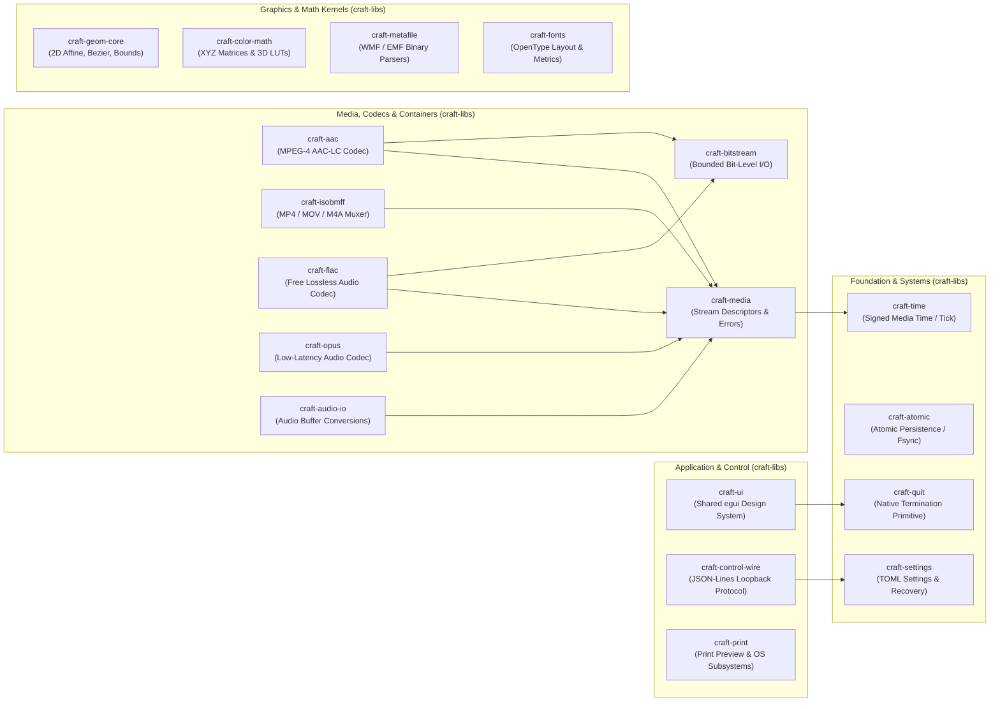

# Shared Infrastructure Specification: Comprehensive Foundation for the Craft Suite (`craft-libs`)

> **Author:** Zach Shallbetter  
> **Date:** 2026-10-12  
> **Status:** Architecture Specification  
> **Target:** Canonical Shared Libraries in `storytold/craft-libs`  
> **Scope:** 13 Craft Applications + Shared `craft-libs` (358 member crates across 14 workspace trees)

---

## 1. Executive Summary & Architectural Doctrine

Across the 14 repositories of the Craft ecosystem, 358 member crates power 13 creative, office, and collaboration applications. A comprehensive audit ([crate-audit.md](crate-audit.md)) and system blueprint ([ecosystem-architecture.md](ecosystem-architecture.md)) demonstrate that while each application addresses a distinct commercial creative workflow (raster imaging, vector illustration, page layout, desktop publishing, non-linear video editing, motion graphics, CAD drafting, DAW audio recording, rich text processing, slide presentations, spreadsheets, collaborative interface design), they share identical architectural layers, identical headless automation harnesses, and significant parallel implementations of underlying codecs, math, parsers, and wire protocols.

### Documentation Authority & Canonical Contracts
 
To maintain clear separation between merged project reality, reviewed contract proposals, and forward-looking exploration:
- **Verified Inventory**: The catalog of current application dependencies, formats, and internal crates reflects empirical source analysis at the audited revisions.
- **Implemented & Merged Contracts**: Core system primitives already merged upstream into `craft-libs` (`craft-atomic`, `craft-settings`, `craft-quit`, `craft-print`, `craft-ui`, `craft-cms`, `craft-menu`).
- **Reviewed Unmerged Contract Proposals**: Proposed canonical contracts undergoing review in [PR #24 (`docs/contracts.md`)](https://github.com/storytold/craft-libs/pull/24) (covering persistence ordering, backup recovery, and termination lifecycle). While referenced for alignment, they remain proposed contracts until formally merged.
- **Future Architectural RFCs**: Blueprints for unextracted crates (`craft-geom-core`, `craft-media`, `craft-bitstream`, `craft-aac`, `craft-isobmff`, `craft-pdf`, `craft-archive`) represent proposed modular designs and candidate extractions. They do not impose binding project commitments until maintainers review, approve, and merge them.

This specification establishes **`storytold/craft-libs`** as the canonical repository for shared, domain-independent technical primitives across the Craft suite. It is founded upon a non-negotiable architectural doctrine:

$$\textbf{Shared Technical Functionality} \not\equiv \textbf{Shared Domain Models}$$

Rather than constructing an over-abstracted, monolithic application framework that collapses domain distinctions or introduces circular couplings, this proposal strictly enforces:
1. **Zero Application Coupling**: Shared crates in `craft-libs` depend strictly on other `craft-libs` primitives, standard libraries (`core`, `alloc`), or vetted external dependencies (`thiserror`, `serde`). They never depend on application crates (`filmcraft-*`, `soundcraft-*`, etc.).
2. **Quarantined Domain Semantics**: Application-specific session models, transaction journals, UI coordinators, and specialized unit spaces (e.g. CAD index colors, publishing spot inks, document twips/EMUs) remain strictly owned by their respective applications.
3. **Signal-First & Renderer-Agnostic Interfaces**: Codecs and math kernels operate on raw planar buffer views (`AudioBufferRef`, `VideoFrameRef`, `Point2<T>`, `Affine2<T>`) rather than complex engine state.
4. **Universal Quality & Safety Invariants**: Every shared crate enforces edition 2024, MSRV 1.95, `forbid(unsafe_code)`, `wasm32-unknown-unknown` portability, and the ecosystem Never-Crash compile-time policy:
   ```rust
   #![deny(clippy::unwrap_used, clippy::expect_used, clippy::panic, clippy::unimplemented, clippy::todo, clippy::unreachable)]
   ```

---

## 2. Global Architecture & Dependency Topology



---

## 3. Comprehensive Shared Crate Matrix

The 18 proposed, extracted, and existing shared crates are grouped into five functional domains. Each crate is classified by its lifecycle status:
* **Existing Upstream**: Merged into `craft-libs`; candidate downstream consumer adoption active under qualification gates.
* **Extraction Candidate**: High-value implementation currently private to an application, ready for extraction under the Extraction Provenance Contract.
* **Proposed Contract**: New domain-independent primitive interface or wire schema.
* **Evaluated Candidate**: Domain overlap established; extraction scheduled following multi-consumer requirement proofs.

| Domain | Target Crate | Role & Scope | Source Provenance | Upstream Status | Downstream Consumer Matrix | Primary Invariants & Guardrails |
| :--- | :--- | :--- | :--- | :--- | :--- | :--- |
| **Foundation** | `craft-time` | Signed media time (`Tick`), rational timebases, sample conversions. | Shared proposal (PR #24) | Proposed contract | FilmCraft, EffectCraft, SoundCraft | Signed arithmetic across `[MIN, MAX]`; negative time valid for preroll/lead-in; no universal clamp to 0. |
| **Foundation** | `craft-atomic` | Atomic file persistence, temporary file staging, directory fsync, new-file permissions policy. | `craft-libs` (PR #16, PR #43) | Merged upstream (v0.1.0 in PR #41) | All 11 Applications | Syscall ordering (`sync < rename < sync_dir`); `PlatformDefault` (0666 minus umask/ACL) for document/export saves vs `Private` (0600) for settings/recovery; zero-allocation error paths; no silent directory creation. |
| **Foundation** | `craft-settings` | TOML settings serialization, schema versioning, backup recovery. | `craft-libs` (PR #22) | Merged upstream (v0.1.0 in PR #41) | All 11 Applications | Validated backup preservation (`refresh_backup`); move-aside broken configs for forensics; no silent clobber. |
| **Foundation** | `craft-quit` | Platform application termination (`-[NSApp terminate:]`, `WM_CLOSE`). | `craft-libs` (PR #5, #21) | Merged upstream (v0.1.0 in PR #41) | Desktop runners | Termination primitive only; dirty-document confirmation and modal UI prompts remain application-owned. |
| **Application** | `craft-ui` | Unified dark-theme tokens, canvas controls, widgets, icons. | `craft-libs` (PR #6) | Merged upstream (v0.1.0 in PR #41) | 9 Applications (pinned `5c874d5` $\to$ `tag = "v0.1.0"`) | Consistent visual styling; DeckCraft & WordCraft maintain standalone UI crates; zero app state coupling. |
| **Application** | `craft-control-wire` | Loopback TCP JSON-RPC / JSON-Lines automation protocol schemas. | 11x app-local `control.rs` | Proposed extraction (refs #32) | All 11 Applications | Wire serialization and parser only; token authentication; engine sessions and commands remain app-owned. |
| **Application** | `craft-print` | Print layout pagination, margin calculations, system print dialogs. | `craft-libs` (PR #8, #28) | Merged upstream (v0.1.0 in PR #41) | DesignCraft, PdfCraft, PhotoCraft, VectorCraft | Native in-process Windows spooler printing; pre-press color separations and spot plates remain application-owned. |
| **Media** | `craft-media` | Stream descriptors, channel layouts, buffer views, media errors. | Shared requirements | Proposed contract | FilmCraft, EffectCraft, SoundCraft | Pure Rust; `wasm32` clean; zero filesystem I/O; typed `MediaError` via `thiserror`. |
| **Media** | `craft-bitstream` | Bounded bit-level read/write primitives, Exp-Golomb, RBSP. | `filmcraft-bitstream` | Extraction candidate | Codec & container crates | 8 tests passing; zero `unsafe`; wasm32 clean; overflow-checked bit shifts; byte-aligned slicing. |
| **Media** | `craft-aac` | Clean-room MPEG-4 AAC-LC encoder & decoder (ISO/IEC 14496-3). | `filmcraft-aac` | Extraction candidate | FilmCraft, EffectCraft, SoundCraft | 31 tests passing; zero `unsafe`; wasm32 clean; planar `f32` in/out; 1 to 8 channels; CBR/VBR; 1024-sample priming. |
| **Media** | `craft-isobmff` | MP4/MOV container demuxer & progressive faststart muxer. | `filmcraft-isobmff` | Extraction candidate | FilmCraft, EffectCraft, SoundCraft | 62 tests passing; zero `unsafe`; wasm32 clean; edit list (`elst`) priming delay compensation; faststart `moov`. |
| **Media** | `craft-flac` | Lossless audio encoder & decoder (RFC 9636). | `filmcraft-flac`, SoundCraft | Evaluated candidate | FilmCraft, SoundCraft | Linear prediction coding; bit-exact PCM reconstruction; stream CRC-16 / MD5 validation. |
| **Media** | `craft-opus` | Interactive low-latency audio codec (RFC 6716). | `effectcraft-opusenc` | Evaluated candidate | EffectCraft, prospective FilmCraft | Constant 20 ms framing; hybrid SILK/CELT layers; bounded bitrates for interactive playback. |
| **Media** | `craft-audio-io` | Audio buffer format conversion, planar/interleaved channel mapping. | `soundcraft-audio-io` | Evaluated candidate | SoundCraft, prospective FilmCraft | Zero-allocation real-time conversions; polyphase decimation filters; DAW bounce coordinator stays local. |
| **Graphics** | `craft-geom-core` | Coordinate-neutral 2D affine transforms, Bezier math, bounding boxes. | 9x app-local `geom` crates | Proposed extraction | Layout, CAD, Vector, Raster apps | Pure math kernel (`Point2<f64>`, `Affine2<f64>`); domain units (twips, EMUs, CAD tolerances) stay in apps. |
| **Graphics** | `craft-color-math` | RGB/XYZ color space matrices, 1D/3D tetrahedral LUT interpolation. | 8x app-local `color` crates | Proposed extraction | PhotoCraft, LightCraft, FilmCraft | Numerical matrix/LUT math only; CAD ACI, broadcast video ranges, and spot inks stay local (see craft-cms PR #39). |
| **Interchange** | `craft-metafile` | Binary WMF (16-bit) and EMF (32-bit) vector parsers. | `vectorcraft-metafile` | Extraction candidate | DeckCraft, VectorCraft, WordCraft | Resolves DeckCraft #327 and WordCraft #802; clean-room [MS-WMF] / [MS-EMF] parsing; generic vector path records. |
| **Interchange** | `craft-fonts` | OpenType font table parsing (CFF, TrueType, cmap, GSUB, GPOS). | 5x app-local font crates | Evaluated candidate | DesignCraft, WordCraft, PdfCraft | Table parser & metric extractor only; font binaries strictly quarantined in external asset storage. |

---

## 4. Public Interface Contracts & Subsystem Specifications

### 4.1 Media Infrastructure Subsystems

#### `craft-media`: Audio & Stream Trait Definitions
```rust
// crates/media/src/audio.rs

/// Channel configuration descriptor.
#[derive(Debug, Clone, Copy, PartialEq, Eq, Hash, serde::Serialize, serde::Deserialize)]
pub enum ChannelLayout {
    Mono,
    Stereo,
    Surround30,
    Surround40,
    Surround51,
    Surround71,
    EightChannel,
    Custom(u16),
}

impl ChannelLayout {
    pub const fn channels(&self) -> usize {
        match self {
            Self::Mono => 1,
            Self::Stereo => 2,
            Self::Surround30 => 3,
            Self::Surround40 => 4,
            Self::Surround51 => 6,
            Self::Surround71 => 8,
            Self::EightChannel => 8,
            Self::Custom(n) => *n as usize,
        }
    }
}

/// Renderer-agnostic planar floating-point audio buffer view.
pub trait AudioBufferRef {
    fn channels(&self) -> usize;
    fn frames(&self) -> usize;
    fn sample_rate(&self) -> u32;
    fn channel(&self, ch: usize) -> Option<&[f32]>;
}

/// Bounded media error hierarchy.
#[derive(Debug, thiserror::Error)]
pub enum MediaError {
    #[error("unsupported media format or codec configuration: {0}")]
    Unsupported(&'static str),
    #[error("malformed container or bitstream header: {0}")]
    Malformed(&'static str),
    #[error("buffer sizing or allocation limit exceeded: {0}")]
    ResourceExceeded(&'static str),
    #[error("codec encoder failure: {0}")]
    EncodeFailed(&'static str),
    #[error("codec decoder failure: {0}")]
    DecodeFailed(&'static str),
    #[error("underlying I/O error: {0}")]
    Io(String),
}

pub type Result<T> = std::result::Result<T, MediaError>;
```

#### `craft-aac`: Standalone AAC-LC Encoder & Decoder
```rust
// crates/aac/src/lib.rs

pub const AAC_LC_FRAME_LEN: usize = 1024;

#[derive(Debug, Clone, Copy, PartialEq, Eq)]
pub enum BitrateMode {
    Cbr(u32),
    Vbr(f32), // Quality scale 1.0..=5.0
}

#[derive(Debug, Clone)]
pub struct AacEncoderConfig {
    pub sample_rate: u32,
    pub channels: u16,
    pub bitrate: BitrateMode,
}

pub struct AacEncoder { /* Psychoacoustics, MDCT, Window Switching, TNS, Huffman, Bit Reservoir */ }

impl AacEncoder {
    pub fn new(config: AacEncoderConfig) -> Result<Self>;
    pub fn audio_specific_config(&self) -> Vec<u8>;
    pub const fn priming_samples(&self) -> u32 { AAC_LC_FRAME_LEN as u32 }
    pub fn encode<B: AudioBufferRef>(&mut self, buffer: &B) -> Result<Vec<Vec<u8>>>;
    pub fn flush(&mut self) -> Result<Vec<Vec<u8>>>;
}

pub struct AacDecoder { /* Demuxer, Huffman, Scalefactors, M/S, PNS, Inverse TNS, IMDCT */ }

impl AacDecoder {
    pub fn new(asc: &[u8]) -> Result<Self>;
    pub fn decode(&mut self, access_unit: &[u8]) -> Result<Vec<Vec<f32>>>;
    pub fn channels(&self) -> usize;
    pub fn sample_rate(&self) -> u32;
}
```

#### `craft-isobmff`: Progressive FastStart M4A/MP4 Multiplexer
```rust
// crates/isobmff/src/mux.rs

pub struct Mp4Writer<W: std::io::Write + std::io::Seek> { /* Box serializers */ }

impl<W: std::io::Write + std::io::Seek> Mp4Writer<W> {
    pub fn new(writer: W, options: WriterOptions) -> Result<Self>;
    pub fn add_audio_track(&mut self, config: TrackConfig) -> Result<u32>;
    pub fn write_sample(&mut self, track_id: u32, sample: WriteSample) -> Result<()>;
    /// Finalizes boxes, calculates edit-list priming delay, and front-loads moov for faststart.
    pub fn finish(self) -> Result<W>;
}
```

---

### 4.2 Application Control & Loopback Wire Protocol (`craft-control-wire`)

Every application currently implements an ad-hoc loopback TCP channel on port 7979. `craft-control-wire` standardizes the wire message framing and serialization while leaving execution to app engines:

```rust
// crates/control-wire/src/lib.rs

#[derive(Debug, Clone, serde::Serialize, serde::Deserialize)]
pub struct WireRequest {
    pub id: u64,
    pub method: String,
    pub params: serde_json::Value,
}

#[derive(Debug, Clone, serde::Serialize, serde::Deserialize)]
pub struct WireResponse {
    pub id: u64,
    pub result: Option<serde_json::Value>,
    pub error: Option<WireError>,
}

#[derive(Debug, Clone, serde::Serialize, serde::Deserialize)]
pub struct CommandWireSpec {
    pub id: String,
    pub label: String,
    pub menu: Option<String>,
    pub shortcut: Option<String>,
    pub params_schema: String,
    pub enabled: bool,
    pub disabled_reason: Option<String>,
}

/// Standardized wire protocol encoder and decoder.
pub struct WireCodec;

impl WireCodec {
    pub fn encode_request(req: &WireRequest) -> Result<String, serde_json::Error>;
    pub fn decode_request(line: &str) -> Result<WireRequest, serde_json::Error>;
    pub fn encode_response(res: &WireResponse) -> Result<String, serde_json::Error>;
    pub fn decode_response(line: &str) -> Result<WireResponse, serde_json::Error>;
}
```

---

### 4.3 Graphics Mathematics Kernels (`craft-geom-core`, `craft-color-math`)

#### `craft-geom-core`: Coordinate-Neutral 2D Float Math
```rust
// crates/geom-core/src/lib.rs

#[derive(Debug, Clone, Copy, PartialEq, serde::Serialize, serde::Deserialize)]
pub struct Point2<T = f64> {
    pub x: T,
    pub y: T,
}

#[derive(Debug, Clone, Copy, PartialEq, serde::Serialize, serde::Deserialize)]
pub struct Rect2<T = f64> {
    pub origin: Point2<T>,
    pub size: Point2<T>,
}

#[derive(Debug, Clone, Copy, PartialEq, serde::Serialize, serde::Deserialize)]
pub struct Affine2<T = f64> {
    pub matrix: [T; 4], // [a, b, c, d]
    pub translation: [T; 2], // [tx, ty]
}

impl<T: num_traits::Float> Affine2<T> {
    pub fn transform_point(&self, p: Point2<T>) -> Point2<T>;
    pub fn inverse(&self) -> Option<Self>;
    pub fn concat(&self, other: &Self) -> Self;
}

#[derive(Debug, Clone, Copy, PartialEq)]
pub struct CubicBezier2<T = f64> {
    pub p0: Point2<T>,
    pub p1: Point2<T>,
    pub p2: Point2<T>,
    pub p3: Point2<T>,
}

impl<T: num_traits::Float> CubicBezier2<T> {
    pub fn evaluate(&self, t: T) -> Point2<T>;
    pub fn split_at(&self, t: T) -> (Self, Self);
    pub fn bounding_box(&self) -> Rect2<T>;
}
```

#### `craft-color-math`: Colorimetric Transforms & Tetrahedral Interpolation
```rust
// crates/color-math/src/lib.rs

#[derive(Debug, Clone, Copy, PartialEq)]
pub struct Xyz {
    pub x: f32,
    pub y: f32,
    pub z: f32,
}

#[derive(Debug, Clone)]
pub struct Lut3D {
    pub size: usize,
    pub table: Vec<[f32; 3]>,
}

impl Lut3D {
    /// High-precision tetrahedral 3D LUT interpolation (superior to trilinear interpolation).
    pub fn sample_tetrahedral(&self, r: f32, g: f32, b: f32) -> [f32; 3];
}
```

---

### 4.4 Format Interchange (`craft-metafile`)

DeckCraft, VectorCraft, and WordCraft all parse WMF and EMF vector files. `craft-metafile` extracts clean-room parsers from [MS-WMF] and [MS-EMF]:

```rust
// crates/metafile/src/lib.rs

#[derive(Debug, Clone)]
pub enum MetafileRecord {
    Polygon { points: Vec<Point2<f64>>, fill: bool },
    PolyBezier { points: Vec<Point2<f64>> },
    DrawBitmap { bounds: Rect2<f64>, rgba: Vec<u8>, width: u32, height: u32 },
    SetPen { color: [u8; 4], width: f64 },
    SetBrush { color: [u8; 4] },
    ClipRect { rect: Rect2<f64> },
}

pub struct MetafileParser;

impl MetafileParser {
    pub fn parse_wmf(bytes: &[u8]) -> Result<Vec<MetafileRecord>, MetafileError>;
    pub fn parse_emf(bytes: &[u8]) -> Result<Vec<MetafileRecord>, MetafileError>;
}
```

---

## 5. The Extraction Provenance Contract

Any code migrated from an application into `craft-libs` must satisfy the **Extraction Provenance Contract** before opening an upstream pull request:

```text
┌────────────────────────────────────────────────────────────────────────┐
│                     EXTRACTION PROVENANCE LEDGER                       │
├──────────────────────────┬─────────────────────────────────────────────┤
│ Source Repository & SHA  │ Immutable upstream commit hash              │
│ Source Crate & Module    │ Exact file path and public API entrypoint   │
│ Dependency Inventory     │ Strip application-specific crates and I/O   │
│ Golden Test Baseline     │ In-tree tests and differential bit vectors  │
│ Contract Deltas          │ Document intentional error/type changes     │
│ Affected Consumers       │ Enumerate all repinned downstream apps      │
│ Differential Evidence    │ Byte-for-byte or differential test proof    │
│ Rollback Mechanism       │ Branch preservation until Level 3 pass      │
└──────────────────────────┴─────────────────────────────────────────────┘
```

---

## 6. The Three-Level Quality Gate Hierarchy

Verification is strictly stratified into three non-conflated tiers:

```text
Level 1: Crate Qualification (Standup Gates)
  │  [cargo fmt --check]
  │  [cargo clippy --workspace --all-targets -- -D warnings]
  │  [cargo test --workspace]
  │  [cargo check --target wasm32-unknown-unknown]
  ▼
Level 2: Extraction Qualification (Parity Gates)
  │  [Extraction Provenance Contract Complete]
  │  [Upstream Golden Baseline Vectors Pass]
  │  [External Oracle Parity: ffmpeg / ffprobe / vello_cpu]
  │  [Zero Application Dependencies in Cargo.toml]
  ▼
Level 3: Adoption Qualification (Integration Gates)
     [Downstream Application Builds with Candidate Pin]
     [cargo xtask compat Runs in Ephemeral Worktree]
     [Non-Vacuous Success: Test Assertions Actually Execute]
     [Zero Downstream Regressions Across App CI]
```

### Quantitative Acceptance Thresholds
* **Audio Codecs**: Objective SNR $> 45\text{ dB}$ against 24-bit PCM reference material; sample duration matches selection $\pm 0$ samples; zero bit-reservoir underflows under transient strain.
* **Math Kernels**: Machine epsilon limits ($\le 1\times 10^{-9}$ on `f64` geometry; $\le 1\text{ LSB}$ on 8-bit/16-bit color conversions).
* **Parsers**: Zero-panic guarantees verified via `proptest` mutation fuzzing on malformed inputs.

---

## 7. Tooling Opportunity: `cargo xtask new-crate` Scaffolding

To eliminate drift and enforce workspace conventions across new crates, `craft-libs` provides an official scaffolding task:

```bash
cargo xtask new-crate <domain>/<name>
```

Generating:
```text
crates/<domain>/<name>/
├── Cargo.toml      # Inherits workspace package metadata, edition 2024, MSRV 1.95, workspace lints
├── README.md       # Provenance record, capability matrix, specification citations
├── src/
│   ├── lib.rs      # Never-Crash deny header, WASM portability check, top-level module documentation
│   └── error.rs    # Domain error enumeration derived with thiserror
└── tests/
    └── contract.rs # Baseline contract tests and proptest property suites
```

---

## 8. Phased Multi-Milestone Adoption Roadmap

To ensure stability, prevent regressions, and preserve bisectability, adoption proceeds in five distinct milestones:

```text
Milestone 1 ────► Milestone 2 ────► Milestone 3 ────► Milestone 4 ────► Milestone 5
 (Media Proof)     (Interchange)       (Math Kernels)    (Extended Codecs)  (Foundations)
  craft-media       craft-metafile      craft-geom-core   craft-flac         craft-fonts
  craft-bitstream   craft-control-wire  craft-color-math  craft-opus         craft-text-core
  craft-aac                                               craft-audio-io
  craft-isobmff
```

### Milestone 1: High-Value Media Proof (Immediate Target)
* Extract `filmcraft-bitstream`, `filmcraft-aac`, and `filmcraft-isobmff` into `craft-libs`.
* Add compressed AAC/M4A bounce to SoundCraft (`soundcraft-audio-io`), resolving **Gap G-21**.
* Decouple EffectCraft's direct Git pins to `filmcraft-aac` and `filmcraft-isobmff`.
* Validate via `cargo xtask compat`.

### Milestone 2: Interchange & Wire Standardization
* Extract `craft-metafile` from DeckCraft, VectorCraft, and WordCraft; prove parity on legacy metafile graphics.
* Consolidate the JSON-lines wire parser into `craft-control-wire`; retain application-owned command registries and engines.

### Milestone 3: Graphics Mathematics Kernels
* Extract coordinate-neutral 2D transforms and Bezier evaluation into `craft-geom-core`.
* Extract RGB/XYZ matrix conversion and tetrahedral 3D LUT sampling into `craft-color-math`.
* Keep CAD precision tolerances, publishing spot inks, and PhotoCraft pixel channel formats local.

### Milestone 4: Extended Media Codecs
* Evaluate and extract `craft-flac` from FilmCraft and SoundCraft.
* Extract `craft-opus` from EffectCraft once low-latency interactive audio requirements are finalized.
* Standardize planar/interleaved buffer conversion routines into `craft-audio-io`.

### Milestone 5: High-Level Foundations
* Evaluate OpenType table parsing for `craft-fonts` without font binaries.
* Evaluate shared document identity and transaction markers (`craft-document-core`), strictly avoiding shared document state models.

---

## 9. Domain Boundaries: What Must Remain Application-Owned

Consolidation must never compromise application domain purity. The following subsystems are permanently non-extractable and must remain local to each application:

```text
┌────────────────────────────────────────────────────────────────────────┐
│                       APPLICATION-OWNED BOUNDARIES                     │
├─────────────────────┬──────────────────────────────────────────────────┤
│ Engine Façades      │ soundcraft-engine, filmcraft-engine, etc.        │
│ Session Models      │ SoundCraft audio tracks vs DesignCraft page layout│
│ Presentation UI     │ crates/ui-egui view coordinators and styling     │
│ Specialized Units   │ WordCraft twips/EMUs, CAD double-precision tolerances │
│ Specialized Color   │ CAD Index Colors (ACI), Spot/custom inks         │
│ Rendering Pipelines │ WebGPU/Vello scene graphs and compute shaders    │
└─────────────────────┴──────────────────────────────────────────────────┘
```

---

## 10. Conclusion & Strategic Next Steps

By establishing `craft-libs` as the canonical home for decoupled technical primitives, the Craft ecosystem achieves three vital objectives:
1. **Elimination of Cross-Application Direct Coupling**: EffectCraft's 16 cross-repo dependencies on FilmCraft are replaced with first-class shared primitives.
2. **Acceleration of Capability Gaps**: High-leverage features (such as SoundCraft's compressed AAC/M4A export) are delivered immediately by reusing audited clean-room implementations.
3. **Guaranteed Suite-Wide Reliability**: Every shared crate is fortified by the Three-Level Quality Gate Hierarchy, ephemerally verified via `cargo xtask compat`, and protected against regression across all 11 applications.
