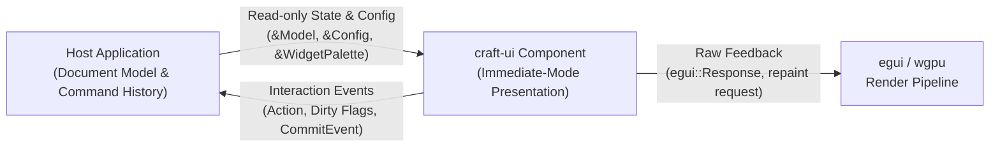
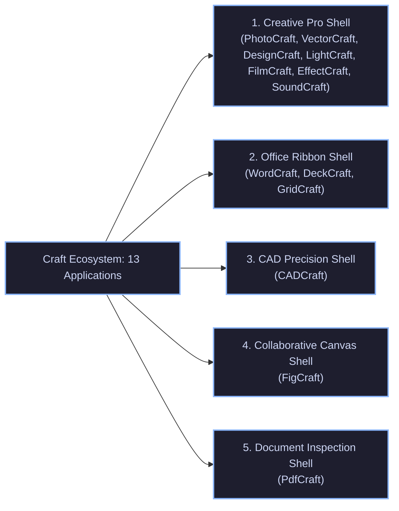
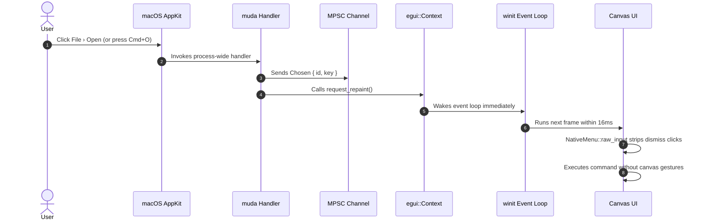
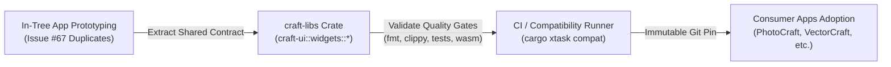

# Craft Application Ecosystem: Master UI Elements and Interaction Map

> **Nature:** Descriptive Component Inventory & Deduplication Evidence  
> **Audited Date:** 2026-10-13  
> **Audited Baseline:** 1,290 UI implementation files across 13 Craft applications  
> **Maintenance Policy:** Point-in-time reference snapshot. This inventory provides evidence for extraction decisions; it does not impose a permanent obligation to centralize every similar component. As applications evolve, this inventory may be refreshed against new revisions using workspace file audits.

### Audited Application Revisions

| Application | Audited Commit | UI Files Audited | Shell Archetype |
| :--- | :--- | :--- | :--- |
| **PhotoCraft** (`photocraft`) | `29f3656f` | 142 | Creative Studio Workstation |
| **VectorCraft** (`vectorcraft`) | `504e7192` | 118 | Creative Studio Workstation |
| **DesignCraft** (`designcraft`) | `91263c9` | 94 | Creative Studio Workstation |
| **LightCraft** (`lightcraft`) | `b3d392b4` | 82 | Creative Studio Workstation |
| **FilmCraft** (`filmcraft`) | `5e1ded33` | 165 | Creative Studio Workstation |
| **EffectCraft** (`effectcraft`) | `470ea7a3` | 134 | Creative Studio Workstation |
| **SoundCraft** (`soundcraft`) | `6cf896e` | 76 | Creative Studio Workstation |
| **CADCraft** (`cadcraft`) | `00c7613` | 88 | CAD Precision Geometry |
| **PDFCraft** (`pdfcraft`) | `e88dd728` | 104 | Document Inspection |
| **WordCraft** (`wordcraft`) | `159b84f` | 102 | Document Productivity Ribbon |
| **DeckCraft** (`deckcraft`) | `1660982` | 78 | Document Productivity Ribbon |
| **GridCraft** (`gridcraft`) | `84acf62` | 64 | Document Productivity Ribbon |
| **FigCraft** (`figcraft`) | `e56856f` | 43 | Minimalist Collaborative Canvas |
| **Total Ecosystem** | N/A | **1,290** | All 5 Shell Archetypes |

### Inventory Methodology & Reproducibility Protocol

To ensure reproducible audits by independent contributors, files included in the 1,290 UI file count satisfy the following selection criteria:

1. **Qualification Scope**:
   - Rust source files (`*.rs`) located within designated presentation crates and desktop runner applications:
     - Application UI crates: `crates/*ui*/**/*.rs`, `crates/*egui*/**/*.rs`, `crates/interface/**/*.rs`, and `crates/shell/**/*.rs`.
     - Desktop runner applications: `apps/**/src/**/*.rs`.
2. **Exclusion Scope**:
   - Headless domain engines (`crates/core`, `crates/geom`, `crates/math`, `crates/model`, `crates/filters`, `crates/crypt`).
   - External vendored trees (`vendor/**`), target artifacts (`target/**`), test fixtures (`tests/data/**`), and non-Rust configuration/asset files.
3. **Reproduction Command**:
   Within any audited application repository at its specified commit hash:
   ```bash
   git ls-files 'crates/*ui*/**/*.rs' 'crates/*egui*/**/*.rs' 'crates/interface/**/*.rs' 'apps/**/src/**/*.rs' | wc -l
   ```

---

## 1. Executive Summary & Design System Axioms

The Craft UI architecture implements a pure-Rust, immediate-mode presentation layer built on `egui` and `wgpu`. The interface layer adheres to five architectural non-negotiables:

1. **Layer Independence**: UI presentation code never executes core domain mathematics; domain compute engines never make GUI framework calls.
2. **Never Crash**: All widget rendering, layout calculations, and string formatting forbid panics, unwraps, and unreachable code paths at compile time via `#![deny(clippy::unwrap_used, clippy::expect_used, clippy::panic)]`.
3. **Strict Memory Safety**: Unsafe code is forbidden across all presentation modules via `#![forbid(unsafe_code)]`.
4. **WASM Clean**: All UI components compile cleanly for `wasm32-unknown-unknown` without thread stalls or platform-specific clock dependencies.
5. **Predictable Input Isolation**: Modal overlays, drag interactions, and native menus isolate underlying canvas tools, preventing unintended drawing operations.

### 1.1 Immediate-Mode Input/Output Architecture



The separation ensures presentation components never own or mutate document state directly. The host application provides read-only state and configuration slices on each frame, while the widget returns an `egui::Response` alongside discrete typed event values.

---

## 2. Shell Archetypes Across the 13 Applications

The thirteen applications group into five distinct desktop shell archetypes based on their commercial workflow requirements:

```
┌────────────────────────────────────────────────────────────────────────┐
│                        FIVE SHELL ARCHETYPES                           │
├────────────────────────────────────────────────────────────────────────┤
│ 1. Creative Studio Workstation Shell                                   │
│    Apps: PhotoCraft, VectorCraft, DesignCraft, LightCraft,             │
│          FilmCraft, EffectCraft, SoundCraft                            │
│    Traits: Docked multi-panel layouts, collapsible tool palettes,      │
│            canvas viewports, rulers, dark themes (cards r=0 or r=4).   │
├────────────────────────────────────────────────────────────────────────┤
│ 2. Document Productivity Ribbon Shell                                  │
│    Apps: WordCraft, DeckCraft, GridCraft                               │
│    Traits: Tabbed ribbon header, responsive group collapse,            │
│            integrated title bar, status bar with ZoomBar (cards r=4).  │
├────────────────────────────────────────────────────────────────────────┤
│ 3. CAD Precision Geometry Shell                                        │
│    Apps: CADCraft                                                      │
│    Traits: Full-bleed canvas, floating tool set palettes, coordinate   │
│            readout status bar, dark canvas with light UI.              │
├────────────────────────────────────────────────────────────────────────┤
│ 4. Minimalist Collaborative Canvas Shell                               │
│    Apps: FigCraft                                                      │
│    Traits: Full-bleed infinite artboard, floating contextual toolbar,  │
│            collapsible layer and property sidebars, presence avatars.  │
├────────────────────────────────────────────────────────────────────────┤
│ 5. Document Inspection Shell                                           │
│    Apps: PDFCraft                                                      │
│    Traits: Split-pane page navigation, form inspection fields,         │
│            continuous vertical scroll layout, signature badges.        │
└────────────────────────────────────────────────────────────────────────┘
```



---

## 3. Comprehensive Application UI Elements Matrix

### 3.1 General UI Chrome Matrix

| Application | Shell Archetype | Title Bar & Header | Menu Bar | Primary Chrome Layout | Surface Style | Font Controls | Canvas Rulers | Status Bar & Zoom | Accent Color |
| :--- | :--- | :--- | :--- | :--- | :--- | :--- | :--- | :--- | :--- |
| **PhotoCraft** | Creative Pro | Integrated macOS 28px; full bleed | Native muda (`craft-menu` candidate) | Docked panels; left 36px tool rail | Flat; r=0; 2px gap | FontBox candidate (PR #34); recents | H+V edge rulers; drag zero point | 22px bar; ZoomBar slider (PR #33) | Dark `#2F7CF6` |
| **VectorCraft** | Creative Pro | Integrated macOS 28px; full bleed | Native muda (`craft-menu` candidate) | Docked panels; left 36px tool rail | Flat; r=0; 2px gap | FontBox candidate (PR #34); recents | H+V edge rulers; drag zero point | 22px bar; ZoomBar slider (PR #33) | Dark `#FF7C26` |
| **DesignCraft** | Creative Pro | Native OS or integrated header | Native muda (`craft-menu` candidate) | Docked panels; master spread view | Flat; r=0; 2px gap | Character panel; FontBox candidate | H+V edge rulers; unit scales | 22px bar; spread navigator; zoom | Dark `#D83080` |
| **PDFCraft** | Document Inspector | Native OS title bar | Native muda (`craft-menu` candidate) | Left thumbnail rail; center page | Flat; r=4 cards | Text annotation font combo | none (page dimension readout) | 24px bar; page counter; zoom bar | Dark `#E5252A` |
| **LightCraft** | Creative Pro | Minimalist custom header | Native muda (`craft-menu` candidate) | Left catalog rail; right dev panel | Flat; r=0; dark | none (non-text application) | none (crop grid overlays) | Filmstrip footer; zoom dropdown | Dark `#2EA8FF` |
| **FilmCraft** | Creative Pro | Integrated header with tabs | Native muda (`craft-menu` candidate) | Docked timeline, monitor, media | Flat; r=0; 4px gap | Essential graphics font combo | Timeline timecode rulers | 20px status; monitor zoom drop | Dark `#2F6BDF` |
| **EffectCraft** | Creative Pro | Integrated header; tool bar | Native muda (`craft-menu` candidate) | Docked comp viewer, graph, layers | Cards; r=6 (sm r=3) | Character panel; custom font box | Viewer rulers; pixel coordinates | Toast notifications; zoom drop | Dark `#2D8CEB` |
| **CADCraft** | CAD Precision | Integrated macOS 28px header | Native muda (`craft-menu` candidate) | Toolbar 34px; floating tool sets | Flat; r=0; dark | Plot styles text mapping | none (coordinate grid cursor) | 26px bar; coordinates; snap toggles | Dark `#2F7CF6` |
| **SoundCraft** | Creative Pro | Native OS title bar | In-window 24px + native muda | Docked Edit/Mix windows; toolbar | Flat; r=4 groups | none (audio application) | Timeline rulers: Bars/Beats, Min/Sec | 22px bar: sample rate, clock, bits | Dark `#4080D0` |
| **WordCraft** | Office Ribbon | Integrated ribbon title bar | Ribbon File menu + native muda | Ribbon with collapsible groups | Cards; r=4 | FontBox (PR #34); size dropdown | Horizontal page ruler | 24px bar; word count; ZoomBar (#1033) | Dark `#185ABD` |
| **DeckCraft** | Office Ribbon | Integrated ribbon title bar | Ribbon File menu + native muda | Ribbon with slide thumbnail rail | Cards; r=4 | FontBox (PR #34); size dropdown | Slide canvas edge rulers | 24px bar; slide counter; ZoomBar (#267) | Dark `#C43E1C` |
| **GridCraft** | Office Ribbon | Integrated ribbon title bar | Ribbon File menu + native muda | Ribbon with formula bar & sheet | Cards; r=4 | FontBox (PR #34); size dropdown | Column (A-Z) and Row (1-N) rulers | 24px bar; sheet tabs; ZoomBar (#779) | Dark `#107C41` |
| **FigCraft** | Collab Canvas | Floating top toolbar | In-window contextual menu | Left layer panel; right inspector | Cards; r=6 | Typography inspector; font family | Dynamic canvas rulers on drag | Floating zoom readout (Cmd+0/1/2) | Dark `#0D99FF` |

### 3.2 Structural Elements Matrix: Cards, Viewers, Containers, and Overlays

| Application | Card & Surface Geometry | Viewer Archetype | Primary Containers & Layout | Overlays & Floating HUDs | Start Screen & Navigation |
| :--- | :--- | :--- | :--- | :--- | :--- |
| **PhotoCraft** | Flat `r=0`; hairline border `#2B2B2B`; recessed field wells `#1E1E1E` | Infinite canvas; 16px alpha checkerboard; scissor clipping | Binary split dock; 36px vertical tool rail; 26px tab strip | Contextual tool options bar; modal export sheets | Start grid; places navigation candidate (PR #50) |
| **VectorCraft** | Flat `r=0`; hairline border `#2B2B2B`; recessed field wells `#1E1E1E` | Infinite canvas; artboard bounds; outline vs preview modes | Binary split dock; 36px vertical tool rail; tear-off panels | Transform HUD; popover flyout tool menus | Start grid; places navigation candidate (PR #50) |
| **DesignCraft** | Flat `r=0`; hairline border `#2B2B2B`; page spread wells | Paginated spread viewer; facing pages; bleed & slug guides | Binary split dock; master pages palette; story editor window | Frame edge highlights; text thread link lines | Start grid; asset link tracking (PR #420) |
| **PDFCraft** | Cards `r=4`; soft border `#383838`; flat grey surround | Paginated continuous stream; single/two-up; page box outlines | Split left thumbnail sidebar; main page scroller; inspector | Form field highlight overlays; signature badges | Places panel (PR #50); open recent files |
| **LightCraft** | Flat `r=0`; dark panels `#202022`; collapsible module rollups | Non-destructive RAW loupe; 1:1 detail zoom; split compare | Left catalog/folder tree; right develop accordion stack | Spot removal reticle; graduated filter pins; filmstrip | Catalog switcher; folder import modal |
| **FilmCraft** | Flat `r=0`; 4px gutter; dark charcoal `#1C1C1E` | Dual-monitor (Source/Program); title/action safe overlays | Docked timeline with track headers; media browser; scopes | Timecode HUD; marker flags; audio VU meters | Start project screen; workspace layout presets |
| **EffectCraft** | Cards `r=6` (small controls `r=3`); border `#333333` | Composition viewer; layer wireframes; motion path splines | Docked viewer, graph editor, comp timeline, effect controls | Layer transform handles; mask vertex points; toast alerts | Project start screen; effect preset browser |
| **CADCraft** | Flat `r=0`; dark high-contrast `#2A2A2A` | Full-bleed vector drafting canvas; infinite polar grid | Floating tool sets; command line dock 28px; property palette | 3D ViewCube; cursor coordinate HUD; snap markers | Recovery staging; recent drawings grid (#911) |
| **SoundCraft** | Flat `r=4`; dark slate `#1E2024` | Multi-track timeline ruler; waveform display; edit grid | Dual-window dock (Edit window vs Mix console window) | Channel strip faders; peak level meters; automation lanes | Session template chooser; recent sessions |
| **WordCraft** | Cards `r=4`; soft elevation; light/dark card tokens | Paginated page view; margin guides; text flow boundaries | 96px tabbed ribbon header; responsive group collapse | Table resize markers; floating mini format bar | Full-window Backstage; places navigation (PR #50) |
| **DeckCraft** | Cards `r=4`; soft elevation; light/dark card tokens | Slide canvas viewport; slide aspect ratio guide (16:9, 4:3) | 96px ribbon; left slide thumbnail rail; presenter view | Shape alignment smart guides; color fill popovers | Full-window Backstage (#381); places panel (#50) |
| **GridCraft** | Cards `r=4`; soft elevation; light/dark card tokens | Virtualized spreadsheet cell grid; formula bar container | 96px ribbon; multi-sheet workbook tab bar; formula bar | Cell selection marquee; auto-fill drag handle | Full-window Backstage (#958); places panel (#50) |
| **FigCraft** | Cards `r=6`; subtle elevation shadow `#00000028` | Infinite collaborative artboard; dynamic distance guides | Floating top toolbar; left layer tree; right property panel | Selection bounding box; gap drag handles; presence avatars | Team project browser; version history modal |

---

## 4. Core Interactive Behaviors & Component Specifications

### 4.1 Native Menu Event Wakeup & Input Isolation (`craft-menu`)

When a user interacts with a macOS menu bar, AppKit executes a modal tracking loop on the main thread. Without special handling, immediate-mode frameworks stall because no window input occurs.



#### Behavioral Rules

- **Immediate Repaint**: Every menu click and key equivalent triggers `repaint.request_repaint()`, eliminating the 8 to 90 second lag documented in `storytold/designcraft#784`.
- **Dismissal Click Suppression**: Clicking outside an open menu or pressing Escape dismisses the menu. `NativeMenu::raw_input` identifies active menu tracking and removes the pointer button or Escape key from `egui::RawInput`, preventing unintended painting strokes on the canvas.
- **Text-Editing Key Protection**: When a text field has keyboard focus (`ctx.wants_keyboard_input()`), standard editing keys (Cmd+C, Cmd+X, Cmd+V, Cmd+A, Cmd+Z, Shift+Cmd+Z) remain assigned to the text field. Global application shortcuts (such as Cmd+S for Save or Cmd+N for New) execute their commands immediately as menu clicks.

---

### 4.2 Scrubbable Numeric Fields (`craft-ui::widgets::numeric`)

Numeric property inputs in creative applications (stroke weight, opacity, font size, coordinates) support three distinct interaction modes:

```
┌────────────────────────────────────────────────────────┐
│                   NUMERIC FIELD INTERACTION MODES                      │
├────────────────────────────────────────────────────────┤
│ 1. Label Scrubbing (Pointer Drag)                                      │
│    • Hover label: mouse cursor changes to resize horizontal.           │
│    • Left-click drag: adjusts value continuously.                      │
│    • Standard drag: step = 1.0.                                        │
│    • Shift + drag: coarse step = 10.0.                                 │
│    • Alt/Option + drag: fine step = 0.1.                               │
│    • Mouse wheel: increments or decrements by active step.             │
├────────────────────────────────────────────────────────┤
│ 2. Direct Text Entry                                                   │
│    • Double-click field: activates inline text editing.                │
│    • Supports math evaluation: typing "100 / 2" evaluates to 50.0.     │
│    • Supports unit conversions: typing "12pt" converts to pixels.      │
│    • Up / Down arrow keys: increments/decrements value.                │
│    • Enter key: commits value and closes editor.                       │
│    • Escape key: cancels edit and restores original value.             │
├────────────────────────────────────────────────────────┤
│ 3. Bounds & Value Clamping                                             │
│    • Hard bounds: value cannot exceed defined range [min, max].        │
│    • Soft bounds: visual warning displayed if value exceeds ideal.     │
└────────────────────────────────────────────────────────┘
```

#### Memory State & Delta Accumulation

In `vectorcraft/crates/ui-egui/src/scrub.rs`:

```rust
pub const PX_PER_STEP: f32 = 2.0;
const LABEL_GAP: f32 = 64.0;

#[derive(Clone, Copy, Debug)]
pub struct Scrub {
    pub zone: Id,          // egui widget identifier for the field or label
    pub start: f64,        // Value when drag began (restored on Escape)
    pub pending: f64,      // Accumulated drag distance not yet applied
    pub step: f64,         // Current step quantum based on active modifiers
    pub moved: bool,       // True once value has mutated during drag
    pub cancelled: bool,   // True if Escape terminated the drag
}
```

#### Behavioral Rules

- **Pointer Grab**: Hovering over a scrubbable label (`X:`, `Y:`, `W:`, `H:`, `Opacity:`) changes the cursor to `CursorIcon::ResizeHorizontal`.
- **Modifier Scaling**: Standard drag steps 1.0 unit per 2.0 screen points. Shift multiplies step by 10.0; Alt/Option or Ctrl divides step by 10.0 (0.1 step).
- **Undo Group Compression**: All drag updates compress into a single undo command via `begin_frame` / `end_frame`. Pressing Escape restores `scrub.start` and discards the undo frame.

---

### 4.3 Canvas Rulers & Drag-and-Drop Zero Point (`craft-ui::widgets::ruler`)

Applications with spatial artboards share a coordinate ruler model:

```
(0, 0) Origin
  ┌───┬──────────────────────────────────────────────────────────────┐
  │ ✛ │ 0   20   40   60   80   100  120  140  160  180  200  220  240 │ (Horizontal Ruler)
  ├───┼──────────────────────────────────────────────────────────────┤
  │ 0 │                                                              │
  │   │                                                              │
  │20 │                                                              │
  │   │                                                              │
  │40 │                        CANVAS VIEWPORT                       │
  │   │                                                              │
  │60 │                                                              │
  └───┴──────────────────────────────────────────────────────────────┘
  (Vertical Ruler)
```

#### Behavioral Rules

- **Origin Crosshair Drag**: Clicking and dragging from the top-left intersection box (`✛`) draws a tracking crosshair across the canvas. Releasing the mouse sets the artboard origin `(0.0, 0.0)` at the cursor position. Double-clicking the intersection box immediately restores the origin to the top-left edge of the primary artboard or page spread.
- **Guide Creation & Deletion**: Dragging from the horizontal ruler draws a horizontal guideline. Dragging from the vertical ruler draws a vertical guideline. Dragging a guide off the canvas deletes it via undoable command `view.deleteGuide`.
- **Tick Subdivisions**: Evaluated via `nice_step(min_distance, whole_units)` with multiplier steps `[1.0, 2.0, 2.5, 5.0]` scaling by 10.0. Major ticks show labels; medium ticks show half intervals; minor ticks show tenths.
- **Unit Conversion Matrix**:
  - `Points`: 1 pt = 1/72 inch
  - `Inches`: 1 in = 72 pt
  - `Millimeters`: 1 mm = 2.83465 pt
  - `Pixels`: 1 px = 1 display unit at 100% zoom

---

### 4.4 ZoomBar & Logarithmic Viewport Scaling (`craft-ui::ZoomBar`)

All three office applications (WordCraft, GridCraft, DeckCraft) and PhotoCraft utilize bottom-right zoom sliders with logarithmic progression:

```
[-] ─────────────●───────────── [+]  100%  [Fit]
 10%            100%            500%
```

#### Behavioral Rules

- **Logarithmic Centering**: The center point of the slider track (`t = 0.5`) represents 100% (1:1 pixel parity). Moving left scales logarithmically down to 10% (`0.10 * 10^(2t)`); moving right scales up to 500% (`1.00 * 5^(2(t-0.5))`).
- **Snapping Zone**: Dragging within `[96.0%, 104.0%]` snaps strictly to `1.00` (100%) to ensure integer pixel rendering without fractional blit interpolation.
- **Step Buttons**: Clicking `[-]` decrements zoom to the next standard preset: `[10%, 25%, 33.3%, 50%, 66.7%, 75%, 100%, 125%, 150%, 200%, 300%, 400%, 500%]`. Clicking `[+]` increments to the next preset.
- **Pivot Preservation**: ZoomBar adjustments center zoom on the viewport center point `screen.center()`. Mouse wheel or pinch gestures preserve the canvas coordinate directly beneath the cursor.

---

### 4.5 Visual Keyboard Shortcut Editor (`craft-ui::widgets::shortcuts`)

FilmCraft and EffectCraft require interactive keyboard layout editors for complex editing workflows:

```
┌────────────────────────────────────────────────────────────────────────┐
│                     KEYBOARD SHORTCUT EDITOR                           │
├────────────────────────────────────────────────────────────────────────┤
│ Active Modifier: [ ] Shift  [x] Command  [ ] Option  [ ] Control       │
│                                                                        │
│ ┌───┐ ┌───┬───┬───┬───┐ ┌───┬───┬───┬───┐ ┌───┬───┬───┬───┐ ┌───┬───┐  │
│ │Esc│ │F1 │F2 │F3 │F4 │ │F5 │F6 │F7 │F8 │ │F9 │F10│F11│F12│ │Prn│Scr│  │
│ └───┘ └───┴───┴───┴───┘ └───┴───┴───┴───┘ └───┴───┴───┴───┘ └───┴───┘  │
│ ┌───┬───┬───┬───┬───┬───┬───┬───┬───┬───┬───┬───┬───┬───────┐ ┌───┬───┐  │
│ │ ~ │ 1 │ 2 │ 3 │ 4 │ 5 │ 6 │ 7 │ 8 │ 9 │ 0 │ - │ = │ Back  │ │Ins│Hom│  │
│ ├───┴─┬─┴─┬─┴─┬─┴─┬─┴─┬─┴─┬─┴─┬─┴─┬─┴─┬─┴─┬─┴─┬─┴─┬─┴─┬─────┤ ├───┼───┤  │
│ │ Tab │ Q │ W │ E │ R │ T │ Y │ U │ I │ O │ P │ [ │ ] │  \  │ │Del│End│  │
│ ├─────┴┬──┴┬──┴┬──┴┬──┴┬──┴┬──┴┬──┴┬──┴┬──┴┬──┴┬──┴┬──┴─────┤ └───┴───┘  │
│ │ Caps │ A │ S │ D │ F │ G │ H │ J │ K │ L │ ; │ ' │  Enter  │            │
│ ├──────┴─┬─┴──┬─┴──┬─┴──┬─┴──┬─┴──┬─┴──┬─┴──┬─┴──┬─┴──┬────┤     ┌───┐  │
│ │ Shift  │ Z  │ X  │ C  │ V  │ B  │ N  │ M  │ ,  │ .  │ /  │     │ ↑ │  │
│ └────────┴────┴────┴────┴────┴────┴────┴────┴────┴────┴─────┘ ┌───┼───┼───┐
│                                                               │ ← │ ↓ │ → │
│ Color Legend:                                                 └───┴───┴───┘
│ ■ Navigation  ■ Editing Tool  ■ Timeline Command  ■ Unassigned         │
└────────────────────────────────────────────────────────────────────────┘
```


#### Behavioral Rules

- **Physical Scancode Binding**: Bindings index against USB HID scancodes rather than character keycodes, preserving physical keycap locations regardless of software layout (QWERTY, QWERTZ, AZERTY).
- **Modifier Toggle**: Toggling Shift, Command, Option, or Control updates the entire keycap matrix to reflect shortcuts active under that modifier chord.
- **Conflict Highlighting**: Duplicate assignments in the same scope trigger amber keycap highlights (`#E5A93C`) and collision dialogs offering Reassign or Swap actions.

---

### 4.6 Card Architecture & Recessed Wells

Cards host properties, layer lists, color pickers, and tool controls:

```
┌────────────────────────────────────────────────────────┐
│ [▼] Card Title Header                        [···] [×] │  <-- 24px/28px Header Well
├────────────────────────────────────────────────────────┤
│ Inner Padding: 8px horizontal, 6px vertical            │
│ Content Slot: Recessed Fields, Sliders, Pickers        │
│                                                        │
│ ┌────────────────────────────────────────────────────┐ │
│ │ Recessed Sub-Well (fill: t.field, r=2)             │ │  <-- Recessed control group
│ └────────────────────────────────────────────────────┘ │
└────────────────────────────────────────────────────────┘
```

#### Behavioral Rules

- **Recessed Control Wells**: Text inputs, numeric steppers, and lists sit inside recessed wells (`Tokens::field`). In dark themes, the card background is lighter than the recessed well (e.g. Card `#282828`, Well `#1E1E1E`), providing depth without gradients.
- **Header Disclosure State**: Clicking the card header collapse triangle (`▼` / `▶`) toggles visibility. Collapsed cards contract to their 24px header height with zero body allocation.
- **Module Bypass Toggles**: In LightCraft Develop cards, card headers feature an eye toggle icon button. Disabling the eye bypasses that specific compute stage in the non-destructive pipeline without losing parameter state.

---

### 4.7 Viewer Archetypes & Hardware Scissor Clipping

Viewers blit raster frames, vector paths, or paginated document spreads to the display:

```
┌────────────────────────────────────────────────────────────────────────┐
│                         FOUR VIEWER ARCHETYPES                         │
├────────────────────────────────────────────────────────────────────────┤
│ 1. Infinite Spatial Canvas (PhotoCraft, VectorCraft, FigCraft)          │
│    • Unbounded pasteboard with dark surround (#181818).                │
│    • Hardware checkerboard pattern for alpha transparency.             │
│    • Arbitrary pan and smooth zoom (10% to 6400%).                     │
│    • Hardware scissor rects isolate rendering to viewport bounds.      │
├────────────────────────────────────────────────────────────────────────┤
│ 2. Paginated Document Viewer (DesignCraft, PDFCraft, WordCraft)        │
│    • Page bounding boxes with realistic drop shadows (2px blur).       │
│    • Continuous vertical stream (PDFCraft) vs facing spreads (Design). │
│    • Visible bleed guides (red 0.5pt) and margin boundaries (magenta). │
├────────────────────────────────────────────────────────────────────────┤
│ 3. Audio/Video Playback Monitors (FilmCraft, EffectCraft)              │
│    • Source and Program dual-monitor split with transport controls.    │
│    • Title Safe (80%) and Action Safe (90%) wireframe overlays.        │
│    • Non-square pixel aspect ratio (PAR) anamorphic correction.        │
│    • Frame blitting synchronized with media ticks via wgpu surfaces.   │
├────────────────────────────────────────────────────────────────────────┤
│ 4. CAD Spatial Geometry Viewer (CADCraft)                              │
│    • Full-bleed canvas with interactive ViewCube orientation widget.   │
│    • Orthographic vs Perspective camera projection toggles.            │
│    • Infinite polar coordinate tracking grid with crosshair cursor.    │
└────────────────────────────────────────────────────────────────────────┘
```


#### Behavioral Rules

- **Transparency Checkerboard**: When viewing documents with transparency (PhotoCraft, VectorCraft), viewports render an alternating 16x16 pixel checkerboard (`#282828` and `#323232`) beneath the document canvas.
- **Hardware Scissor Clipping**: All viewer rendering passes call `ui.set_clip_rect(viewport_rect)`. Objects outside the active canvas viewport are culled at the GPU rasterizer stage.
- **High-DPI Coordinate Mapping**: Canvas shaders render at native physical resolution (`wgpu::TextureView`), while egui overlays (rulers, selection bounds, text cursors) render at logical point coordinates:
  $$ ext{Physical Framebuffer Pixels} =  ext{Screen Points}  imes  ext{Display Scale Factor}$$

---

### 4.8 Container Topology & Splitter Physics

Containers manage layout hierarchies, docking panels, tool strips, and tab groupings:

```
┌────────────────────────────────────────────────────────┐
│                        SPLIT DOCK CONTAINER                            │
├───────────────────────────────────┬────────────────────────────────────┤
│ Left Panel Container (width: 280) │ Center Viewport Container          │
│ ┌───────────────────────────────┐ │ ┌────────────────────────────────┐ │
│ │ Tab Strip: [Layers] [Paths]   │ │ │ Viewport Canvas                │ │
│ ├───────────────────────────────┤ │ │                                │ │
│ │ Layer Tree List               │ │ │                                │ │
│ │ (virtualized scroll area)     │ │ │                                │ │
│ └───────────────────────────────┘ │ └────────────────────────────────┘ │
│ ◄─────── Splitter Bar ──────────┼────────────────────────────────────► │
│ Bottom Panel Container           │                                    │
│ ┌───────────────────────────────┐ │                                    │
│ │ Timeline / Properties         │ │                                    │
│ └───────────────────────────────┘ │                                    │
└───────────────────────────────────┴────────────────────────────────────┘
```

#### Behavioral Rules

- **Splitter Physics (`craft-ui::layout::SplitPane`)**: 4px interactive pointer grab zone centered over a 1px visible divider line (`Tokens::separator`). Dragging adjusts container split ratios (`[0.05, 0.95]`), preventing accidental collapse to 0px. Double-clicking a splitter bar resets the split to default equal proportions.
- **Tab Wells & Tab Strips (`craft-ui::tabs`)**: Fixed 26px height container with horizontal tab layout. Inactive tabs display flat background matching card fill with muted text (`Tokens::text_dim`). Active tabs display lighter surface fill, high-contrast text (`Tokens::text`), and a 2px accent indicator bar (`Tokens::accent`). Close button (`×`) provides a 12x12px hit box with soft hover rounding.
- **Tool Rails (`photocraft/crates/ui-egui/src/toolbar.rs`)**: 36px fixed width vertical container on the left screen edge with single-column vs dual-column toggle. Tools containing nested siblings display a 4px corner triangle (`◢`); long-pressing or right-clicking pops out a horizontal menu of alternate tools.
- **Office Ribbon Groups (`craft-ui` PR #34)**: 96px header container divided into functional groups (Clipboard, Font, Paragraph, Styles). Groups separated by 1px vertical dividers (`Tokens::separator`). As window width decreases, groups scale from Full Layout to Compact Icon Grid to a Single Overflow Dropdown Button.
- **Scroll Areas**: 8px track width, 0px border. Track remains invisible until hovered; thumb expands from 4px to 6px on hover. Virtualized list rendering renders only visible items plus an offscreen buffer of 2 items above and below.

---

### 4.9 Overlays, Contextual HUDs & Modal Sheets

Overlays provide contextual interaction without disrupting underlying window geometry:

```
┌────────────────────────────────────────────────────────┐
│ [Modal Backdrop: #00000080 captures all pointer clicks]│
│                                                        │
│        ┌──────────────────────────────────────┐        │
│        │ Modal Dialog Sheet (r=6, shadow=16)  │        │
│        ├──────────────────────────────────────┤        │
│        │ Export Document As...                │        │
│        │                                      │        │
│        │ [Cancel]                    [Export] │        │
│        └──────────────────────────────────────┘        │
└────────────────────────────────────────────────────────┘
```

#### Behavioral Rules

- **Modal Dialog Sheets**: Centered window sheet over a translucent backdrop (`Color32::from_black_alpha(128)`). Backdrop captures all pointer events, preventing mouse clicks from bleeding into the canvas or toolbars. Escape triggers Cancel; Enter triggers the default primary action.
- **Contextual Floating HUDs**: Floats above canvas tools during interactive creation (e.g. CADCraft dynamic length/angle inputs, VectorCraft transform readouts). 2px corner radius, dark semi-transparent fill (`Color32::from_black_alpha(200)`), white text, positioned with a 12px offset from the mouse pointer to prevent obscuring the cursor crosshair.
- **Dropdown Popovers with Boundary Auto-Flip**: Standard anchor opens directly below trigger widgets. If `anchor.bottom() + popover.height() > screen.height()`, the popover automatically flips to open above the trigger widget (`anchor.top() - popover.height()`).

---

### 4.10 Color Systems, Swatch Libraries & Screen Eyedropper (`craft-ui::widgets::color`)

Color selection unifies interactive color spaces, binary swatch import, and pixel sampling:

```
┌────────────────────────────────────────────────────────┐
│ [HSV Gradient Saturation/Value Square (180x180)]       │
│                                                        │
│ ┌─●──────────────────────────────────────────────────┐ │  <-- Hue Slider Track
│ └────────────────────────────────────────────────────┘ │
│ ┌─●──────────────────────────────────────────────────┐ │  <-- Alpha Slider Track
│ └────────────────────────────────────────────────────┘ │
├────────────────────────────────────────────────────────┤
│ R: [ 255 ]  G: [ 128 ]  B: [   0 ]  Hex: [ #FF8000   ] │
│ C: [   0 ]  M: [  50 ]  Y: [ 100 ]  K:   [   0       ] │
├────────────────────────────────────────────────────────┤
│ Recent Swatches: [■] [■] [■] [■] [■] [■] [■] [■] [+]   │
└────────────────────────────────────────────────────────┘
```

#### Behavioral Rules

- **Synchronized Color Models**: Mutating any color channel (RGB, CMYK, HSL, or Hex) immediately converts through `craft-cms` and updates all parallel fields without rounding drift.
- **ASE Swatch Import**: Implements Swatch Exchange (`.ase`) binary decoding (`designcraft#567`), extracting global swatches, spot colors, and swatch groups into named palettes.
- **Recent Swatches Memory**: Bounded LRU cache holding the 16 most recently applied colors. Double-clicking a swatch applies it to the active selection; right-clicking provides options to delete or rename.
- **Screen Eyedropper & Loupe**: Clicking the eyedropper icon activates global pointer capture. Moving over the window renders a circular 5x5 pixel zoom loupe with an RGB readout beneath the cursor, sampling exact untagged framebuffer pixels.

---

### 4.11 Layer Hierarchies, Tree Views & Inline Renaming (`craft-ui::widgets::tree`)

Document tree views manage nested layers, artboards, groups, and symbol hierarchies:

```
┌────────────────────────────────────────────────────────┐
│ Layers                                        [+][🗑]  │
├────────────────────────────────────────────────────────┤
│ ▼ [👁] [🔒] Folder: Hero Artwork                      │
│   ├── [👁] [ ] Vector Path: Logo Mark                  │
│   ├── [👁] [ ] ↳ Clipping Mask: Texture                │  <-- Indented clipping layer
│   └── [👁] [🔒] Text: Headline                         │
│ ────────────────────────────────────────────────────── │  <-- Blue Drag Insertion Line
│ ▶ [👁] [ ] Folder: Background Elements                 │
└────────────────────────────────────────────────────────┘
```

#### Behavioral Rules

- **Virtualized Tree Rendering**: Virtualized list geometry allocates only visible 24px rows plus a 2-row buffer above and below, maintaining 60 FPS across trees with thousands of layers.
- **Depth Indentation**: Nested children indent 16px per hierarchy tier. Expander chevrons (`▼` / `▶`) toggle child visibility with zero-allocation when collapsed.
- **Drag Reordering & Reparenting**:
  - Dragging between two rows renders a 2px blue horizontal insertion line (`Tokens::accent`), moving the layer to that index.
  - Dragging directly onto a folder row highlights the entire row with a soft accent well, parenting the layer inside that group.
- **State Toggles (Visibility & Lock)**:
  - Clicking the eye (`👁`) toggles visibility. Clicking and dragging vertically across multiple eye icons toggles visibility continuously down the stack without multiple individual clicks.
  - Clicking the padlock (`🔒`) toggles edit lock.
- **Inline Renaming**: Double-clicking a layer name replaces the label with an inline `TextEdit` buffer. Pressing Enter or clicking outside commits the new name; pressing Escape restores the previous name.

---

### 4.12 Typography Engine, FontBox & Local Font Access (`craft-ui::widgets::font`)

Typographic inspection combines font family selection, style variants, and optical sizing:

```
┌────────────────────────────────────────────────────────┐
│ Font: [ Inter                       ▼ ]  Style: [Bold] │
├────────────────────────────────────────────────────────┤
│ Recent Fonts:                                          │
│   Inter              | The quick brown fox jumps       │
│   JetBrains Mono     | The quick brown fox jumps       │
├────────────────────────────────────────────────────────┤
│ All System Fonts:                                      │
│   Arial              | The quick brown fox jumps       │
│   Courier New        | The quick brown fox jumps       │
│   Helvetica Neue     | The quick brown fox jumps       │
└────────────────────────────────────────────────────────┘
```

#### Behavioral Rules

- **FontBox Glyph Previews (PR #34)**: The font family dropdown displays the typeface name in the application UI font on the left, paired with a preview string rendered in the actual font face on the right.
- **Variant Cascades**: Selecting a family updates the Style dropdown with available typographic weights (Thin, Light, Regular, Medium, Semi-Bold, Bold, Extra-Bold, Black, and matching Italics).
- **Recent Fonts LRU**: Pins the top 5 recently used typefaces above a horizontal divider line, saving scroll time in large font libraries.
- **Web Local Font Access (WASM)**: In browser builds (`deckcraft#386`, `gridcraft#393`), font lists asynchronously query the browser `window.queryLocalFonts()` API, falling back to bundled fonts if permission is denied.

---

### 4.13 Context Menus & Right-Click Interaction Physics (`craft-ui::menu::context`)

Contextual menus provide spatial commands directly at the pointer position:

```
┌────────────────────────────────────────────────────────┐
│ Canvas Selection                                       │
│ ┌────────────────────────────────────────┐             │
│ │ Bring to Front                ⇧⌘]      │             │
│ │ Bring Forward                  ⌘]      │             │
│ │ Send Backward                  ⌘[      │             │
│ │ Send to Back                  ⇧⌘[      │             │
│ ├────────────────────────────────────────┤             │
│ │ Group Selection                ⌘G      │             │
│ │ Ungroup Selection             ⇧⌘G      │             │
│ └────────────────────────────────────────┘             │
└────────────────────────────────────────────────────────┘
```

#### Behavioral Rules

- **Selection Hit-Testing on Pointer Down**: Right-clicking an unselected canvas object selects it immediately before opening the context menu. Right-clicking an object that is already part of a multi-item selection preserves the entire selection set.
- **Boundary Auto-Containment**: Context menus measure screen extents prior to painting. If spawning at the cursor would cause the menu to bleed past the right or bottom screen boundary, the menu flips its spawn origin to open to the left or above the cursor.
- **Input Grabbing**: Opening a context menu grabs pointer focus. Clicking outside the menu, pressing Escape, or window defocus dismisses the menu cleanly without triggering underlying canvas drawing tools.

---

### 4.14 Unified Drag-and-Drop Payloads & Drop Targets (`craft-ui::dnd`)

Standardized drag-and-drop transfers data across panels, documents, and operating system windows:

```rust
pub enum DragPayload {
    Color(Color32),
    LayerId(u64),
    AssetPath(PathBuf),
    SymbolId(String),
    VectorPaths(Vec<kurbo::BezPath>),
}
```

#### Behavioral Rules

- **Pointer Ghost**: While dragging, a semi-transparent (50% alpha) thumbnail chip follows the cursor offset by 8px to maintain cursor visibility.
- **Target Illumination**: Compatible containers (canvas artboards, layer groups, color wells) illuminate with a 2px accent stroke outline (`Tokens::accent`) when hovered by a compatible drag payload.
- **OS File Drops**: Dragging files from macOS Finder or Windows Explorer onto the application window initiates a clean import pipeline: image files place onto the canvas; document files (`.craft`, `.psd`, `.ai`) open as new tabs.

---

### 4.15 Timeline Transport, Playheads & Keyframe Curves (`craft-ui::timeline`)

Video, motion graphics, and audio timelines track exact tick media time:

```
┌────────────────────────────────────────────────────────┐
│ [⏮] [◀] [▶] [⏭] [⏺]  Timecode: [ 00:01:24:18 ]         │
├────────────────────────────────────────────────────────┤
│ 00:00        00:01        00:02        00:03        00:04
│ ───────┬────────────┬───────────▼────────┬───────────  │  <-- Playhead Needle
│ Video: │ [ Clip A ]             │ [ Clip B ]         │ │
│ Audio: │ [ Waveform Track 1 ]   │                    │ │
└────────┴────────────────────────┴────────────────────┴─┘
```

#### Behavioral Rules

- **Signed Tick Synchronization**: Timecode displays (`HH:MM:SS:FF`) map directly to `craft-time::Tick`. Negative timestamps are fully supported for audio lead-in bars and negative trim offsets.
- **Playhead Navigation**: Clicking or dragging on the timeline ruler positions the playhead needle. A vertical hairline indicator extends through all audio and video tracks to coordinate cuts.
- **Bézier Keyframe Graph Editor**: In EffectCraft, keyframe animation lanes expand into a velocity graph editor. Draggable Bézier tangent handles provide curve shaping (Linear, Ease In, Ease Out, Hold) with value and speed readouts.

---

### 4.16 Focus Rings, Tab Navigation & Accessibility (`craft-ui::a11y`)

Keyboard navigation and accessibility ensure full keyboard operation:

```
┌────────────────────────────────────────────────────────┐
│ Normal State:   [ Input Value: 12.00 ]                 │
│ Focused State: ┌────────────────────────┐              │
│                │ Input Value: 12.00     │  <-- 2px Accent Focus Ring
│                └────────────────────────┘              │
└────────────────────────────────────────────────────────┘
```

#### Behavioral Rules

- **Focus Rings**: Focused controls (inputs, buttons, sliders) display a continuous 2px accent stroke (`Tokens::accent`) with a 1px outer offset. Focus rings appear during Tab key navigation and remain hidden during mouse interactions.
- **Tab Cycle Traversal**: Pressing Tab moves keyboard focus forward through form fields, dialog options, and panel inspectors; pressing Shift-Tab cycles backward. Disabled controls are skipped.
- **Accessibility Tree (`egui::WidgetInfo`)**: Every interactive control populates an accessible name, role (Button, Slider, TextEdit, Checkbox), and current value for screen reader assistive software.

---

### 4.17 Task Progress Indicators & Toast Notifications (`craft-ui::notifications`)

Asynchronous background operations provide non-blocking feedback:

```
┌────────────────────────────────────────────────────────┐
│                                                        │
│                                ┌─────────────────────┐ │
│                                │ Exporting PDF...    │ │
│                                │ [████████░░] 80%    │ │  <-- Progress Toast
│                                │ [Cancel]            │ │
│                                └─────────────────────┘ │
└────────────────────────────────────────────────────────┘
```

#### Behavioral Rules

- **Non-Modal Toast Stack**: Notifications anchor to the bottom-right corner of the application window, stacking vertically with a 4px gap.
- **Auto-Dismiss Timers**: Informational toasts dismiss automatically after 4.0 seconds. Error and warning toasts persist until explicitly dismissed via the close button (`×`).
- **Determinate Progress Bars**: Background export and cloud sync operations render horizontal progress bars with percentage readouts and an explicit [Cancel] button wired to task cancellation tokens.

---

### 4.18 Buttons, Toggles, Segmented Controls & Dropdowns (`craft-ui::widgets::controls`)

Standard controls provide consistent interaction physics across all toolbars and cards:

```
┌────────────────────────────────────────────────────────┐
│ Primary:   [  Save Document  ]  (Solid accent fill)    │
│ Secondary: [  Cancel Action  ]  (1px border, card bg)  │
│ Subtle:    [  Settings Icon  ]  (Transparent, hover bg)│
│ Danger:    [  Delete Layer   ]  (Red warning stroke)   │
├────────────────────────────────────────────────────────┤
│ Segmented: [ Left | Center | Right ] (Pill switch)     │
│ Toggle:    (●──────) Off   (──────●) On                │
└────────────────────────────────────────────────────────┘
```

#### Behavioral Rules

- **Button Interaction Hierarchy**:
  - `Primary`: Solid accent fill (`Tokens::primary_bg`), white text, used for the single primary action in a sheet.
  - `Secondary`: 1px card border (`Tokens::card_border`), used for cancel and secondary choices.
  - `Subtle`: Transparent fill, paints hover well on pointer enter.
  - `Destructive`: Red outline/fill (`Tokens::danger`) for irreversible deletion operations.
- **Segmented Pill Controls**: Used for mutually exclusive choices (e.g. text alignment: Left, Center, Right). An animated sliding well highlights the active option.
- **Toggle Switches**: 18px height by 32px width track. Clicking toggles state with smooth thumb gliding between off (left, muted) and on (right, accent fill).

---

### 4.19 Text Editing, Carets & Selection Highlight Physics (`craft-ui::widgets::text`)

Text inputs and rich typographic frames handle inline text interaction:

#### Behavioral Rules

- **Caret Mechanics**: Caret blinks on a 500ms cycle. Typing or moving the cursor resets the blink timer to solid visibility. When moving across lines, the caret glides smoothly to the target position.
- **Multi-Click Word Selection**:
  - Single click: Positions caret at nearest glyph boundary.
  - Double click: Selects the entire word under the cursor.
  - Triple click: Selects the entire paragraph or line.
  - Drag: Expands selection range with an accent highlight well (`Tokens::row_selected`).
- **IME Composition Buffer**: International text input (Chinese, Japanese, Korean) renders an active composition underline beneath uncommitted characters, anchoring candidate windows directly beneath the caret.

---

### 4.20 File Navigation, Start Screen & Places Panel (`craft-ui::places`)

Standardized document launch and cloud file picking:

```
┌────────────────────────────────────────────────────────┐
│ Backstage / Start Screen                               │
├─────────────────┬──────────────────────────────────────┤
│ Places:         │ Recent Documents:                    │
│ 📁 Recent Files │ ┌──────────┐ ┌──────────┐ ┌────────┐ │
│ 📁 Documents    │ │ [Thumb]  │ │ [Thumb]  │ │[Thumb] │ │
│ 📁 Desktop      │ │ Poster   │ │ Vector   │ │Book    │ │
│ ☁️ Nextcloud    │ └──────────┘ └──────────┘ └────────┘ │
│ ☁️ Cloud Drive  │                                      │
└─────────────────┴──────────────────────────────────────┘
```

#### Behavioral Rules

- **Three-Column Navigation**: Left column lists local places and authenticated cloud storage roots (Nextcloud PR #48, PR #54); center column displays document grids or lists; right pane provides file metadata and thumbnail previews.
- **Unreachable File Detection**: Recent files that have been moved, deleted, or unmounted display an amber warning badge (`deckcraft#173`, `deckcraft#291`) with an option to browse and relink.
- **Backstage Viewport Presentation**: In Office Ribbon applications (WordCraft, DeckCraft, GridCraft), the File tab opens a full-window Backstage view overlaying the canvas while preserving document state in memory (Issue #53).

---
\n## 5. Comprehensive App-by-App UI Elements & Interaction Catalog

This catalog details the specific UI elements, canvas interactions, gestures, shortcuts, and panel structures implemented across all thirteen applications in `craft-compat`.

---

### 5.1 PhotoCraft (`storytold/photocraft`)

- **Shell**: Creative Studio workstation shell with integrated macOS 28px title bar and 36px vertical tool rail.
- **Tool Rail**:
  - Selection: Marquee (Rectangular `M`, Elliptical `Shift+M`), Lasso (`L`, Polygonal, Magnetic), Quick Selection (`W`, Magic Wand).
  - Manipulation: Move (`V`, auto-select toggle, rollover bounding box highlights `move_hover.rs`), Crop (`C`, perspective crop, slice tool).
  - Retouching & Painting: Healing Brush (`J`), Clone Stamp (`S`), Brush (`B`, size/hardness HUD via Alt+Right-Click drag, brush tip angle/roundness dial in `brush_sections.rs`), Eraser (`E`), Paint Bucket (`G`, Gradient tool with interactive angle ramp).
  - Vector & Type: Pen (`P`, Alt-break handles, Shift-45° constraint in `pen_draw_tests.rs`), Horizontal Type (`T`), Direct Selection (`A`), Shape Tools (`U`).
  - Measurement: Eyedropper (`I`, 5x5 magnifier loupe), Ruler tool, Note tool, Count tool (numbered badge stamps on canvas in `analysis_ui.rs`).
- **Layers Panel (`layers`)**:
  - Layer rows: Visibility toggle eye (`👁`), padlock lock (`🔒`), layer mask badge, layer effect badge (`fx`).
  - Interactions: Drag layer effects onto sibling layers (`fx_drag_tests.rs`); hover blend mode dropdown live-previews on canvas (`blend_preview.rs`); drag layers across document window tabs (`layer_transfer.rs`).
- **Actions Panel (`actions.rs`)**:
  - Record button, stop button, play execution, action tree hierarchy with checkmark toggles.
- **Canvas Interaction**:
  - Space + Drag for canvas panning; Cmd + Option + 0 for 100% zoom; Cmd + 0 for fit to screen.
  - Guide layout dialog (`guide_layout_ui.rs`): non-destructive overlay grid of columns, rows, margins, and gutters.

---

### 5.2 VectorCraft (`storytold/vectorcraft`)

- **Shell**: Creative Studio workstation shell with integrated macOS 28px title bar and 36px vertical tool rail.
- **Tool Rail & Geometry**:
  - Selection: Selection tool (`V`), Direct Selection tool (`A`, individual anchor node selection and tangent handle editing).
  - Vector Drawing: Pen tool (`P`), Anchor Point tool (`Shift+C`, convert smooth curve to corner point), Curvature tool.
  - Live Corner Radii: Circular corner radius drag handles inside polygon vertices; dragging smoothly fillets corner radius (`vectorcraft#1403`).
  - Shape Tools: Rectangle (`M`), Rounded Rectangle, Ellipse (`L`), Polygon, Star, Line Segment.
  - Type on a Path (`tests_pathtype.rs`): Type on a Path tool with interactive start/end bracket handles, Rainbow, Skew, and 3D Ribbon projection.
- **Panels & Dialogs**:
  - Recolor Artwork (`tests_recolor.rs`): Interactive color wheel with linked/unlinked harmony nodes and color reduction table.
  - Command Palette (`palette.rs`): Cmd+K fuzzy search modal covering all tools, commands, and scriptable actions.
  - Keyboard Shortcut Editor (`shortcut_editor.rs`): User shortcut overrides, conflict detection matrix, preset export.
  - Numeric Scrubbing (`tests_scrub.rs`): Draggable labels on numeric fields (`PX_PER_STEP = 2.0`), 10x Shift, 0.1x Ctrl/Cmd, Escape cancellation.

---

### 5.3 DesignCraft (`storytold/designcraft`)

- **Shell**: Publishing Studio shell with master page viewports.
- **Canvas & Spreads**:
  - Multi-Page Spreads: Facing pages layout (Left/Right pages separated by spine gutter).
  - Page Geometry Guides: Bleed box (red 0.5pt guide), slug area, margin boundaries (magenta line), column gutters.
  - Text Frame Threading: Clicking the in-port or out-port square on a text frame loads the cursor with overflow text; clicking another frame establishes a linked story thread.
- **Story Editor (`story_editor.rs`)**:
  - Separate unstyled text buffer window displaying raw story copy with paragraph style names in the left margin, decoupled from visual frame layout.
- **Panels**:
  - Pages Panel: Spread thumbnail tree, master page assignment drag-and-drop.
  - Swatches & ASE Import (`designcraft#567`): Swatch Exchange binary parsing, spot colors, tint percentage slider (`0%` to `100%`).

---

### 5.4 LightCraft (`storytold/lightcraft`)

- **Shell**: Non-destructive RAW develop shell with dark interface and dual-rail layout.
- **Viewports & Modes**:
  - Loupe View: 1:1 pixel inspection with smooth pan navigation.
  - Split Compare (`tests_before_after.rs`): Split-screen Before/After view (horizontal split, vertical split, side-by-side).
  - Lights Out (`tests_lights_out.rs`): Pressing `L` dims interface chrome by 80% or 100% black to isolate photograph evaluation.
- **Develop Accordion Modules (`docking.rs`)**:
  - Basic: Exposure, Contrast, Highlights, Shadows, Whites, Blacks, Temperature (Kelvin slider), Tint.
  - Tone Curve: Parametric curve with 4 control points (Highlights, Lights, Darks, Shadows).
  - 3-Way Color Grading (`tests_grading.rs`): Interactive color wheels for Shadows, Midtones, and Highlights with luminance sliders and balance controls.
  - Detail: Sharpening (Amount, Radius, Detail, Masking) and Noise Reduction.
- **Filmstrip Footer (`tests_filmstrip.rs`)**:
  - Horizontal thumbnail scroller with star rating buttons (1 to 5 stars) and color label flags (Red, Yellow, Green, Blue, Purple).

---

### 5.5 FilmCraft (`storytold/filmcraft`)

- **Shell**: NLE video editing shell with docked timeline, media browser, and dual monitors.
- **Viewers**:
  - Source Monitor: Media clip preview with In-point (`I`) and Out-point (`O`) mark handles.
  - Program Monitor: Sequence timeline preview with Title Safe (80%) and Action Safe (90%) wireframe overlays.
  - Dropped Frame Indicator (`perf.rs`): Real-time playback status badge (green circle for locked frame rate, yellow/red for dropped frames).
- **Timeline (`scrub.rs`, `shuttle.rs`)**:
  - Multi-track timeline (V1-V4 video tracks, A1-A6 audio tracks) with track mute (`M`), solo (`S`), and track lock (`🔒`).
  - J-K-L Shuttle Navigation: `J` reverses (1x, 2x, 4x, 8x), `K` pauses, `L` plays forward (1x, 2x, 4x, 8x).
  - Three-Point Editing: Insert (`,`) and Overwrite (`.`) shortcuts dispatching clip sub-ranges to timeline.
  - Playhead needle with magnetic snapping to clip cuts, markers, and audio transients.

---

### 5.6 EffectCraft (`storytold/effectcraft`)

- **Shell**: Motion graphics and compositing shell with composition viewer and layer graph.
- **Viewers & Controls**:
  - Composition Viewer: Wireframe layer bounding boxes with interactive 3D rotation rings and camera view modes.
  - Pointer Wrap Scrubbing (`pointer_wrap.rs`): Pointer coordinates wrap across screen edges during continuous parameter scrubbing.
  - Velocity Graph Editor (`graph.rs`): Bézier curve graph displaying property velocity over time with draggable tangent handles (Ease In, Ease Out, Hold, Linear).
  - Expression Diagnostics (`expression_diagnostics.rs`): Inline syntax error banners and execution diagnostics beneath animated property rows.
  - HDR Color Picker (`color_picker.rs`): High-dynamic-range floating-point color picker supporting values beyond 1.0.

---

### 5.7 CADCraft (`cadcraft`)

- **Shell**: Precision drafting shell with full-bleed canvas, dark background, and high-contrast vector geometry.
- **Interactive Tools & Controls**:
  - ViewCube (`viewcube.rs`): Interactive 3D orientation cube in top-right corner; clicking faces, edges, or corners rotates view; compass ring rotates azimuth.
  - Command Line Dock (`cmdline.rs`): Bottom command dock accepting typed commands (`LINE`, `CIRCLE`, `TRIM`, `EXTEND`, `OFFSET`) with auto-completion and command history recall via Up/Down arrow keys.
  - Dynamic Input HUD (`dyninput.rs`): Cursor-following floating inputs for distance length and polar angle; pressing Tab switches between fields; pressing Enter commits entity.
  - Object Grips (`grip_dyn.rs`): Blue square grips at line endpoints and midpoints; hovering turns grip red; clicking enters Stretch, Move, Rotate, or Scale modes.
  - SpaceMouse 6-DOF Navigation (`spacemouse.rs`): Hardware support for 3Dconnexion 6-axis controller navigation.

---

### 5.8 SoundCraft (`soundcraft`)

- **Shell**: Digital audio workstation shell with dual Edit and Mix console windows.
- **Mix Console Window (`mix_window.rs`)**:
  - Channel Strips: Top input/output routing selectors, rotary Pan pot dial, Solo (`S`) button, Mute (`M`) button, Record Enable (`R`) button.
  - Volume Faders: Long-throw vertical fader slider with decibel scale (`-inf` to `+12 dB`) and numeric peak hold readout.
  - Multi-Segment Peak VU Meter: Color-segmented LED ladder (green `-60` to `-18 dB`, yellow `-18` to `-3 dB`, red `0 dB` clip indicator).
- **Edit Window & Editors**:
  - Timeline tracks with sample-accurate waveform rendering.
  - MIDI Piano Roll Editor (`midi_editor.rs`): Virtual piano keyboard along left edge, note grid with velocity stalks, grid quantization snapping (1/4 to 1/64 notes).
  - Musical Score Editor (`score_editor.rs`): Traditional grand staff notation editor.

---

### 5.9 PDFCraft (`pdfcraft`)

- **Shell**: Document inspection and form utility shell with thumbnail sidebar and continuous page scroller.
- **Viewports & Controls**:
  - Continuous Page Pager (`wheel_pager.rs`): Smooth vertical page streaming with inertia and zoom snapping to page width.
  - Page Box Inspection (`pageboxes.rs`): Visual color-coded overlay lines for MediaBox (white), CropBox (green), BleedBox (blue), TrimBox (orange), and ArtBox (magenta).
  - Form Fill & Sign (`fill_sign.rs`): Interactive form field filling, checkbox toggles, radio buttons, and digital signature placement.
  - Printer Marks (`marks_ui.rs`): Trim marks, bleed marks, registration crosshairs, and color calibration bars for print validation.

---

### 5.10 WordCraft (`wordcraft`)

- **Shell**: Document Productivity Ribbon shell with tabbed header and document canvas.
- **Ribbon Header (`ribbon.rs`)**:
  - 96px header with tabs (Home, Insert, Layout, References, Review, View).
  - Collapsible groups (`wordcraft#708`): Groups scale from full layout to compact grids to single dropdown overflow buttons on narrow viewports.
  - Alt Keytips (`keytips.rs`): Pressing Alt displays keytip letter badges over every ribbon tab and button for keyboard navigation.
- **Document View & Formatting**:
  - Caret Glide (`caret_glide.rs`): Smooth animated caret transition between character coordinates.
  - Mini Formatting Bar (`mini_toolbar.rs`): Semi-transparent toolbar appearing above text selections offering quick Font, Size, Bold, Italic, Color, and List controls.
  - Table Resize & Rulers (`table_mouse.rs`, `table_ruler.rs`): Draggable table column and row borders with Alt-key column width HUD readout.
  - Backstage Navigation (`backstage.rs`, `wordcraft#1224`): Full-window File screen with places navigation and recent documents.

---

### 5.11 DeckCraft (`deckcraft`)

- **Shell**: Presentation slide design shell with ribbon header and thumbnail rail.
- **Slide Canvas & Layout**:
  - Slide Aspect Ratio Guides: Fixed 16:9 widescreen or 4:3 standard slide canvas with surround drop shadow.
  - Slide Thumbnail Rail (`thumbs.rs`): Left vertical thumbnail list with slide renumbering and selection.
  - Shape Alignment Guides: Dynamic smart snap lines indicating center alignment and equal horizontal/vertical distribution.
- **Slide Sorter & Presenter View**:
  - Slide Sorter (`sorter.rs`): Multi-column grid of slide tiles with drag-to-reorder slide resequencing.
  - Presenter View (`show.rs`): Multi-monitor presentation mode showing current slide, next slide preview, elapsed presentation timer, and speaker notes.
  - Backstage & Revisions (`backstage.rs`, `deckcraft#173`): Unreachable file detection with amber warning indicators.

---

### 5.12 GridCraft (`gridcraft`)

- **Shell**: Spreadsheet and calculation shell with ribbon header, formula bar, and virtualized cell grid.
- **Spreadsheet Grid (`grid.rs`)**:
  - Infinite virtualized cell grid with column letters (`A`, `B`, `C`...) and row numbers (`1`, `2`, `3`...).
  - Selection Marquee & Auto-Fill (`selection_glide.rs`): Bounded cell selection box with small solid square handle at bottom-right corner; dragging handle down or across auto-fills series data.
  - Column/Row Resizing: Double-clicking divider between column headers auto-fits column width to longest text entry.
- **Formula Bar (`formula_bar.rs`)**:
  - Function Wizard button (`fx`), Cell Address Box (`A1`), and expandable multi-line formula text editor with parenthesis syntax coloring.
- **Workbook Tab Bar**:
  - Bottom sheet tab bar with `[+]` add sheet button, sheet tab drag-reordering, and tab color badges.

---

### 5.13 FigCraft (`figcraft`)

- **Shell**: Collaborative canvas shell with floating top toolbar and collapsible sidebars.
- **Infinite Artboard Canvas**:
  - Bounding Box Handles (`handles.rs`): 8 transform handles; dragging corner scales object; holding Shift locks aspect ratio; holding Option/Alt scales from center.
  - Live Corner Radius Dots: Inner circular radius dots near vertices; dragging inward increases corner rounding.
  - Smart Distance Measurement (`guides.rs`): Holding Option/Alt displays red hairline measurement lines showing exact pixel distances to nearest sibling elements.
- **Collaborative Presence**:
  - Multiplayer Cursors (`cursors.rs`): Real-time floating cursor badges displaying participant names and custom avatar colors.
- **Interactive Prototyping (`proto_editor.rs`)**:
  - Blue circular interaction handles on artboard elements; dragging creates an interactive wire connector to destination screens with trigger (On Click, While Hovering) and transition animations (Instant, Dissolve, Smart Animate).

---

## 6. Candidate Deduplication Opportunities & Verification Criteria

This section outlines potential extraction opportunities identified across consumer applications (as tracked in issue #67). These opportunities serve as descriptive evidence for maintainers evaluating future shared widgets; they do not constitute mandatory extraction obligations or require centralizing every similar component.

### 6.1 Upstream Component Intake Pipeline



Candidate opportunities and upstream evaluation milestones:

```mermaid
timeline
    title Shared UI Component Migration Sprints
    section Sprint 1 : Upstream Unification
        craft-menu PR #66 : macOS menu event loop wakeup
        craft-ui PR #33 / #41 : ZoomBar release tagging v0.1.0
        craft-ui PR #34 : FontBox & RibbonGroup merge
    section Sprint 2 : High-Value Extractions
        craft-ui::widgets::numeric : Extract from VectorCraft #1403 & PhotoCraft #2258
        craft-ui::widgets::ruler : Extract from DesignCraft #345 & PhotoCraft rulers
        craft-ui::widgets::color_picker : Extract from GridCraft #1083 & DesignCraft #567
    section Sprint 3 : Advanced Chrome
        craft-ui::widgets::shortcuts : Extract from EffectCraft #1277 & SoundCraft #191
        craft-ui PR #49 / #50 : Places navigation panel & Backstage resolution
        Application Repinning : Transition all 13 apps to tag v0.1.0
```

### Verification Criteria for Extracted Widgets

1. **Level 1 (Crate Qualification)**: Enforce `#![forbid(unsafe_code)]`, zero unwrap/expect/panic lints, and clean compilation for `wasm32-unknown-unknown`.
2. **Level 2 (Extraction Qualification)**: Synthetic property tests verifying numeric range clamping, ruler coordinate transforms, color model synchronizations, and event queue drains.
3. **Level 3 (Adoption Qualification)**: Run `cargo xtask compat` against candidate applications to verify zero visual or behavioral regressions.
