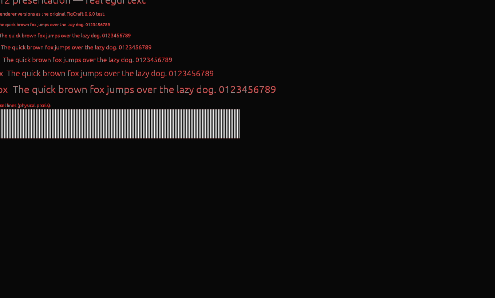

> Local Windows/NVIDIA RTX 3060 sample from 2026-11-09 at one pixel per point. This is not a hosted-runner result or a golden-image assertion.

# DX12 presentation: PASS

The unpatched restored/resized output reproduced the bug. Patched output matched its framebuffer exactly in all tested states.

| Window | Without patch | With patch |
| --- | ---: | ---: |
| restored | 17954 | 0 |
| resized | 18099 | 0 |
| maximized | 0 | 0 |
| restored-again | 17954 | 0 |

The counts compare Windows captures with identical internal GPU framebuffers. Only the reported integer client offset and a 40-pixel edge crop are applied; no resizing or nonzero threshold.

[Before](01-before.png) · [After](02-after.png) · [Red difference overlay](03-difference.png)

This run does not test mouse-drag resizing, mixed-DPI monitor moves or composition targets.
